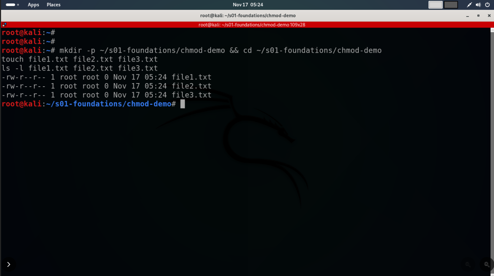
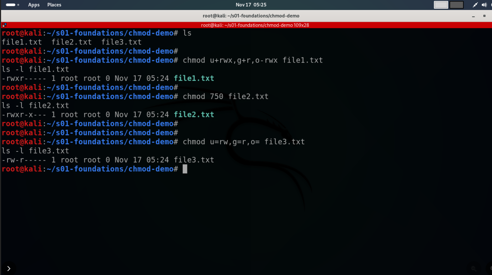
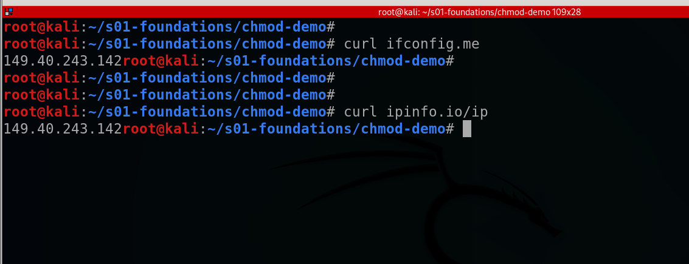
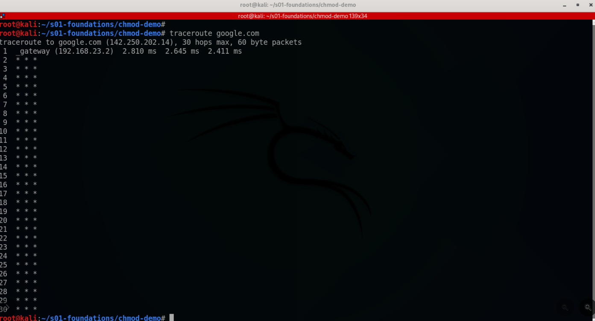

# Day 1 Assignment — Foundations, Linux & Networks

**Submitted by:** Musab Ahmad
**Cohort:** PSEB-Cyber-ISB-02
**Course:** Digital Forensics & Cyber Security Bootcamp — Atomcamp
**Date:** 17 November 2026

---

## Task A (Compulsory) — Malware Types and Examples

| Type | Definition (own words) | Named example + year | How it spread | Primary impact |
|---|---|---|---|---|
| **Virus** | Code that attaches itself to a program or file and copies itself only when that file is run | ILOVEYOU (2000) | Email attachment (`LOVE-LETTER-FOR-YOU.txt.vbs`) opened by the user | Files overwritten worldwide; estimated ~$10 billion in damage |
| **Worm** | Spreads on its own across a network, with no file or human action needed | WannaCry (2017) | Exploited the SMB vulnerability EternalBlue (CVE-2017-0144) to jump between machines automatically | Encrypted files in 150+ countries; shut down NHS hospital systems in the UK |
| **Trojan** | Disguises itself as legitimate software while hiding malicious code inside | Zeus / Zbot (2007) | Delivered through phishing emails or bundled with fake software downloads | Stole banking credentials from millions of infected accounts |
| **Ransomware** | Encrypts a victim's files and demands payment for the decryption key | NotPetya (2017) | Hijacked the update mechanism of Ukrainian accounting software (M.E.Doc) | Over $10 billion in global damage; halted operations at Maersk, Merck and others |
| **Spyware** | Secretly monitors and records a user's activity, keystrokes or data | Pegasus, NSO Group (2016) | Delivered via a zero-click SMS/iMessage exploit, requiring no action from the target | Enabled covert surveillance of journalists and activists' phones |
| **Adware** | Displays unwanted advertisements and may sell browsing data in the background | Fireball (2017) | Bundled with free software installers | Hijacked browser settings on an estimated 250 million devices |
| **Rootkit** | Hides deep inside the operating system with admin-level access while evading detection | Stuxnet's rootkit component (2010) | Spread via infected USB drives into Windows machines, then into Siemens industrial controllers (PLCs) | Caused physical destruction of centrifuges at an Iranian nuclear facility |
| **Keylogger** | Records every keystroke and sends it back to the attacker | Agent Tesla (2014–present) | Distributed through phishing emails with malicious Office document attachments | Theft of passwords and credit card numbers |
| **Botnet agent** | Turns an infected device into a remotely controlled "bot" in a larger network | Mirai (2016) | Scanned the internet for IoT devices (cameras, routers) still using default passwords | Powered a record-breaking DDoS attack on DNS provider Dyn, taking down Twitter, Netflix and others |
| **Fileless / living-off-the-land** | Operates in memory using legitimate system tools (PowerShell, WMI) instead of writing a file to disk | Astaroth (2019) | Delivered via a malicious spam link that launched a PowerShell script directly in memory | Evaded signature-based antivirus tools; enabled data theft |
| **Logic bomb** | Code that stays dormant until a specific condition (a date or event) triggers it | Fannie Mae insider case (2008) — a departing contractor planted code to wipe 4,000+ servers | Planted directly by an insider with legitimate access to production systems | Code was discovered before triggering; had it executed, it would have wiped the company's data centre |

**Which type is most dangerous for a Pakistani SME, and why:**
Ransomware is the most dangerous for a Pakistani SME, because most small businesses have neither dedicated backups nor an incident response team, so a single encrypted database can stop operations entirely. WannaCry and NotPetya both show how one unpatched machine can take down an entire network within hours. Botnet agents are a close second, because many Pakistani SMEs run IoT devices and routers on default passwords, which is exactly the weakness Mirai exploited at scale.

---

## Task B — Option B2: File Permissions with chmod (Three Methods)

**Goal:** change permissions on three files using the symbolic, octal and `=` (set) styles of `chmod`, showing `ls -l` before and after each change.

### Setup and baseline permissions

```bash
mkdir -p ~/s01-foundations/chmod-demo && cd ~/s01-foundations/chmod-demo
touch file1.txt file2.txt file3.txt
ls -l file1.txt file2.txt file3.txt
```



All three files start at the default `-rw-r--r--` (owner: read/write, group: read, others: read).

### Method 1 — Symbolic notation

```bash
chmod u+rwx,g+r,o-rwx file1.txt
ls -l file1.txt
```

Result: `-rwxr-----`
This adds read, write and execute for the owner, keeps read for the group, and removes every permission from others.

### Method 2 — Octal (numeric) notation

```bash
chmod 750 file2.txt
ls -l file2.txt
```

Result: `-rwxr-x---`
`750` breaks down as: **7** = owner gets read+write+execute (4+2+1), **5** = group gets read+execute (4+1), **0** = others get nothing.

### Method 3 — `=` (explicit set) notation

```bash
chmod u=rw,g=r,o= file3.txt
ls -l file3.txt
```

Result: `-rw-r-----`
`=` replaces the permission set entirely rather than adding/removing bits: owner is set to read+write, group to read-only, and others to nothing.



**Comparison of the three methods**

| Method | Syntax style | Adds/removes or replaces? | Example used |
|---|---|---|---|
| Symbolic | `u/g/o` with `+`/`-` | Adds or removes specific bits, leaves the rest untouched | `u+rwx,g+r,o-rwx` → `-rwxr-----` |
| Octal | Three digits (0–7) | Replaces the whole permission set at once | `750` → `-rwxr-x---` |
| `=` (set) | `u/g/o` with `=` | Replaces the whole permission set, but written symbolically | `u=rw,g=r,o=` → `-rw-r-----` |

---

## Task B — Option B6: Public IP, Address Class, and Traceroute

### Public IP lookup

```bash
curl ifconfig.me
curl ipinfo.io/ip
```



**Result:** `149.40.243.142`

**Address class:** the first octet is **149**, which falls in the range 128–191, so this is a **Class B** address.

| Class | First octet range | This IP |
|---|---|---|
| A | 1–126 | — |
| **B** | **128–191** | **149 ✓** |
| C | 192–223 | — |

### Traceroute to google.com

```bash
traceroute google.com
```



**Result:**

```
traceroute to google.com (142.250.202.14), 30 hops max, 60 byte packets
 1  _gateway (192.168.23.2)  2.810 ms  2.645 ms  2.411 ms
 2  * * *
 3  * * *
 ...
30  * * *
```

Only hop 1 — the local gateway (`192.168.23.2`) — replied. Every hop after that, all the way to the 30-hop limit, returned `* * *` (no response).

**Hop-count observation:** the traceroute does not show a usable hop count beyond the first router, even though the destination is reachable in practice (for example, a normal web request to google.com succeeds).

**One reason TTL/hop count can be misleading:**
A `* * *` result does not necessarily mean a router is down or the path is broken — it usually means a firewall or router along the path (very often the ISP's or a cloud/NAT gateway, which is likely the case here since this VM sits behind a `192.168.23.x` private network) is configured to silently drop the ICMP "TTL exceeded" replies or block the probe packets outright, without sending any response at all. Traceroute cannot tell the difference between "this hop is overloaded/slow" and "this hop's administrator deliberately blocks traceroute traffic," so a string of asterisks can make a perfectly healthy, reachable path look broken or far longer than it really is. This is why TTL-based tools like traceroute give a *lower bound* on path visibility, not a guaranteed map of the real route.
