OSINT & FOOTPRINTING ASSESSMENT

Google Dorking, Exploit-DB / GHDB, Shodan and Subdomain Footprinting

Practical report: passive reconnaissance against an intentionally vulnerable practice target (vulnweb.com)

| Field | Details |
| --- | --- |
| Programme | Digital Forensic & Cyber Security |
| Cohort | PSEB-Cyber-ISB-01 (PSEB-CYB-ISB-01) |
| Student name | Musab Ahmad |
| Roll / ID | PSEB-2026-017582 |
| Date performed | 5 to 6 November 2026 |
| Lab environment | Kali Linux (VMware Workstation), terminal tools + Firefox / Chrome |
| Primary target | vulnweb.com and testphp.vulnweb.com (Acunetix practice sites) |
| Course reference | DFCS Day 5 (Web Pentesting and Recon): Dork report and Subdomain reconciliation assignments |

# 1. Introduction and scope

This report documents four reconnaissance exercises: (1) Google dorking, (2) exploring the Exploit Database and the Google Hacking Database (GHDB), (3) searching Shodan for internet-exposed IoT / network devices, and (4) subdomain footprinting with Subfinder, WHOIS and theHarvester. Every result shown here comes from the screenshots and terminal output captured during the practical session.

Authorisation and ethics. The domain used for the active-looking work, vulnweb.com, belongs to Acunetix and is published as a deliberately vulnerable site for security training. All other activity was passive: search-engine queries, public databases and public DNS / certificate data. No exploit code was downloaded or executed, no login was attempted and no third-party system was scanned. IP addresses of third-party Shodan results are partly masked in this report.

## 1.1 Objectives

- Use Google search operators to discover what a target exposes in public search indexes.
- Explore the GHDB and Exploit-DB to see how public dorks and exploits are catalogued.
- Use Shodan to measure the exposure of a specific class of network / IoT device in one country.
- Enumerate subdomains with several tools and compare what each one shows.
# 2. Environment and tools

| Tool | Version / source | Purpose in this task |
| --- | --- | --- |
| Google Search | Web (Firefox on Kali) | Dorking with site:, filetype:, inurl:, intitle:, intext: operators |
| GHDB | exploit-db.com/google-hacking-database | Browse catalogued dorks by category |
| Exploit-DB / searchsploit | exploit-db.com; local Kali copy | Search public exploits and advisories for Apache |
| Shodan | shodan.io (web interface) | Search internet-exposed MikroTik devices in Pakistan |
| whois | 5.5.23 | Domain registration data |
| Subfinder | ProjectDiscovery v2 (installed with Go) | Passive subdomain enumeration |
| theHarvester | 4.6.0 | OSINT gathering from crt.sh, HackerTarget, RapidDNS |
| assetfinder | Go tool, run from Kali | Passive subdomain enumeration (third tool for reconciliation) |
| amass | OWASP Amass, passive mode | Passive enumeration plus DNS, netblock and ASN mapping |
| jq, sort, comm | Kali coreutils / jq | Parse theHarvester JSON, merge and compare host lists |
| httpx-toolkit | ProjectDiscovery httpx 1.1.5 | Live-host check (the Python package named httpx is a different program) |
| dig / host | Kali bind-utils | DNS resolution and wildcard check |

Tools were installed on Kali with apt and Go (Figure 1). whois and theHarvester were already at their newest packaged versions; golang was installed as a dependency for Subfinder.

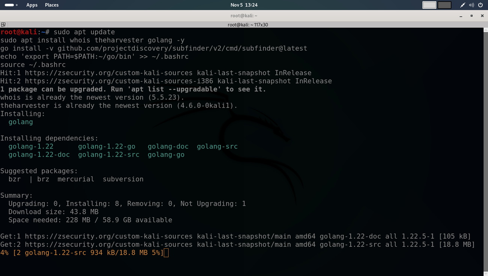

*Figure 1: Installing whois, theHarvester and Go; Subfinder installed via go install*

# 3. Google dorking

Google dorking combines search operators to narrow results to a site, file type, URL pattern or page content. Six queries were run against the target. The table summarises each query and what it returned; the screenshots follow.

| Dork | Observed result | Fix / defensive action |
| --- | --- | --- |
| site:testphp.vulnweb.com | Two entries: /crossdomain.xml and /listproducts; Google omitted similar results | Keep crossdomain.xml restrictive; keep test and demo content out of the public index |
| site:testphp.vulnweb.com filetype:php | /signup.php and /listproducts (parameter-driven PHP endpoints) | Validate input and use prepared statements; put test pages behind authentication or noindex |
| site:testphp.vulnweb.com inurl:login | Results came from unrelated third-party sites; no login page of the target confirmed (excluded, not investigated) | Keep login pages noindex, rate-limited and protected by MFA |
| site:testphp.vulnweb.com intitle:"index of" | No documents matched: no indexed directory listings | Keep directory listing off (Options -Indexes) |
| site:testphp.vulnweb.com intext:"error" | Only generic articles; no target page with error text indexed | Show generic error pages; turn off verbose errors in production |
| site:vulnweb.com -www | Pages from testasp.vulnweb.com (acuforum) and testaspnet.vulnweb.com (acublog) | Keep an asset inventory; retire or isolate test applications |

## 3.1 Results

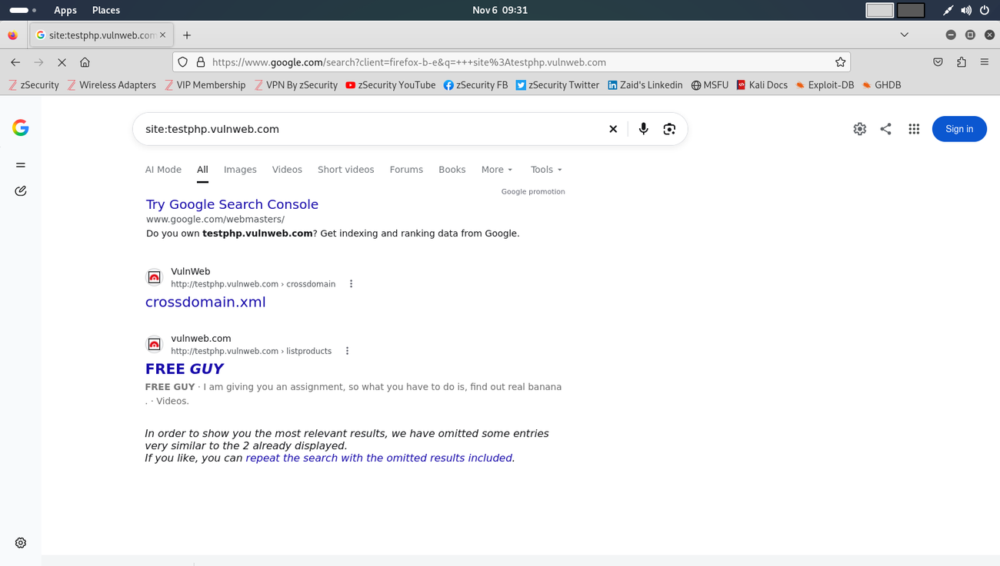

*Figure 2: Dork: site:testphp.vulnweb.com*

The index scope query shows only a small number of indexed pages. crossdomain.xml is a policy file used by Flash/Silverlight clients; when it is permissive it can allow other sites to read content from the domain, so it is worth reviewing on a real target. The /listproducts result is notable because its snippet contains unrelated injected text ("I am giving you an assignment..."), which shows that user-controlled content on this practice site was indexed by Google.

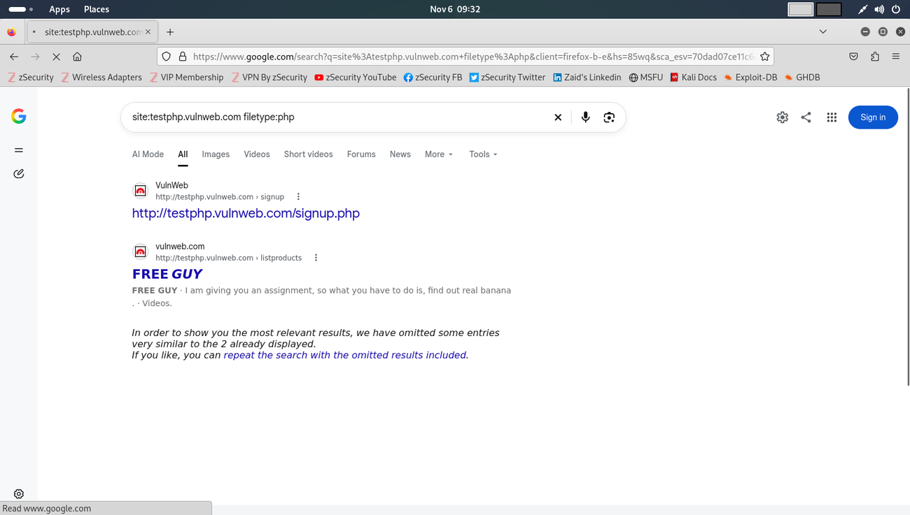

*Figure 3: Dork: site:testphp.vulnweb.com filetype:php*

Restricting to PHP reveals dynamic endpoints (signup.php, listproducts). On a real target these are the pages an attacker would probe next for injection or authentication weaknesses.

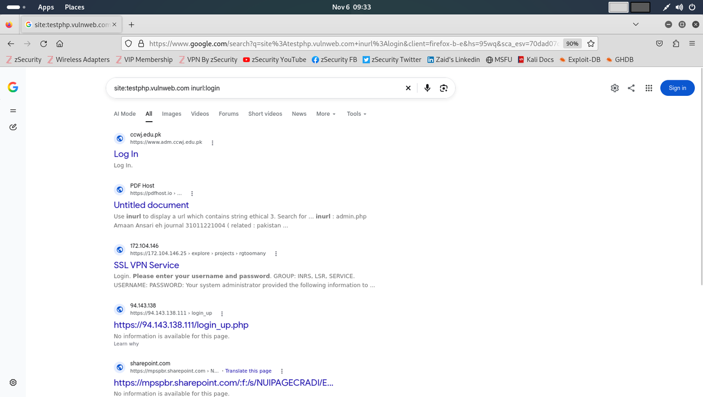

*Figure 4: Dork: site:testphp.vulnweb.com inurl:login (results are from other, unrelated sites)*

This query did not return the target. It returned pages from other organisations, which were not examined further because they are outside the scope of the exercise. The honest conclusion is that no login page for the target was found through this dork.

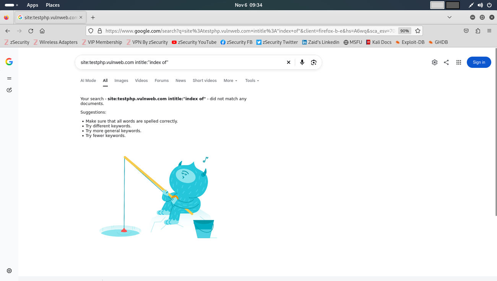

*Figure 5: Dork: site:testphp.vulnweb.com intitle:"index of" (no matches)*

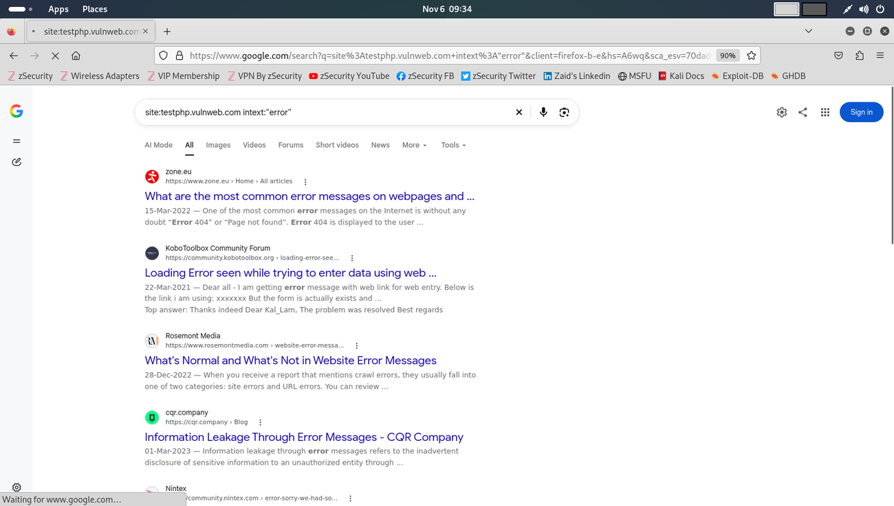

*Figure 6: Dork: site:testphp.vulnweb.com intext:"error" (generic, unrelated results)*

Neither the directory-listing dork nor the error-message dork found anything on the target. A negative result is still useful evidence: it shows that these two common information-leak types are not visible through Google for this host.

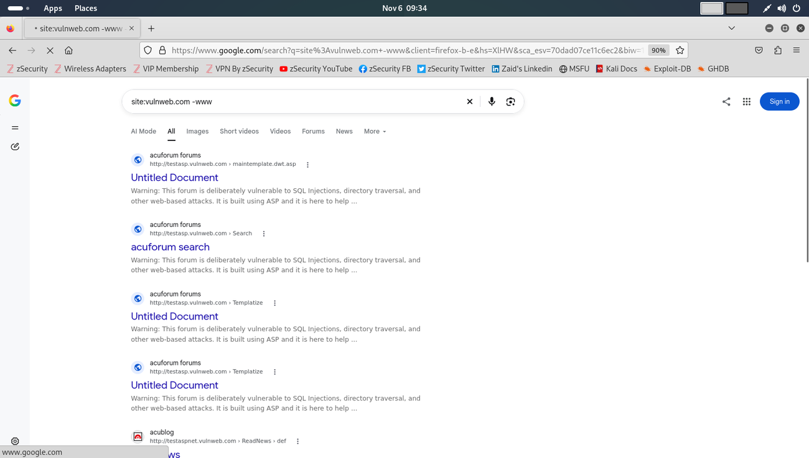

*Figure 7: Dork: site:vulnweb.com -www reveals other subdomains*

Excluding www surfaces other hosts. The results show acuforum pages on testasp.vulnweb.com and an acublog page on testaspnet.vulnweb.com, and the snippets state that the forum is deliberately vulnerable to SQL injection and directory traversal. This matches names later found by Subfinder (Section 7).

# 4. Google Hacking Database (GHDB)

The GHDB at exploit-db.com catalogues dorks by category. Figure 8 shows the category Sensitive Online Shopping Info. Examples visible in the screenshot:

| Date added | Dork | What it looks for |
| --- | --- | --- |
| 2021-11-10 | inurl:product-list.php?id= | Shop pages that pass an ID in the URL, a typical SQL-injection test point |
| 2021-11-09 | inurl:/commodities.php?id= | Same pattern on a different script name |
| 2016-07-07 | intext:"Dumping data for table orders" (table name is wrapped in backticks in the original) | Exposed SQL dump files containing order data |
| 2021-11-15 | site:mail.* intitle:Dashboard | Mail-host dashboards |
| 2005-06-03 | intext:"Powered by X-Cart: shopping cart software" -site:x-cart.com | Sites running a specific shopping-cart product |

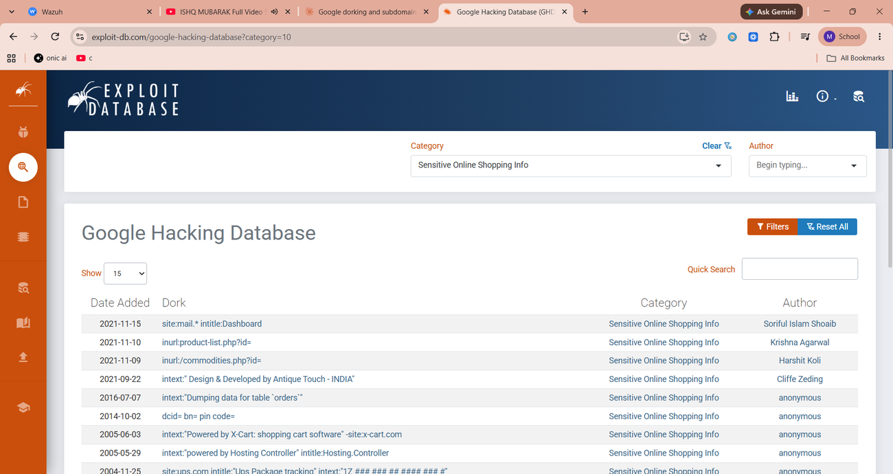

*Figure 8: GHDB, category "Sensitive Online Shopping Info"*

The list shows that dorks fall into two kinds: footprinting dorks that identify a technology (the X-Cart example) and exposure dorks that find leaked data (the SQL dump example). The oldest entries date from 2004 to 2005, which shows that these exposure patterns are long-standing and still relevant because the same mistakes keep recurring.

# 5. Exploit Database

## 5.1 Web search for "apache"

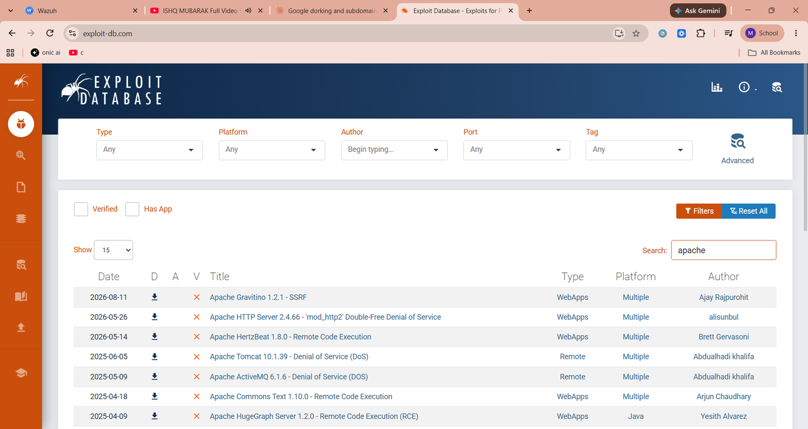

*Figure 9: Exploit-DB search for "apache"*

The newest results include Apache Gravitino 1.2.1 (SSRF, 2026-08-11), Apache HTTP Server 2.4.66 mod_http2 double-free denial of service (2026-05-26), Apache HertzBeat 1.8.0 remote code execution (2026-05-14), and older entries for Tomcat, ActiveMQ, Commons Text and HugeGraph. The "V" column shows a red cross for these entries, meaning they are not EDB-verified: the exploit was submitted but not independently confirmed by the Exploit-DB team.

## 5.2 Case study: EDB-52577

| Field | Value (as shown on the page) |
| --- | --- |
| Title | Apache HTTP Server 2.4.66 - 'mod_http2' Double-Free Denial of Service |
| EDB-ID / CVE | 52577 / CVE-2026-23918 |
| Author / date | alisunbul / 2026-05-26 (exploit header lists 2026-05-06) |
| Type / platform | WebApps / Multiple |
| EDB verified | No |
| Google dork in header | intext:"Apache/2.4.66" "HTTP/2" |
| Impact class | Denial of service (availability), not code execution |

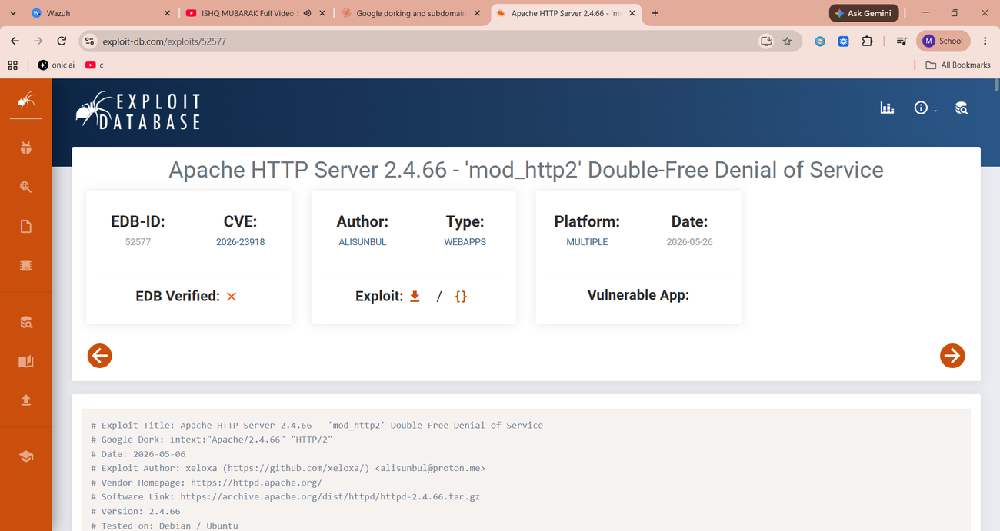

*Figure 10: Exploit-DB entry 52577*

This entry is useful because the author included a Google dork in the header. It links two tools from this assignment: the dork finds servers advertising the vulnerable version in their banner, and the exploit entry describes the weakness. The paired example shows why version banners should be hidden (ServerTokens Prod, ServerSignature Off), because a banner turns a generic search into a targeted one.

## 5.3 Local search with searchsploit

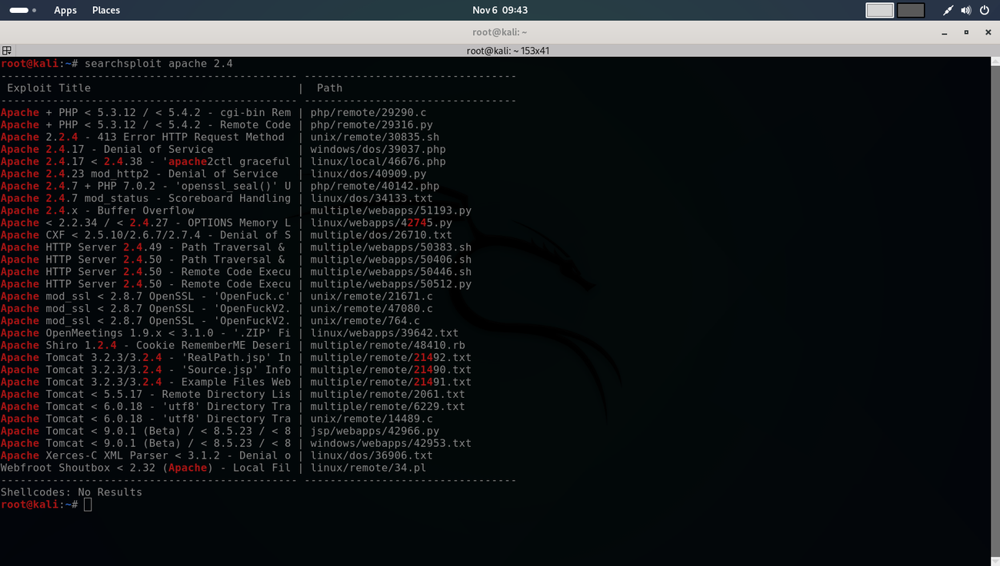

*Figure 11: searchsploit apache 2.4 on Kali*

searchsploit queries the offline Exploit-DB copy bundled with Kali. The output lists many Apache 2.4.x items, including path-traversal and remote-code-execution entries for 2.4.49 and 2.4.50 (paths multiple/webapps/50383.sh, 50406.sh, 50446.sh, 50512.py), mod_ssl and Tomcat issues. The shellcode search returned no results. Because this is an offline copy, its date should be checked with searchsploit -u before relying on it. No exploit was run.

# 6. Shodan: IoT / network device exposure

Query used: product:"MikroTik" country:"PK". MikroTik routers are widely deployed by internet service providers and small networks, which makes them a good example of edge network devices that are exposed to the internet.

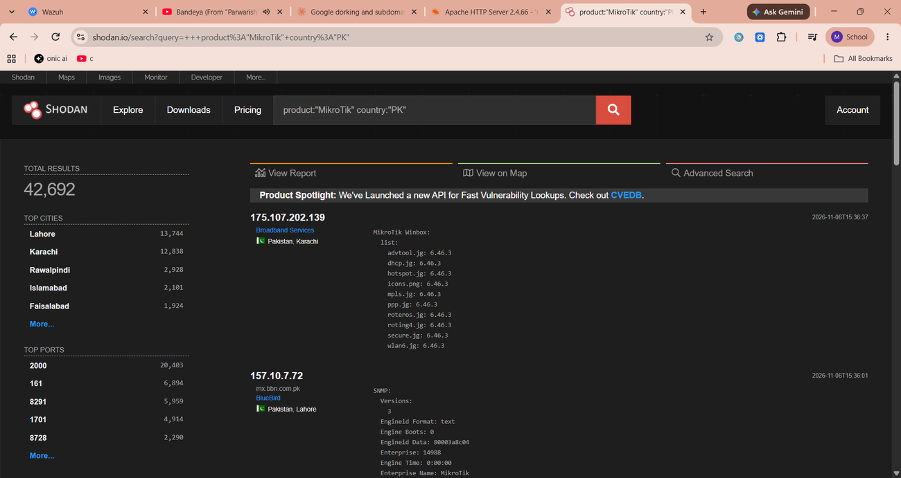

*Figure 12: Shodan results for product:"MikroTik" country:"PK" (2026-11-06)*

| Metric (from the screenshot) | Value | Share of total results |
| --- | --- | --- |
| Total results | 42,692 | 100% |
| Top city: Lahore | 13,744 | 32.2% |
| Top city: Karachi | 12,838 | 30.1% |
| Rawalpindi / Islamabad / Faisalabad | 2,928 / 2,101 / 1,924 | 6.9% / 4.9% / 4.5% |
| Port 2000 | 20,403 | 47.8% |
| Port 161 (SNMP) | 6,894 | 16.1% |
| Port 8291 | 5,959 | 14.0% |
| Port 1701 (L2TP) | 4,914 | 11.5% |
| Port 8728 | 2,290 | 5.4% |

Reading the data. Shodan counts service banners, not unique devices, so one router with several open ports appears several times. Even so, two cities (Lahore and Karachi) account for roughly 62% of results. Port 8291 is MikroTik's Winbox management port and 8728 is the RouterOS API port; port 2000 is commonly the bandwidth-test service. Exposing management ports to the whole internet is the main risk shown here.

Two sample banners are visible. The first (a Karachi broadband provider, 175.107.202.xxx) returns a MikroTik Winbox file list with version strings 6.46.3, an older 6.x release. The second (a Lahore ISP, 157.10.7.xxx) answers SNMP version 3 with enterprise number 14988 (MikroTik). The version string is a fingerprint: an attacker can match it against public advisories, while a defender can use the same data to find devices needing updates.

# 7. Subdomain footprinting

## 7.1 WHOIS

Command: whois vulnweb.com > whois.txt

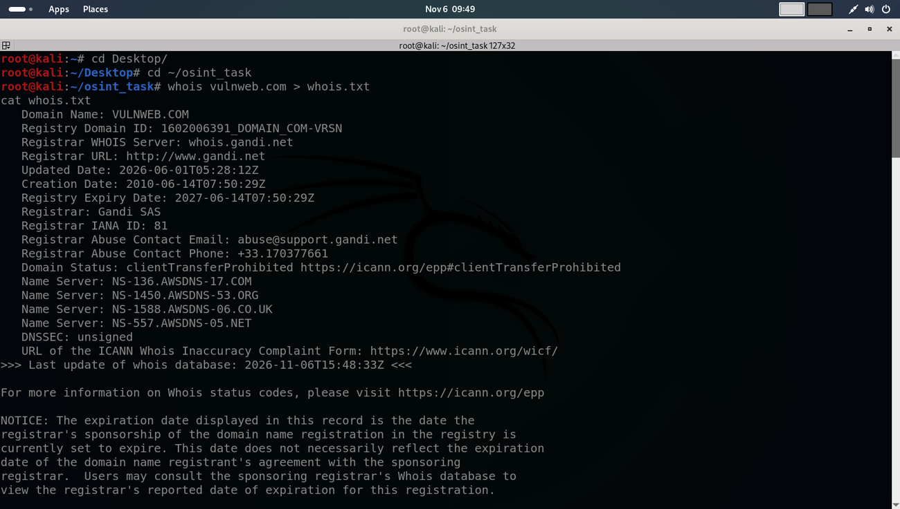

*Figure 13: whois vulnweb.com: registration details*

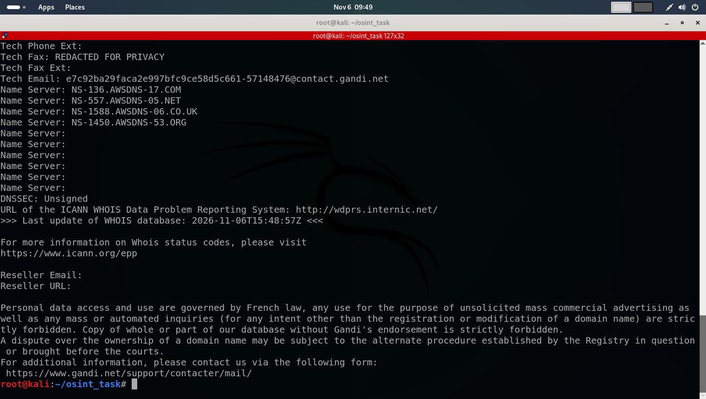

*Figure 14: whois vulnweb.com: tail of the record (contacts and name servers)*

| Field | Value |
| --- | --- |
| Domain | VULNWEB.COM |
| Registrar | Gandi SAS (IANA ID 81); WHOIS server whois.gandi.net |
| Creation date | 2010-06-14 |
| Last updated | 2026-06-01 |
| Expiry date | 2027-06-14 |
| Status | clientTransferProhibited |
| Name servers | NS-136.AWSDNS-17.COM, NS-1450.AWSDNS-53.ORG, NS-1588.AWSDNS-06.CO.UK, NS-557.AWSDNS-05.NET |
| DNSSEC | Unsigned |
| Registrar abuse contact | abuse@support.gandi.net, +33.170377661 |
| Registrant / tech contact | Redacted for privacy; tech email is a Gandi relay address |

Analysis. The domain is 16 years old. The name servers are Amazon Route 53 (awsdns), so DNS is hosted on AWS. Personal registrant data is redacted, which limits what WHOIS reveals about people, but the registrar, dates and name servers still give useful infrastructure intelligence. DNSSEC is not enabled, so DNS answers are not cryptographically signed.

## 7.2 Subfinder (passive)

Subfinder queries many public sources (certificate transparency, passive DNS and others) without touching the target. Output was saved to subfinder.txt, then de-duplicated:

wc -l subfinder.txt

sort -u subfinder.txt > all_subdomains.txt

wc -l all_subdomains.txt

grep -E '^(test|www|rest|html5|php|cameras|solr)' all_subdomains.txt

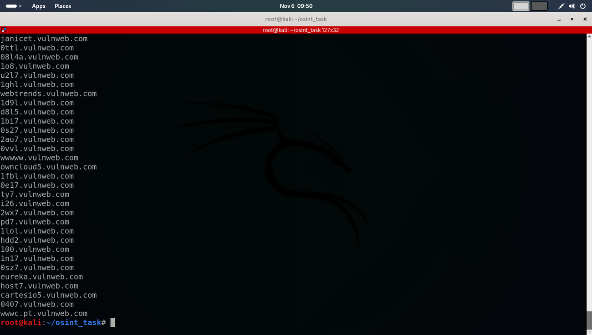

*Figure 15: Part of the Subfinder output*

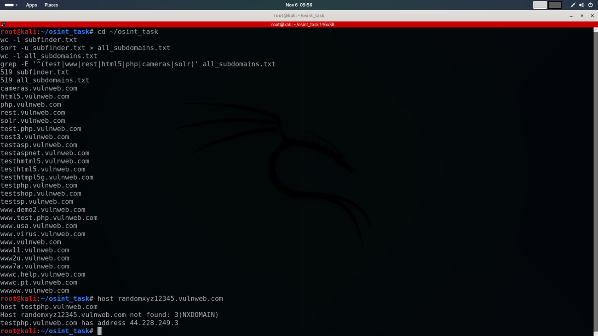

*Figure 16: Line counts, interesting names and the wildcard DNS test*

Result: 519 lines before and 519 after sort -u, so there were no duplicate entries. The grep shows names that suggest purpose: cameras, solr, rest, html5, php, several test* hosts (testphp, testasp, testaspnet, testhtml5, testshop) and several www* variants. Names like these are what an attacker looks for, because test and legacy hosts are often less protected than the main website.

Wildcard DNS check. host randomxyz12345.vulnweb.com returned NXDOMAIN, while host testphp.vulnweb.com returned 44.228.249.3. A random name that does not resolve shows that the zone does not use a wildcard record, so the names found are genuine records and not artefacts of a catch-all.

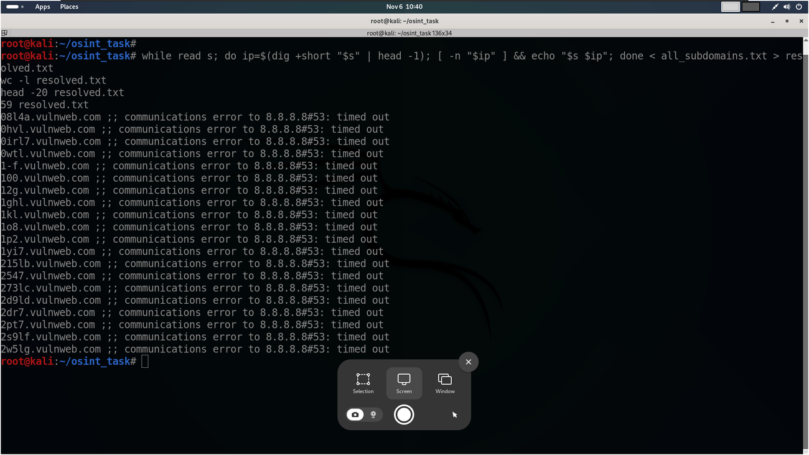

*Figure 17: First resolution attempt through 8.8.8.8 timed out (not used as evidence)*

The first attempt to resolve all 519 names through Google DNS (8.8.8.8) timed out. The 59 lines saved in resolved.txt are error messages, not addresses, because dig prints errors to standard output. That file was therefore not used for counting. A corrected check filters for valid IPv4 answers only:

while read s; do

ip=$(dig +short +time=2 +tries=1 A "$s" | grep -E '^[0-9]+(\.[0-9]+){3}$' | head -1)

[ -n "$ip" ] && echo "$s $ip"

done < all_subdomains.txt > resolved.txt

wc -l resolved.txt

The combined list from all four tools (Section 7.5) is checked with ProjectDiscovery httpx-toolkit -l union.txt -ip -sc -title. Kali also ships a Python package called httpx; running it with these flags fails with "No such option: -l", so the toolkit package was installed and used instead. Result: [ X ] of 599 names respond. The gap between 599 and X represents stale or non-existent records, which shows why passive results must be verified.

## 7.3 theHarvester

Command used (theHarvester 4.6.0):

theHarvester -d vulnweb.com -b crtsh,hackertarget,rapiddns -l 100 -f harvester_report

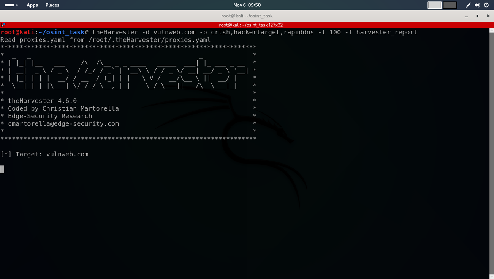

*Figure 18: theHarvester started against vulnweb.com*

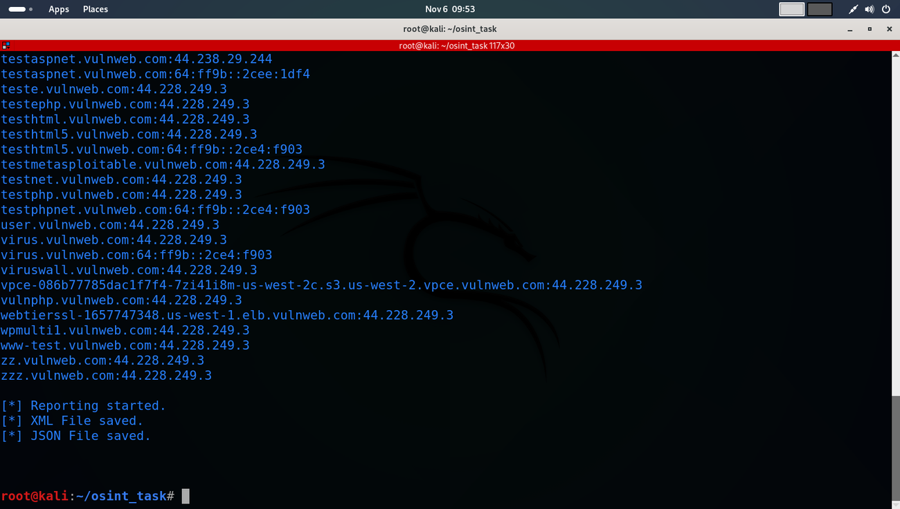

*Figure 19: theHarvester host:IP results and report files*

The tail of the output lists host:IP pairs. Most visible hosts resolve to 44.228.249.3; testaspnet.vulnweb.com resolves to 44.238.29.244. Some hosts also show addresses in the 64:ff9b::/96 range (for example 64:ff9b::2ce4:f903), which are NAT64 representations of the IPv4 addresses (44.228.249.3) and not separate IPv6 servers. Two long names, vpce-...us-west-2.vpce.vulnweb.com and webtierssl-...us-west-1.elb.vulnweb.com, follow AWS VPC-endpoint and load-balancer naming. The tool finished with "XML File saved" and "JSON File saved".

## 7.4 Additional tools: assetfinder and amass

Day 5 asks for at least three independent enumeration tools. Two more were added so that four were compared:

assetfinder --subs-only vulnweb.com | sort -u > assetfinder.txt

amass enum -passive -d vulnweb.com -o amass.txt

jq -r '.hosts[]' harvester_report.json | cut -d: -f1 | sort -u > harvester.txt

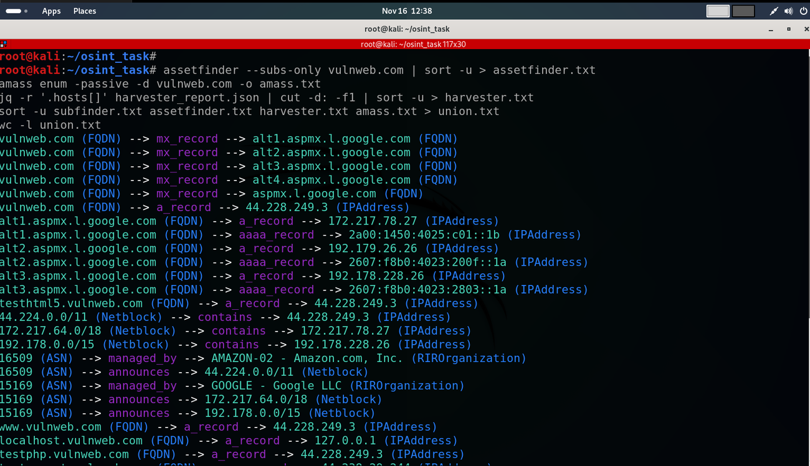

*Figure 20: amass passive output: MX records, A records, netblocks and ASNs*

amass writes a relationship graph, not a plain host list, so hostnames were extracted with grep -oE before merging. The combined list was lower-cased, filtered to valid *.vulnweb.com names (an artefact beginning u003e, which is a JSON-escaped ">" and not a real host, was removed) and de-duplicated into union.txt.

## 7.5 Reconciliation across four tools

| Tool | Entries | Only this tool | Observation |
| --- | --- | --- | --- |
| Subfinder | 519 | 509 | Largest list; many short random-looking names typical of passive DNS data |
| theHarvester (crtsh, hackertarget, rapiddns) | 83 | 74 | Includes host:IP data and the AWS-style names seen in Section 7.3 |
| amass (passive) | 7 | 7 [verify] | Few names but each comes with DNS answers (Section 7.6) |
| assetfinder | 7 | 1 | Small, mostly overlaps the others |
| Union (unique, valid) | 599 |  | 616 entries in total reduced to 599 after lower-casing, filtering and de-duplication |

Reading the table. The tools overlap very little: nearly every name was reported by one tool only, so any single tool gives an incomplete picture. This is the reason Day 5 recommends running at least three tools and taking the union. Subfinder contributes the bulk of the volume; theHarvester adds names from certificate and HackerTarget data; amass and assetfinder add few names but with verified DNS answers. Before submitting, confirm the "Only this tool" figure for amass by checking that testphp.vulnweb.com and testasp.vulnweb.com appear in amass_clean.txt and in subfinder.txt (use cat -A to rule out hidden characters).

## 7.6 DNS, hosting and mail findings from amass

| Host | Address | Network |
| --- | --- | --- |
| vulnweb.com, www, testphp, testhtml5 | 44.228.249.3 | AS16509 AMAZON-02 (44.224.0.0/11) |
| testasp, testaspnet | 44.238.29.244 | AS16509 AMAZON-02 (44.224.0.0/11) |
| rest | 18.215.71.186 | AS14618 AMAZON-AES (18.208.0.0/13): a different AWS network |
| localhost | 127.0.0.1 | Reserved loopback block (AS0) |

- Mail is hosted on Google Workspace. The MX records point to aspmx.l.google.com and alt1 to alt4.aspmx.l.google.com, which tells an attacker which mail platform to target with phishing and which spoofing protections (SPF, DKIM, DMARC) matter.
- Hosting is split. Most resolved hosts share one address, but rest.vulnweb.com sits in a separate AWS block and autonomous system, so "everything is on one server" would be wrong.
- localhost.vulnweb.com resolves to 127.0.0.1. A public DNS record that points to the loopback address is a small misconfiguration. It can be abused in some SSRF and filter-bypass cases and should simply be deleted.
## 7.7 Tool comparison

| Tool | Type of data | Strength | Limit seen here |
| --- | --- | --- | --- |
| whois | Registration and name servers | Shows ownership, dates and DNS provider | Registrant redacted; no host list |
| Subfinder | Passive subdomain list | Fast, large list (519 names) | Does not prove names are live; noisy |
| theHarvester | Hosts with IPs from selected sources | Host:IP pairs and XML/JSON reports | Depends on chosen sources and the -l limit |
| assetfinder | Passive subdomain list | Very fast, simple output | Only 7 names here |
| amass (passive) | Names plus DNS, netblock and ASN graph | Context: mail, hosting network, ASN | Few names; output needs parsing |
| dig / host / httpx | Live DNS and HTTP answers | Verifies existence, detects wildcard | Needs a working resolver; wrong httpx package gives errors |

# 8. Summary of findings

| # | Finding | Evidence | Relevance on a real target |
| --- | --- | --- | --- |
| 1 | Search index exposes PHP endpoints and crossdomain.xml | Figures 2 and 3 | Low to medium |
| 2 | No indexed directory listings or error pages | Figures 5 and 6 | Positive result |
| 3 | Other test applications are discoverable through site:vulnweb.com -www | Figure 7 | Medium |
| 4 | 599 unique names from four tools (Subfinder 519, theHarvester 83, amass 7, assetfinder 7), including test, cameras and solr names; tools overlap very little | Section 7.5 | Medium to high (attack surface) |
| 5 | No wildcard DNS (random name returns NXDOMAIN) | host command | Informational |
| 6 | Hosting on AWS (two networks, AS16509 and AS14618); most hosts on one IP; DNS on Route 53; DNSSEC off; mail on Google Workspace | WHOIS, theHarvester, amass | Informational |
| 7 | localhost.vulnweb.com resolves to 127.0.0.1 | amass | Low |
| 8 | 42,692 MikroTik results in Pakistan with management and SNMP ports visible | Shodan | High for operators with exposed Winbox / API |
| 9 | Public exploits exist for several Apache 2.4.x releases; banners aid targeting | Exploit-DB, searchsploit | Depends on version in use |

# 9. Defensive recommendations

## Against dorking and indexing

- Use robots.txt and noindex only as a hint, and protect sensitive paths with authentication, since robots rules do not stop attackers.
- Disable directory listing, return generic error pages and remove SQL dumps, backups and test files from web roots.
- Run your own dorks (site:yourdomain.com filetype:sql, intitle:"index of") regularly and use Google Search Console to request removal of exposed pages.
## Against subdomain footprinting

- Keep an inventory of all subdomains and delete DNS records for retired test and demo hosts.
- Remember that certificate transparency logs are public: every certificate issued for a hostname reveals it, so do not rely on obscure names for security.
- Enable DNSSEC where supported and keep registrar contact data redacted.
## Against device exposure (Shodan)

- Do not expose Winbox (8291), the RouterOS API (8728) or SNMP (161) to the internet; restrict them to a management VPN or allow-listed addresses.
- Keep RouterOS updated, disable unused services, use SNMPv3 with strong credentials and change default accounts.
- Check your own address ranges on Shodan (or set up Shodan Monitor) to see what attackers see.
## Against exploit-driven attacks

- Patch web servers promptly and subscribe to vendor advisories; hide version banners (ServerTokens Prod, ServerSignature Off).
- Treat unverified Exploit-DB entries as leads to test in a lab, not as confirmed vulnerabilities.
# 10. Limitations

- Google results vary by time, location and personalisation, and Google withheld similar results in the first query.
- The inurl:login dork returned unrelated third-party pages, so no conclusion about a target login page is possible.
- Shodan numbers are service banners at one moment (2026-11-06 15:36 UTC in the screenshot) and are not a count of unique devices.
- Passive subdomain lists contain stale entries, and each tool draws on different sources, so the union of 599 names is a candidate list. The live-host count comes from the httpx-toolkit run (Section 7.2).
- The Exploit-DB entries were reviewed as information only. Exploit code was not downloaded or executed, and EDB-52577 is unverified.
# 11. Conclusion

The exercise shows how much can be learned about an organisation without sending a single packet to it. Google dorks mapped the indexed pages, the GHDB and Exploit-DB showed how dorks and exploits are shared publicly, Shodan quantified the exposure of one device family across Pakistan (42,692 results, concentrated in Lahore and Karachi), and WHOIS, Subfinder and theHarvester built a picture of the infrastructure: 599 unique names across four enumeration tools, AWS-hosted DNS, Google-hosted mail and no wildcard record. The main lesson for defenders is to reduce what is visible: keep an asset inventory, patch quickly, hide versions, close management ports and review your own footprint with the same tools an attacker would use.

# References

- Exploit Database and Google Hacking Database: https://www.exploit-db.com/
- Shodan search engine: https://www.shodan.io/
- Subfinder (ProjectDiscovery): https://github.com/projectdiscovery/subfinder
- theHarvester: https://github.com/laramies/theHarvester
- Acunetix test sites: http://testphp.vulnweb.com/
# Appendix A: Commands used

# Setup

sudo apt update

sudo apt install whois theharvester golang -y

go install -v github.com/projectdiscovery/subfinder/v2/cmd/subfinder@latest

echo 'export PATH=$PATH:~/go/bin' >> ~/.bashrc && source ~/.bashrc

mkdir ~/osint_task && cd ~/osint_task

# Exploit-DB (offline)

searchsploit apache 2.4

# WHOIS

whois vulnweb.com > whois.txt

# theHarvester

theHarvester -d vulnweb.com -b crtsh,hackertarget,rapiddns -l 100 -f harvester_report

# Subfinder post-processing

wc -l subfinder.txt

sort -u subfinder.txt > all_subdomains.txt

wc -l all_subdomains.txt

grep -E '^(test|www|rest|html5|php|cameras|solr)' all_subdomains.txt

# Extra enumeration and reconciliation

assetfinder --subs-only vulnweb.com | sort -u > assetfinder.txt

amass enum -passive -d vulnweb.com -o amass.txt

jq -r '.hosts[]' harvester_report.json | cut -d: -f1 | sort -u > harvester.txt

grep -oE '[A-Za-z0-9._-]+\.vulnweb\.com' amass.txt | sort -u > amass_clean.txt

cat subfinder.txt assetfinder.txt harvester.txt amass_clean.txt | tr 'A-Z' 'a-z' | grep -E '^[a-z0-9._-]+\.vulnweb\.com$' | sort -u > union.txt

httpx-toolkit -l union.txt -ip -sc -title -o live.txt

# Wildcard check

host randomxyz12345.vulnweb.com

host testphp.vulnweb.com
