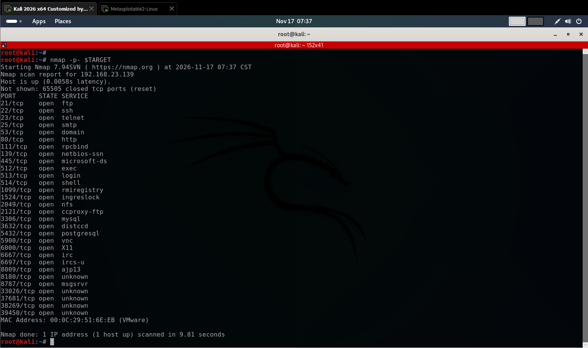
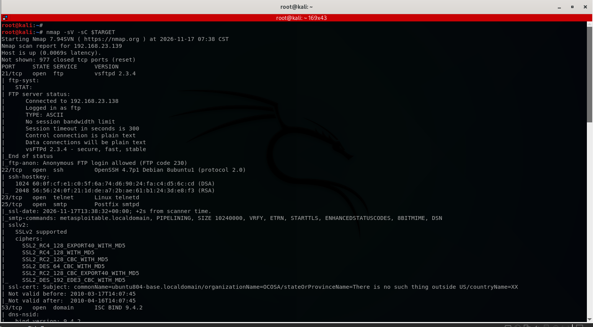
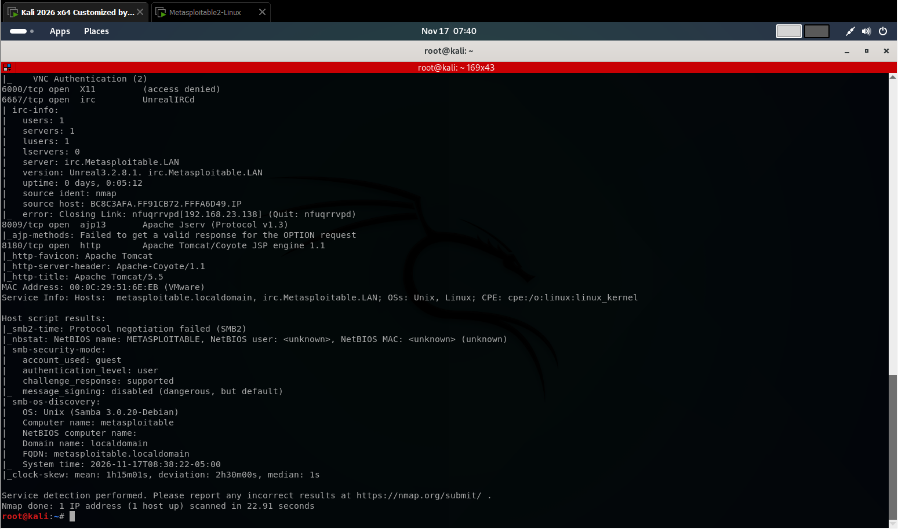
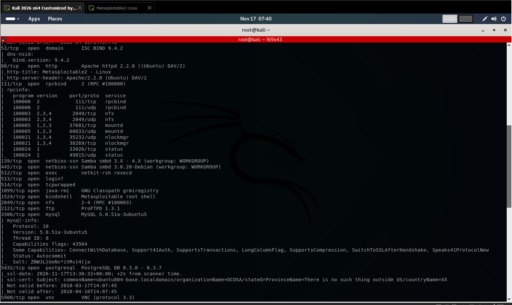
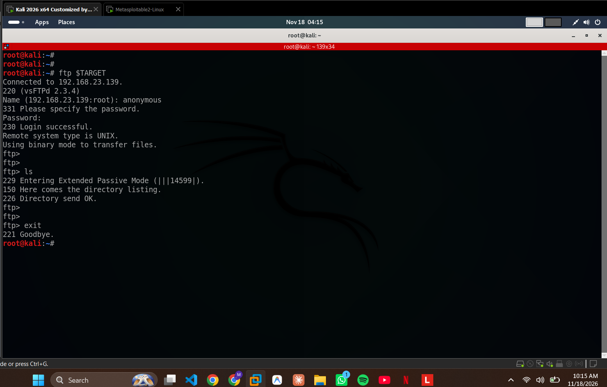
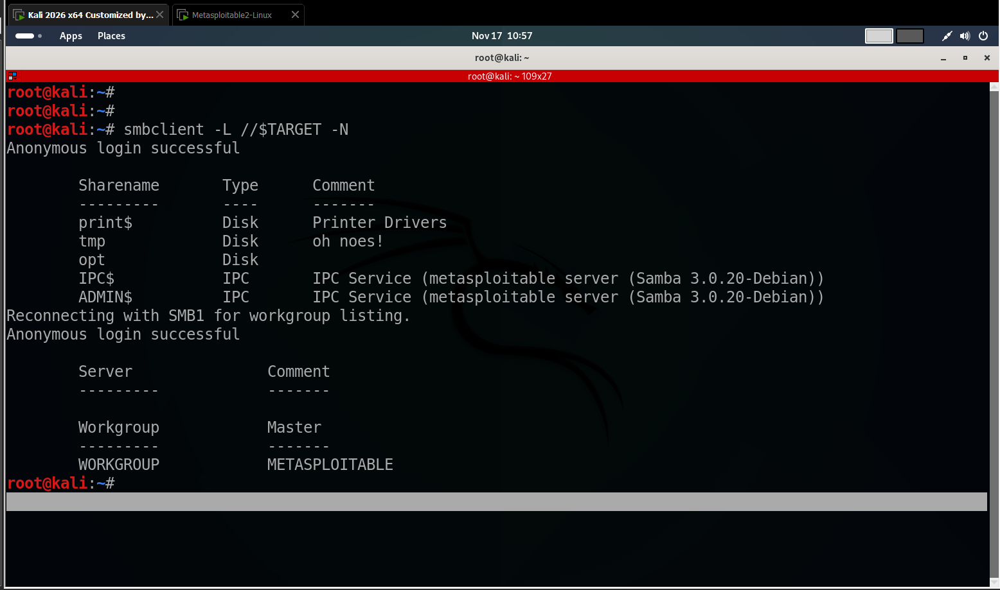
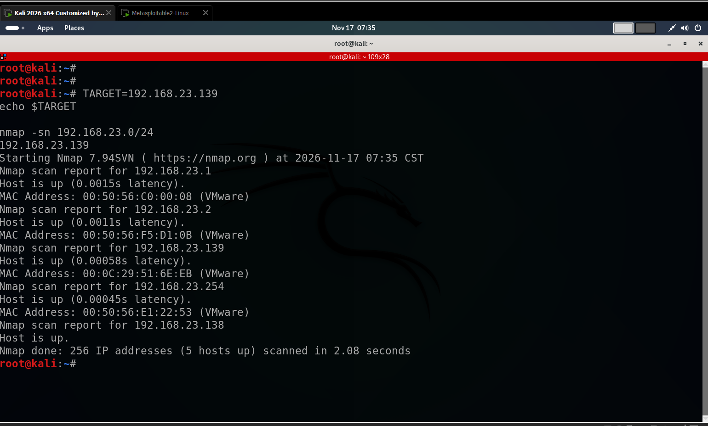
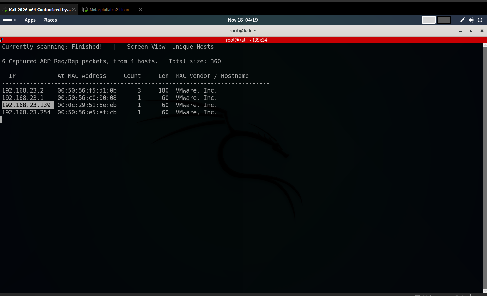
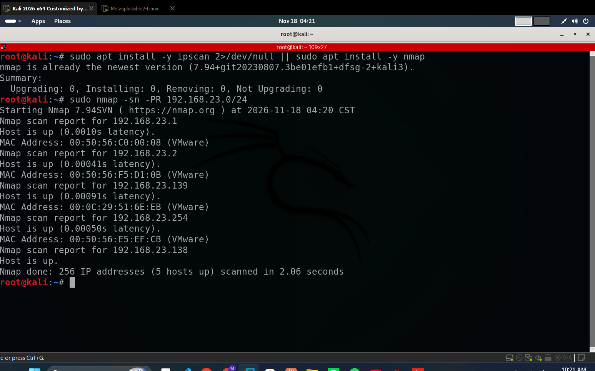

# Day 2 Assignment — Scanning and Vulnerability Assessment

**Submitted by:** Musab Ahmad
**Cohort:** PSEB-Cyber-ISB-02
**Course:** Digital Forensics & Cyber Security Bootcamp — Atomcamp
**Target:** Metasploitable 2 (`192.168.23.139`), isolated lab network
**Date:** 18 November 2026

---

## Task A (Compulsory) — Three Complete Findings

Three findings were selected from the scan, each from a different category, following the required workflow: automated scan first (`nmap -sV -sC`), then manual verification (`ftp`, `smbclient`) as the handout's own session sequence specifies.

A full 65,535-port scan (`nmap -p- 192.168.23.139`) was run first to confirm no ports outside the default top-1,000 were being missed — the same 23 ports were found open either way, so the top-1,000 scan used for service/version detection below covers the full attack surface on this host.



### Finding 1 — vsftpd 2.3.4 Backdoor Command Execution

| Field | Detail |
|---|---|
| **TITLE** | vsftpd 2.3.4 Backdoor Command Execution |
| **SEVERITY** | CRITICAL (CVSS 9.8) |
| **VECTOR** | `CVSS:3.1/AV:N/AC:L/PR:N/UI:N/S:U/C:H/I:H/A:H` |
| **AFFECTED** | FTP (21/tcp) |
| **CWE** | CWE-78 — Improper Neutralization of Special Elements used in an OS Command (OS Command Injection) |

**DESCRIPTION**
Service version detection identified `vsftpd 2.3.4` running on port 21. The source tarball of vsftpd 2.3.4 distributed between 30 June and 3 July 2011 was compromised by an unknown attacker who inserted a backdoor: a client that logs in with a username containing the smiley-face sequence `:)` causes the server to open a listener on TCP port 6200 that hands out an unauthenticated root shell to anyone who connects. This is tracked as CVE-2011-2523.

**PROOF OF CONCEPT**
```
Step 1 — Version identification
Command: nmap -sV -sC 192.168.23.139
Result:  21/tcp open ftp vsftpd 2.3.4
Confirms the backdoored version is running and reachable.
```






Triggering the backdoor itself (sending the `:)` sequence and connecting to port 6200 for a root shell) is an exploitation action. In line with the course's own separation between a vulnerability assessment (Day 2 — identify and verify exposure) and a penetration test (Day 3 — prove impact), that step was intentionally left for the Day 3 exploitation exercise rather than performed here. The version banner plus the public CVE record is sufficient evidence of exposure for this assessment.

**IMPACT**
If exploited, this grants unauthenticated, remote root-level command execution on the host — complete compromise of confidentiality, integrity and availability.

**REMEDIATION**
1. Remove the compromised binary; replace it with a clean build or a current, patched vsftpd release from the official source.
2. Verify package checksums against vendor-published hashes before any future deployment, since this was a supply-chain compromise.
3. Firewall TCP port 6200 regardless, as defence in depth.
4. Monitor FTP authentication logs for usernames containing non-standard characters.

---

### Finding 2 — Anonymous FTP Access Enabled

| Field | Detail |
|---|---|
| **TITLE** | Anonymous FTP Login Allowed |
| **SEVERITY** | MEDIUM (CVSS 5.3) |
| **VECTOR** | `CVSS:3.1/AV:N/AC:L/PR:N/UI:N/S:U/C:L/I:N/A:N` |
| **AFFECTED** | FTP (21/tcp) |
| **CWE** | CWE-284 — Improper Access Control |

**DESCRIPTION**
The FTP server accepts the standard `anonymous` account with no real password and grants access to the FTP directory tree. The scan's `ftp-anon` script first flagged this (`Anonymous FTP login allowed (FTP code 230)`); it was then manually verified.

**PROOF OF CONCEPT**
```
Command: ftp 192.168.23.139
Name:    anonymous
Password: (blank)
Result:  230 Login successful.
Command: ls
Result:  Directory listing returned without error — read access confirmed.
```


**IMPACT**
Any unauthenticated party on the network can browse (and on some configurations, write to) the FTP directory tree. This requires no credentials, no prior reconnaissance beyond a port scan, and provides a foothold for further information gathering.

**REMEDIATION**
1. Set `anonymous_enable=NO` in `/etc/vsftpd.conf` unless anonymous access is a reviewed business requirement.
2. If anonymous access is genuinely required, `chroot` it to a dedicated, non-sensitive directory and disable uploads.
3. Restart the service and re-run the same `ftp` login attempt to confirm the fix — this proof of concept doubles as its own remediation-verification script.

---

### Finding 3 — SMB Null Session Enumeration

| Field | Detail |
|---|---|
| **TITLE** | SMB Null Session Allows Unauthenticated Enumeration |
| **SEVERITY** | MEDIUM (CVSS 5.3) |
| **VECTOR** | `CVSS:3.1/AV:N/AC:L/PR:N/UI:N/S:U/C:L/I:N/A:N` |
| **AFFECTED** | SMB (139/tcp, 445/tcp) |
| **CWE** | CWE-200 — Exposure of Sensitive Information to an Unauthorized Actor |

**DESCRIPTION**
Samba 3.0.20 on the target permits a "null session" — an SMB connection made with no username or password — to list every available share, plus the server name, workgroup and OS fingerprint. The scan's `smb-os-discovery` script had already disclosed the OS, computer name and domain without authentication, and `smb-security-mode` showed message signing disabled.

**PROOF OF CONCEPT**
```
Command: smbclient -L //192.168.23.139 -N
Result:  Anonymous login successful.
         Sharename  Type  Comment
         print$     Disk  Printer Drivers
         tmp        Disk  oh noes!
         opt        Disk
         IPC$       IPC   IPC Service (metasploitable server (Samba 3.0.20-Debian))
         ADMIN$     IPC   IPC Service (metasploitable server (Samba 3.0.20-Debian))
```


**IMPACT**
An attacker maps the internal file-sharing structure without a single credential. The `tmp` share's own comment ("oh noes!") is itself a small information leak, and the OS/version fingerprint obtained this way feeds directly into selecting further exploits.

**REMEDIATION**
1. In `smb.conf`, set `restrict anonymous = 2` and `map to guest = never`.
2. Enable mandatory SMB message signing (`server signing = mandatory`) to also close the signing gap found alongside this issue.
3. Samba 3.0.20 is end-of-life; schedule an upgrade rather than relying on configuration hardening alone.

---

## Task B — Option B1: Host Discovery, Three Methods Compared

Three discovery methods were run against `192.168.23.0/24`.

| Tool | Command | Hosts found | Notes |
|---|---|---|---|
| **nmap** (ICMP/ARP ping sweep) | `nmap -sn 192.168.23.0/24` | 5 — `.1, .2, .139, .254, .138` | Default discovery scan |
| **netdiscover** (passive ARP capture) | `sudo netdiscover -r 192.168.23.0/24` | 4 — `.1, .2, .139, .254` | Run twice to confirm; `.138` never appeared |
| **nmap -PR** (explicit ARP ping — substituted for Angry IP Scanner) | `sudo nmap -sn -PR 192.168.23.0/24` | 5 — `.1, .2, .139, .254, .138` | Matches the default `-sn` scan exactly |

**A note on the third tool:** Angry IP Scanner (`ipscan`) is a GUI application and was not available to install on this minimal Kali CLI image (`apt install ipscan` returned nothing to install). In its place, `nmap -sn -PR` was used — an explicit ARP-ping-only discovery scan, which tests the same underlying mechanism (ARP) from the command line rather than a GUI.







**Explaining the discrepancy:**
`192.168.23.138` is this Kali attacker machine's own IP address on the lab subnet — independently confirmed earlier, when the vsftpd FTP server itself reported `Connected to 192.168.23.138` while this machine was connected to it. Both nmap commands report it as "up" without needing to send or receive an ARP packet at all, since nmap already knows its own interface is live. `netdiscover`, by contrast, only reports hosts it captures ARP *replies* from on the wire — and a machine does not send an ARP request for its own address, so it is structurally invisible to a tool that only watches captured traffic. This is not a tool malfunction; it is a direct consequence of what each tool is built to detect (self-knowledge of the local interface vs. observed wire traffic), and it is exactly the kind of difference the handout's own host-discovery step is meant to surface.

---

## Task B — Option B4: CWE Classification and Remediation by Class

Mapping each Task A finding to its CWE, and explaining why the fix lives at a different layer for each:

| Finding | CWE | Name | Fix is applied at... |
|---|---|---|---|
| vsftpd 2.3.4 backdoor | **CWE-78** | OS Command Injection | **Code / binary level** — the vulnerable software itself must be replaced. No configuration change closes this, because the flaw is inside the compromised binary. |
| Anonymous FTP login | **CWE-284** | Improper Access Control | **Configuration level (FTP service)** — a single directive, `anonymous_enable=NO` in `vsftpd.conf`, removes the exposure entirely. No code patch is needed. |
| SMB null session enumeration | **CWE-200** | Exposure of Sensitive Information to an Unauthorized Actor | **Configuration level (SMB service)** — `restrict anonymous` and `map to guest` in `smb.conf`. Same layer of fix as finding 2 (configuration, not code), but a completely different service and setting. |

**Why this distinction matters for remediation:** a finding classified under CWE-78 cannot be fixed by changing a setting — the underlying executable is malicious and must be removed or replaced, which is a much larger and slower remediation than editing a config file and restarting a service. Grouping CWE-284 and CWE-200 together as "just configuration issues" would also be a mistake in a real report, because they are different services (FTP vs. SMB) with different configuration files and different operational owners — fixing one does nothing for the other. Keeping the three classes distinct in a report tells the client's administrator exactly which team and which action closes each exposure, rather than one vague "harden the server" instruction.
